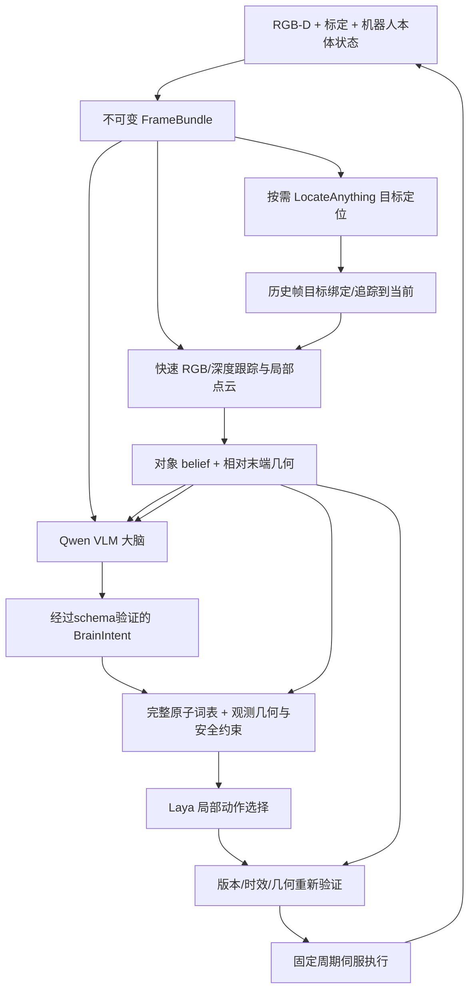

# VLM 大脑、Laya 小脑与 RGB-D/点云感知：可执行重设计

版本：v2 设计稿，2026-09-29 更新目标点感知与传感器选型。基于本地代码 `75d8107` 的只读审计及第一手资料核验。

**状态：本文件是新计划，不是新系统已实现或实验已成功的声明。本轮不下载模型，不修改运行代码。**

各模块的具体消息字段、完整27项词表、异步拒绝规则和数值信息流，以 [模块通信协议与推理例子](protocols-and-inference-example.md) 为接口设计依据；示例不是实际模型输出。

本计划替代旧交接文档中“异步融合已可靠”“两步运行证明完整快慢闭环”等过强判断。旧运行日志保留作历史 smoke 证据；它们不证明操控能力、实时性或泛化。

## 1. 核心决策

采用“仿生职责划分”的三层控制：

- **大脑：Qwen3-VL-4B-Instruct。**看 RGB 与观测场景摘要，理解指令、选择目标和当前阶段、处理失败、请求重新观察。
- **小脑：Laya + 局部反馈状态 + 短动作选择。**输入压缩的相对几何、目标阶段和近期执行误差，从完整原子动作词表中选择一个，仍需用域内测试验证高选项数能力。Laya需要机器人域验证、训练与校准；当前checkpoint没有已证明的机器人控制能力。
- **脊髓：确定性的几何伺服、机器人控制器和执行门控。**在固定周期执行、限速、保持姿态/夹爪，检查动作有效期和目标可见性。模型慢或失败时仍能停住。

感知由“慢语义绑定 + 快RGB-D几何跟踪”组成。点云从深度图反投影而来，用于几何；RGB负责语义和特征跟踪。本体传感提供机器人自身状态。**RGB-D、由它得到的点云及其质心不是三份独立证据。**

这里“小脑”是工程类比，不宣称复现生物小脑。若要研究小脑的前向模型/误差学习，第二阶段才增加基于允许观测的动作效果预测；不是首版前提。

首版只做一类交互：**固定相机、目标正面可见的关闭已打开抽屉**。先通过非接触接近验收，再做接触关闭。拉开抽屉、抓取搬运、微波炉旋转关节是后续扩展，不混入首版交付。

## 2. 为什么这样分工

| 问题 | 负责层 | 输出 | 不该承担的能力 |
|---|---|---|---|
| “关哪一个抽屉？现在该接近、推动还是检查？” | VLM 大脑 | 目标track ID、阶段、操作、约束模板 | 毫米级世界坐标、实时7D动作 |
| “本阶段往哪个方向做下一小步？是否需要重观察？” | Laya 小脑 | 一个候选ID + 版本/期限 | 从原始图像/点云直接控制、关节力矩 |
| “怎样保持姿态、夹爪和速度，把这一小步执行出来？” | 伺服执行层 | 控制周期上的动作 | 理解自然语言、猜测被遮挡物体 |
| “目标可见表面在哪里？位置有没有变化？” | RGB-D 几何层 | 点云面片、位姿的可观察部分、质量/不确定度 | 单帧推断隐藏关节轴/真实接触 |
| “之前看到的目标是不是现在这个？” | 时间/关联层 | 身份关联与时效 | 把低质量结果自动变成高置信状态 |

这种分工与 SayCan 的语义/可执行性分离、VoxPoser 的语义约束到3D几何闭环，以及 SmolVLA 的推理与执行解耦相容 [S1–S3]。这些来源支持架构思路，不证明“Qwen + Laya”组合已经在LIBERO上有效。

## 3. 当前仓库实际情况：必须先过 P0

可复用：RGB-D采集接口、LocateAnything解析和本地加载、Laya `system_one` 包装、容量1队列的基本结构、原子动作命名、实验日志目录。

尚未具备：规划VLM、持续高频几何跟踪、点云操作几何、真正基于视觉的动作门控、可抢占固定周期执行、可验证的小脑学习。

2026-09-28已在本地只读复现/核查以下问题；不能在其上直接叠新模型：

| 优先级 | 问题和证据 | 修复合同/验收 |
|---|---|---|
| P0 | `runtime_core.py` 与 `adapters/libero.py` 夹爪极性相反；GRASP→MOVE 实测为 `close,+1` 后 `x+10mm,-1` | 后端独占极性和夹爪状态；上层只用 OPEN/CLOSE/KEEP。抓取后移动不能松爪；释放后移动不能闭爪 |
| P0 | `BeliefStore('A')` 接受 episode B 的事件；store拒绝后 `Runtime.ingest()` 仍把事件送fusion | 统一路由先验 episode generation、camera、calibration、query generation，拒绝不得改变任何belief |
| P0 | 首帧anchor不随lag窗口前移；重放改变拒绝统计；被拒异常观测仍刷新age | 保存窗口边界后验；窗口滚动与完整时间序滤波一致；读取snapshot纯读；age只来自最后接受观测 |
| P0 | 语义 `{drawer:.9,unknown:.1}` 在0s与2s仍为 `.9/.1`；应用fusion会重新授时 | 向unknown prior衰减；保留原capture/expiry；半衰期正确使用ln(2)，不因读取续命 |
| P0 | Laya输入没有ages/flags；执行层不检查decision期限、状态和goal版本 | 小脑显式接收时效；执行前硬验证有效期/版本/目标变化，失败HOLD |
| P0 | visual没有EEF/proprio输入；候选无条件开放；规则baseline可在无视觉时GRASP | 加入合法本体传感，计算相对误差；无可靠目标只允许HOLD/REOBSERVE；规则基线确实依赖几何 |
| P0 | 有框就人为 `score=1.0` | 改为detection_present；confidence=null直到校准，不把它当物理概率 |
| P1 | `QueryTrackManager`没有进入runner，greedy关联且2D/3D为宽松OR门 | 接到主流程；使用相机/语义/3D硬门和小规模全局指派；显式LOST/AMBIGUOUS |
| P1 | RGB-D K调用把width/height传反，384×384掩盖问题；RGB与depth分别render | 按官方签名height,width；一次depth render返回的RGB/depth绑定，非方形图像重投影测试 |
| P1 | 执行依赖 `jev_libero.World.execute`，可能内部读取features和成功后提前break | visual改用受限LIBERO公开env.step执行适配器；评测success不能影响primitive内控制时长 |

审计重点文件：`runtime_core.py:130,178,241,308`、`runtime.py:31,49`、`fusion.py:94,135,186`、`adapters/libero.py:50`、`adapters/locateanything.py:58`。行号针对上述基线提交。

现有12项测试是基础检查，不覆盖这些性质。第一阶段增加性质测试，且测试不过禁止进入模型联调。**本计划没有在本轮修复这些问题。**

## 4. 系统结构与进程



最小部署用Python有界队列/IPC即可，不先安装ROS/DDS。分三个资源域：

1. 仿真与执行进程：唯一可以访问env，负责传感器读取/控制周期；只发布白名单观测。评测真值单独写日志，不供策略读取。
2. 感知worker：LocateAnything低频初始化；RGB-D几何CPU路径持续处理最新帧。几何与推理不可串行锁死。
3. 大脑/小脑worker：VLM与Laya独立请求/结果队列；模型输出只是proposal，执行器决定其是否仍可执行。

可以先在同一进程测试协议，再拆模型worker进程；不把大模型 `decide()` 放在servo线程上。GPU使用需启动时核查，不固定抢占历史空闲卡。优先VLM与Laya/Locate分两张空闲4090；显存不足时减少图像token/隔离进程，再考虑3B降级单独评测。

### 模型决定

- **规划VLM选 Qwen3-VL-4B-Instruct** [S4]：官方模型卡提供多模态输入、Apache-2.0许可和Transformers 4.57.0起的示例。首版1张当前RGB和1张编号候选的同帧图，输出受约束的目标/部件/阶段JSON；其自身预测的2D/3D点只当粗定位候选，不能作为毫米级接触点。点云以观测几何摘要进入state。旧Qwen2.5-VL-7B留作同帧对照；更新的Qwen3.5-4B另开依赖环境比较，不阻塞首轮。
- **LocateAnything-3B继续用作定位器**：复用已下载模型，阶段开始/失跟踪时调用。不是大脑，不承担任务规划。与VLM是两个不同职责；稳定后做去除它的消融，再决定能否合并减少模型数。
- **Laya先锁定现有0.3.4/checkpoint**：新版本文档能提供限制参考，但不能无理由升级。先测输入长度/候选数/热态延迟，再用官方训练路径做机器人域适配 [S5]。
- **初版不增加学习型点云编码器**。OpenCV、NumPy/SciPy、Open3D足够构建几何基线；DP3仅作需要训练的后续替代参考 [S9]。
- **SAM 2.1 tiny是有条件备选** [S8]：若box引导深度聚类在50帧检查集中出现>20%不可用ROI（背景污染、目标被剔除、无有效面），再做分割对照。当前官方依赖Torch≥2.5.1，与已有2.2冲突，必须独立环境；不要直接升级旧环境。其video predictor还需单独验证流式/内存行为，不假定现成API满足无限流。

## 5. 感知具体怎么做

### 5.1 传感器与坐标

初版核验LIBERO已有的`agentview`固定相机和`robot0_eye_in_hand`腕部相机；两路均可通过MuJoCo/robosuite获得RGB-D，反投影为点云，不添加激光雷达。先用固定相机跑通，再将腕部作为独立双视角实验。LIBERO默认`camera_depths=False`，开启深度必须明确标记增加了观测模态。每路RGB与depth同一采集帧，K/深度单位/T随帧记录；腕部T用采集时刻本体位姿。当前单相机源码尚未做到这些，且K的height/width顺序对非方图有误。

反投影：`p_camera = depth_m * inverse(K) * [u,v,1]`，`p_base = T_base_camera_at_capture * p_camera`。计划中的metric depth是模拟RGB-D传感器，不能把本方法称为RGB-only。相机标定和机器人模型是已知条件，未知物体几何从观测恢复。

每次采集保留capture_sim_time和capture_monotonic_ns。运动外参必须使用采集时刻的FK；不许用推理完成时的位姿解释旧图。

### 5.2 从框到可操作表面

1. 大脑根据任务与RGB提出目标描述及部件类型；LocateAnything按描述找drawer front与柜体固定参照的2D框；点云构建候选track后，用编号图和几何摘要让大脑选择track/部件ID。保存RGB、模型原始响应、编号框和选择，人工可复核。VLM的坐标只作粗候选，不直接当metric真值。
2. box仅作ROI。滤除无效/截断深度，做深度连通域/3D聚类，剔除明显背景及机器人本体点。机器人自滤波只用URDF/本体状态，不用仿真segmentation ID。
3. 目标ROI体素起始2–3mm，周围占据5mm；目标点上限约5k、场景点上限20k，实际按耗时/细节校准。只表示已观测空间，遮挡不是自由空间。
4. RANSAC提取可见面，SVD重拟合；得到面片、法向、残差、支持点比例、可见边界。法向符号按相机/接近侧约定；相机可见侧不自动等于机械可达侧。单平面的面内平移/转动可能不可观察，协方差须保留这种各向异性。
5. 在可靠的目标面片内生成多个推点，要求边缘裕量大于工具有效接触半径加定位误差；比较机器人可达性、已观察障碍间距、面残差、位置协方差及末端接近距离。输出候选点、法向、质量和拒绝原因。框中心不是把手、质心或抓取点。完整合同和验收见 [target-point-perception.md](target-point-perception.md)。
6. 由可见占据点+机器人运动学做短路径可达性/局部碰撞检查，使用已知机器人连杆的胶囊/几何模型覆盖相关整臂扫掠，不能只检查EEF点。未知空间保守处理。此检查不是完整物理安全证明，不能用隐藏mesh/SDF补洞。

平面法向仅作“常见直线抽屉可能沿此方向运动”的显式类别先验，不等于观测到真实滑轨轴。关闭动作先从有支持点的正面短推；若连续RGB-D看到足够位移，再拟合运动方向。不充分时保持axis_unknown，不能从task JSON读取真实轴。

### 5.3 快速几何路径

慢语义只做初始化/纠错。之后每帧独立运行：ROI内RGB角点/稀疏光流 → 当前depth回投 → 小位移3D匹配/局部ICP与面片跟踪 → 几何质量。

ICP只在初值良好、重叠足够时启用。平面/对称物体可退化，必要时只保留可观察的position/normal，不输出虚假的完整6D pose。反光/遮挡/纹理不足返回LOST；触发重定位并暂停接触动作。

一个track保存：visible patch、position、normal、covariance、mask/ROI、semantic age、geometry age、last accepted frame、quality reasons。关联先按camera/query/可达3D范围门控，再小规模Hungarian；跨camera只比共同坐标系的3D，不直接算IoU。强2D重叠不能覆盖明显错误的3D距离。

首版每帧只有一个几何主测量来源。LocateAnything旧帧的bbox不能再生成一条独立位置观测重复加权；它负责修正历史track的目标绑定，或者触发重新初始化。这样简化相关误差处理。

### 5.4 不确定度

先做ROI正确性，再估计噪声。mask错误导致的是偏差，不能靠增加Kalman方差修好。

几何质量采用有效点比例、面残差、重投影误差、跟踪一致性和遮挡标志；这些是quality指标，不冒充模型校准概率。位置协方差用像素/深度噪声经Jacobian传播，并加入外参/模型偏差下限；不能仅用点数把协方差压到接近0。

滤波首先修成可测试CV基线，3D门限按自由度3的NIS分位数（如0.99对应约11.34）设置并做鲁棒性验证。接触中限制速度外推时长，必要时增大过程噪声；观测过期时停止接近。


### 5.5 多传感器提高动作可辨性

第一版固定相机RGB-D与机器人本体读数是可部署基线。增加wrist RGB-D须通过标定、时间同步和两视角目标关联验收，优先解决推点被手遮挡、抽屉面深度孔洞与未知自由空间；仅在环境真实提供时加入夹爪开度、电流/力或触觉。每个动作携带用到的传感证据与协方差。传感器融合先减少几何误差，再分析Laya决策错误，不用“多传感器”掩盖标签歧义。

不要求估计不可观察的“物体绝对正确位置”：同一可见表面的目标接近点、面法向、相对EEF误差和误差区间才是本任务直接需要的状态。bbox中心/框内深度中位数都不是把手或物体质心。遮挡和系统性偏差导致的错误不能靠叠加更多同源深度估计消除；需要换视角、独立本体反馈或明确返回UNKNOWN。


## 6. 大脑输出什么

大脑输入：任务原文、当前RGB、编号目标/面片、简短几何状态、最近3个执行反馈、已有计划和失败原因。大脑输出**当前阶段**，可附短期阶段意图；不生成任意Python或整段开放环轨迹。

允许阶段：`OBSERVE, APPROACH, ALIGN, INTERACT, RETREAT, VERIFY`。
允许操作由首任务配置限制为 `PUSH, HOLD, REOBSERVE`；以后逐项验证后才启用grasp/pull/rotate。

```json
{
  "schema_version": 2,
  "episode_id": "ep_007",
  "goal_generation": 3,
  "based_on_snapshot": "s_118",
  "target_track_id": "track_2",
  "stage": "APPROACH",
  "operation": "PUSH",
  "feature_id": "observed_patch_4",
  "constraint_template": "approach_visible_surface",
  "completion_template": "standoff_reached",
  "max_duration_sim_s": 30.0
}
```

schema验证器要求track/feature在引用snapshot中存在，约束/操作在注册表中存在。数值阈值由版本化配置给出；VLM不能现场编造坐标、工具宽度、成功谓词或忽略安全限制。

关键：计划到达时不要求snapshot仍是最新revision，否则慢模型永远不能生效；验证的是episode/goal generation、target lineage、语义是否变化、几何能否对齐到当前。目标已换、阶段已结束或观测不充分时丢弃并重请求。

大脑触发：初次目标选择、阶段完成、失跟踪、连续多次不进展、执行门控拒绝、阶段超时。允许提前计算下一阶段，但只能由当前阶段的视觉完成证据原子切换intent。

## 7. Laya“小脑”如何获得真实贡献

Laya输入使用固定英语schema，避免提示长度和多语言干扰：

- `intent_id/stage/operation`；
- 目标相对EEF的米/弧度误差，面法向，可见障碍距离；
- 几何质量、观测age、协方差摘要、LOST状态；
- 自身EEF/夹爪状态，以及最近3次动作的实际误差变化；
- 固定完整原子词表中的全部可执行动作，含方向、尺度、坐标系、有限时域及几何估计；不按阶段人为缩减到固定的少数选项。

首版采用已验证的27个Jev-LIBERO原子primitive作为完整可选词表：世界坐标X/Y/Z各±3/±10/±40mm共18个、绕X/Y/Z各±10°共6个，以及open/close/hold共3个。继承Show-Harness的上层命名只是兼容映射；实际给Laya和执行器的每项必须保留唯一action ID、reference frame、单位和控制时域。大步动作仅在可见工作空间/制动距离和当前不确定度允许时执行；没有传感依据的机械接触动作被硬门控拒绝，不能靠提示词侥幸纠正。REOBSERVE是调度操作，不冒充机器人动作。

几何层预计算方向/距离区间、left/aligned/right、near/far、error_improving/no_progress，同时保留原数值供审计；不要求Laya用文本精确计算向量或毫米误差。做“原始数值 vs 关系分桶”表达对照。

每次从完整词表按稳定ID生成27项，几何层为每项标注可执行性、有效时域与拒绝原因；安全门控后选项数量可因传感器证据和机器人约束而变化，不能为了迎合模型而固定减少。**只允许按真实可观测几何、机器人已知运动学和动作硬约束排除不可执行项**；不能按“看起来不优”预先裁剪、排序取前K，不能把隐藏MuJoCo状态或未来预演用于选项过滤。各baseline必须共享同一动作空间与同一硬门控，记录原始27项、实际可执行数量、拒绝原因、选项排列/哈希。不可观察空间不视为安全空闲；接触未知时保留HOLD/重观察。只有一个可执行动作的步骤不计算Laya相对规则的选择能力。

动作起始预算：自由空间单次执行片段≤5mm/100ms；接触探测≤1–2mm；角度≤2°。这是待标定参数，不是通用安全保证。完整词表中的±10/±40mm和±10°表示Laya可提出的**方向与上界**，不是允许一次100ms执行整个幅度；执行器按当前几何/制动距离切成可抢占片段，每段后重新验证，候选ID与已执行量在日志中分开。禁止当前Jev每次执行8个env step、期间不能取消的动作块直接冒充20Hz可抢占控制。

Laya输出候选意图ID（类别/方向/小步尺度），不携带无期限绝对终点。执行层重新检查goal generation、target、proposal墙钟期限；再用最新几何实例化该ID的短动作，赋予新的100ms执行合同。只允许参数刷新，不允许换类别/方向：若法向变化过大、误差符号翻转或该动作已失去原语义则拒绝。绝对waypoint提议不能静默改位置，必须重新决策。记录source_snapshot、validated_snapshot和实际endpoint。确定性伺服只执行所选目标并限幅，不暗中选择另一项动作。机器人关节控制和夹爪极性始终由后端处理。


### 完整动作集与Laya容量测试

保留完整词表不等于把“27个长段自然语言描述”无条件塞进Laya。官方文档 [S5] 写明选项共享`head_max_len`：默认English 192 tokens、typed-decisions 256 tokens，约20项且描述稍长便可能逐项截短；这不是安全排除理由，而是需要测量与优化的**输入表示限制**。先锁定现有0.3.4实际接口是否支持逐请求/实例`head_max_len`，将选项压缩为例如`X+03`,`X-10`,`RZ+10`,`CLOSE`,`OPEN`,`HOLD`等唯一、可逆ID，数值参数在固定结构状态字段中解释。扩展预算（例如512）前验证state与选项都未被截断，并实测显存、GPU负载、p50/p95、选择准确率及校准误差。若现有0.3.4不支持，走受控兼容性升级或领域训练；不能悄悄改小词表并称原方案成功。

实验把**定位误差**与**选择错误**分开：用人工标注/离线GT仅评估可见面/推点的位置误差；让Laya在真实视觉估计与经人工修正的同结构估计上选择相同27项，比较动作正确率和轨迹结果。人工修正组是诊断上界，不计入视觉方法。若位置更准确但27项准确率仍低，就针对Laya输入/训练/预算处理，而不是继续堆传感器。若感知仍不能区分大步或转动动作，记录`unknown`和拒绝原因，不伪造安全性。


### 训练与可证伪假设

Laya官方说明“fast base to specialise, not a zero-shot decision engine”；其typed decisions测评不是机器人任务 [S5]。因此零样本只是基线，域内适配是计划的一部分。

- 先用同一视觉接口的几何规则专家/人工纠正获得20–40条调试episode、约2k–5k个有效选择样本，检查表达与候选标签；这只是起始规模。
- 若学习曲线仍改善，再扩到100–200条episode、约10k–30k去相关样本；覆盖遮挡/重观察/错误动作恢复/HOLD，不能全是容易正例。
- 标签只依赖允许的视觉、本体状态和几何规则；不调用`predict_all`选最优，不读取隐藏物体关节生成监督。
- 按episode、init_index、布局划分train/validation/test；不能随机分帧。近重复帧降采样，候选顺序随机化、固定每次action ID映射，同义动作允许等价标签，验证是否记住选项位置；训练/验证需覆盖词表中的所有动作及足够多的多选项状态。
- 先采用官方训练脚本的小规模适配；不先做RL、不先训练新3D编码器。冻结或参数高效微调是否受所锁版本支持需在训练入口验收。
- calibration使用独立验证集。模型confidence只能提供拒绝/退让参考，几何/期限硬门控独立存在；不用目前被官方指出缺乏区分信号的`action.act_probability`。

要验证的命题是：同一VLM意图、同一视觉/候选/执行预算下，域内Laya能否保持接近规则控制的成功率并降低纯VLM局部决策的时延，且对扰动/失败恢复有价值。若不成立，诚实报告并调整Laya职责，而不是靠oracle补结果。

## 8. 三种时钟、异步和时效

区分：仿真采集/传播时钟、monotonic墙钟（耗时和deadline）、数据版本（episode/goal/track generation）。禁止用到达时刻替代采集时刻。源snapshot较旧和当前geometry过期是不同条件，不能用一个TTL把慢模型全部拒绝，也不能延长旧geometry有效期迁就模型。

| 环节 | 首版目标预算（未实测承诺） | 调度 |
|---|---|---|
| env控制/本体读取 | 读取LIBERO真实控制配置，初始约20Hz | 唯一执行线程；每tick可抢占 |
| RGB-D几何跟踪 | 10Hz起步，目标p95<100ms | 新帧覆盖旧待处理帧；跳帧显式记账 |
| Laya | 先2Hz，优化后争取5Hz | 完全异步；5Hz须热态端到端p95≤200ms且推理预算约100ms |
| VLM大脑 | 按需，初始上限约0.2–0.5Hz | 阶段/异常触发；记录实际p50/p95，计划有效时可续用 |
| LocateAnything | 初始化/失跟踪按需，约0.2–0.5Hz | 不置于高频几何必经路径 |

历史记录LocateAnything约2s、Laya单次约0.277–0.892s，条件不同，不能推导固定Hz。第一步先测至少100次覆盖不同输入长度、正常/恢复状态，以及11项缩减对照/27项完整词表分别在默认与扩展`head_max_len`下的热态分布；区分冷启动、GPU同步计时和端到端墙钟，在模型并发下复测；吞吐受限就降频和HOLD，不延长盲执行假装实时。

采用有界最新值队列：一个in-flight、一个pending；pending覆盖计数；result也有容量与身份检查，不能无限积累。模型失败显式报告，线程关闭必须等待/终止所有自有worker，不允许daemon残留占GPU。

### 慢语义回来的具体处理

1. 语义结果携带原frame/episode/query/calibration版本。
2. 在历史RGB-D中定位到原帧，初始化/确认目标track；利用缓冲帧跟踪到当前（必要时跳帧但须质量过关）。
3. 当前目标已被高频tracker可靠维护时，只更新语义绑定，不把旧深度点再次当新的独立几何测量。
4. 历史不足、跨轨迹歧义、标定改变或replay质量差时丢弃；请求新观测，接触动作HOLD。

图像历史初值5s、10Hz、384×384，RGB+float depth约52MB/单相机（不含副本/结构开销），限制总RAM。根据真实p99语义延迟调整，不无界保存。

VLM的高层意图可以只依赖持续可靠的track lineage，并不必要求把它引用的RGB全程回放；LocateAnything旧帧ROI初始化需要足够图像历史，二者失效规则不同。

几何OOSM历史初值1s，根据**几何**通路延迟校准；语义的2s延迟使用图像/关联历史，不因此强行把2s前的对象位置当当前位置。fixed-lag裁剪必须推进anchor；Joseph形式更新协方差；snapshot纯读；唯一事件ID幂等。

### 动作截止与安全退让

将“模型proposal期限”和“新鲜几何实例化后执行合同期限”分开：Laya proposal墙钟期限初值1.2s，VLM请求初值10s，先按p99校准；过期proposal不得重新授时。重新实例化只允许在上述动作语义一致性门通过时发生。所有执行动作合同同时带 `valid_until_sim` 和 `expires_monotonic_ns`。当前geometry age、目标位移、协方差或frame错误超限则HOLD。接触阶段初始geometry age上限0.2s、自由接近0.3s；最终由 `v_max * age + k*sigma_position < available_clearance` 和实测误差校准，硬上限只作兜底。

Laya在等待时，servo仅可完成仍有效的短合同或保持；不能无限复用上一方向。VLM在等待时可继续当前有效阶段，但子动作仍被实时几何约束。视觉LOST时不靠CV无限外推推动目标。2Hz Laya搭配100ms动作必然有HOLD占空比，这是可接受的保守MVP，不能用延长盲动作消除停顿。

阶段时限根据距离与实测接受动作率计算：`T_stage >= travel_m / (step_m * accepted_actions_per_s) + reobserve_allowance`。5mm×2Hz理想仅10mm/s，100mm至少10s；示例30s仅为可配置起点。debug episode初值1200个20Hz控制tick（60s仿真）和90s墙钟双预算，所有HOLD计入；若所用benchmark规定不同上限，正式评测从benchmark读并固定，不给慢模型私自加步数。

闭环分为两种评测：`realtime_paced`（默认，真实模型耗时和env按墙钟推进）和`offline_step`（调试可暂停）。manifest显式标记；不把暂停仿真后age≈0当实时证据。env算得比实时慢时报告overrun，不虚报20Hz。

## 9. 数据合同与防止oracle泄漏

采用不可变快照，所有消息至少有：

| 合同 | 必要字段 |
|---|---|
| FrameBundle | episode_generation、frame_seq、camera_id、calibration_version、t_sim、t_mono、RGB/depth、K、采集时刻T、同步proprio、source_provenance |
| ObjectBelief | track_id/lineage、semantic_source_frame、geometry_source_frame、位置/法向及covariance、面片ID、visibility/quality、最后接受几何时间、语义有效期 |
| BrainIntent | episode/goal generation、source snapshot、target/feature、stage/operation、约束与完成模板、期限 |
| ActionProposal | intent/target、source snapshot、candidate_hash、action_id、模型耗时、最大保持时域、sim/wall期限 |
| ExecutionFeedback | 命令、实际EEF/夹爪变化、观测目标变化、误差是否减小、门控拒绝原因；不含隐藏接触语义 |
| EvaluationRecord | env success、可选GT误差、资源/耗时、终止原因；独立文件/接口，策略不可读 |

允许：RGB、metric depth、相机标定、机器人模型、关节位置/速度、EEF FK、夹爪开度。force/tactile只有在真实声明的传感器通道可用时才加入。

禁止策略/候选/安全层使用：目标body/geom/site pose、目标关节、真实滑轨/铰链轴、object-ID segmentation、未声明contact列表、未来物理分支、`world.features`、`predict_all`。训练state也遵循同一约束；不能把整个混合评测row回灌。

官方success只由评测器记录和统一终止episode，不作为大脑阶段判断、Laya输入、技能退出的正反馈。每个动作的deadline/保持时长独立于隐藏success。visual backend在接口层封锁oracle方法，通过spy/访问审计测试。

## 10. 第一项任务的可执行阶段

目标：`close the top drawer of the cabinet`，只使用可见抽屉面和已知机器人本体。

1. OBSERVE：识别正确抽屉与柜体参照，获得可用面片；失败重观察至上限，否则结束为perception_failure。
2. APPROACH：到面外约3–5cm standoff；沿真实RGB-D误差更新，先验证坐标/方向。
3. ALIGN：EEF接触面朝向与推点对齐；目标点远离可见边缘，夹爪采用已标定适合推的姿态。
4. INTERACT：可抢占1–2mm探测，观察抽屉面相对柜体参照的运动；“沿面法向”只是先验。若连续3次有效探测无可分辨视觉进展，退离并让大脑重新选择，不盲推。
5. VERIFY：P1先确定固定柜体参照（可见固定边/邻近固定面）与活动抽屉面，定义闭合偏移 `g = n_ref · (p_drawer - p_reference)`。仅在已声明的flush类别先验适用且参照可观测时，用 `abs(g-g_closed) + 2*sigma_g <= epsilon_close` 连续3个有效几何更新作为完成证据，epsilon由标定与允许误差固定；g_closed来自可见齐平参照与明示先验，不读取GT关节。位移趋零可能是卡住/未接触，不能当作关好。缺少参照/遮挡/误差过大则verification_unknown。
6. 评测器最后记录官方success。视觉判“完成”而官方失败必须统计false_completion，不能用官方值悄悄修正策略。

单帧不支持唯一运动轴；位移小于观测噪声时不拟合轴。没有可见柜体参照/间隙时，VERIFY不能凭动作次数完成。P1必须先验证该任务init集合确实存在这一观测条件；若不成立，首关只验收接近/受控推动，并把“关闭任务尚不可视觉验证”写成阻断项，不能用官方success替代策略完成判断。开抽屉则额外需要把手分割、抓取几何和抓后跟踪，另开阶段验收。

## 11. 实施工作包、依赖和验收

工作量按一名执行者+现有环境估算，**约10–15个工作日得到受限MVP/可证伪结果，不保证任务成功或LIBERO-PRO泛化**。异常安装/模型能力不达标会增加时间；以门槛决定继续。

| 包 | 工作/交付物 | 预计 | 必过门槛 |
|---|---|---|---|
| P0 | 修当前动作/时效/滤波；拆sensor-policy-evaluator；保存基线依赖锁 | 1–2日 | 夹爪保持、跨episode拒绝、lag滚动/OOSM一致、拒绝不刷新age、semantic过期、stale action不执行；oracle访问测试全过 |
| P1 | 同帧RGB-D、点云清理、表面/推点、快跟踪、录制回放及可视化 | 2–3日 | 非方图重投影正确；50帧人工ROI检查及闭合参照可观测性；10段含接近透视变化/EEF遮挡/开闭边界的短序列无错误ID接触；几何10Hz目标受测，失败转SAM备选/降低范围 |
| P2 | 独立servo调度与视觉规则baseline；非接触接近→关闭 | 2–3日 | 10个debug初始条件接近≥8次，受限关闭≥7次；每次失跟踪可HOLD，无过期动作执行；不达标先修几何/执行，不堆模型 |
| P3 | Qwen大脑与BrainIntent协议；失跟踪/不进展重规划 | 1–2日 | 100个正常/异常schema病例；跨episode/goal、失效target、过期plan全部拒绝，旧snapshot但可可靠重绑定的plan允许；正确目标/阶段人工检查；VLM+规则baseline可跑 |
| P4 | Laya机器人数据、训练/校准、全词表延迟与准确率、异步ActionProposal | 2–4日 | 27项输入无token截断/选项碰撞，动作覆盖与候选顺序鲁棒性；验证episode成功率相对同动作空间规则下降不超过10个百分点（工程门槛，非统计结论） |
| P5 | 固定初始化清单、延迟/掉帧、对照表和LIBERO-PRO初步扰动 | 2日+ | heldout逐episode可复算；报告所有失败/预算；无法泛化则明确范围，不混报 |

VLM部署/协议可在P1采集回放期间并行准备；Laya数据在规则baseline可信后再采集。不同时训练VLM、3D编码器、Laya和新执行器。

需要的模块（新代码须与旧接口有迁移边界）：

```text
contracts.py                 FrameBundle / BrainIntent / ActionProposal / PolicyObservation
adapters/libero_sensor_env.py 公开env.step、白名单传感、独立评测
perception/rgbd_geometry.py   点云、聚类、面片、推点
perception/visual_tracker.py 快路径与track生命周期
fusion.py                    正确fixed-lag/语义时效（修现有）
brain/vlm_planner.py          规划VLM进程、schema和触发策略
control/local_candidates.py  共用候选、可见几何硬约束
control/servo.py              定周期执行、夹爪保持、原子抢占
control/scheduler.py          期限、队列、阶段切换
learning/export_choices.py    合法观测与动作监督
experiments/summarize.py      从原始事件/episode重算表
configs/brain_cerebellum_v2.* 模型revision、单位、频率、阈值、任务清单
```

## 12. 评测要回答的具体问题

使用完全相同感知、完整动作库、硬约束、候选呈现和预算；另按11项/27项与token预算做受控消融，不能把删选项后的成功率当全动作空间成绩：

| ID | 大脑/阶段 | 局部选择 | 用途 |
|---|---|---|---|
| B0 | 手写任务阶段（仅视觉进度） | 几何规则servo | 检查感知/执行上限；明确带任务先验 |
| B1 | VLM | 同一几何规则 | 大脑收益/错误成本 |
| B2 | VLM | 现有Laya零样本 | 测真实冷启动能力，不选最好seed |
| B3 | VLM | 域内训练Laya | 主方案，验证小脑贡献 |
| B4 | VLM | VLM选择同一局部候选 | 少量同预算消融：速度/质量折中 |

先debug清单10个init_index；训练/调参与正式holdout严格分开。确认批每方法至少30个不同初始化episode，固定task/config/hash/seed/init_index清单；**只改seed但默认init_index=0可能没有改变LIBERO起始状态**。该样本量只适合初步可行性，若要声称方法优势需更多episode和统计效力设计。

报告：success及Wilson95%CI（小样本会宽）、false_completion、目标/几何/关联/控制/模型/超时失败、env steps/墙钟完成时间、tracking误差的离线评测、实际geometry Hz、各模型p50/p95、观测age、missed deadline、HOLD比例、候选单选比例、重定位次数、点云碰撞近似与离线真实接触分别标注。

延迟注入：额外0/250/1000/2000ms、随机掉帧10/30%、重复/乱序消息、目标短暂遮挡。标签为人工干扰，不能把离线录像成绩当在线操控成绩。记录返回结果被用在了哪个动作和哪个目标版本，而不是只记“模型完成数”。

LIBERO-PRO [S10]：先原LIBERO稳定后，将同一适配器移到其检出；先位置扰动，再语言/外观，再环境/任务逻辑。按所锁版本实际支持的组合执行，特别task perturbation不盲目与其他项组合。通过修改camera/depth传感配置形成RGB-D扩展时明确标注，不能直接与RGB-only VLA榜单混比。

## 13. 停止条件与降级路径

- ROI/几何不可靠：先修分割/标定，必要时SAM备选；不加VLM推理来“补”不存在的几何证据。
- 抽屉面不满足可见/可达条件：记录unsupported_observation；增加允许的视角后另做验证，不硬编码真值轴。
- VLM 4B资源或p95不达标：缩减图像预算、减少调用、分GPU；更小型号作为显式新配置对照，不静默换模型。
- Laya适配后仍显著弱于规则：保留VLM+视觉servo作为有效工程基线，报告Laya假说未通过；再调整数据/输入或职责，不篡改候选让它看似成功。
- 所有模型快了但闭环不稳定：看执行时效、几何误差和小步反馈；快推理不是稳定性证明。

**首版成功定义**：在明确RGB-D传感条件下，通过受限关闭抽屉任务验证VLM阶段规划、Laya局部选择、持续几何反馈、可抢占执行和故障退让；全链路无隐藏物体状态；结果可由日志复算。它不是通用机器人“小脑”完成的证明。

## 14. 第一手来源与采用边界

以下来源于2026-09-29实际读取的官方模型卡/作者页面/仓库；本文中的频率、阈值、日程和成功门槛是项目设计参数，不是这些文献给出的保证。

- **[S1] SayCan**：https://say-can.github.io/ — 语义规划与技能可执行性结合；不是文本模型直接稳定控制。
- **[S2] VoxPoser**：https://voxposer.github.io/ — 语言/视觉约束转3D value maps与闭环规划；不照搬潜在仿真真值接口。
- **[S3] SmolVLA官方说明**：https://huggingface.co/blog/smolvla — 推理/执行线程分离、提前请求与动作块机制；本计划只借调度思想，不引入其整套VLA。
- **[S4] Qwen3-VL-4B-Instruct官方模型卡和作者代码**：https://huggingface.co/Qwen/Qwen3-VL-4B-Instruct ；https://github.com/QwenLM/Qwen3-VL — 多模态、定位示例与依赖要求；这些都不能推导LIBERO成功率。原Qwen2.5-VL-7B模型卡：https://huggingface.co/Qwen/Qwen2.5-VL-7B-Instruct 。
- **[S5] Laya作者仓库**：https://github.com/NandhaKishorM/laya — typed decisions、领域微调、置信度局限；核验时main SHA `9d955671415fc19f069b9cc998928075c1f255ec`。已装0.3.4与此版本不同，实施时重新锁定。
- **[S6] ROS message_filters官方文档源码**：https://raw.githubusercontent.com/ros2/message_filters/rolling/doc/index.rst ；**robot_localization文档源码**：https://raw.githubusercontent.com/cra-ros-pkg/robot_localization/noetic-devel/doc/state_estimation_nodes.rst — capture-time缓存、迟到恢复与history_length。仅借协议和处理机制，不先加ROS。
- **[S7] Open3D点云/RGB-D文档**：https://www.open3d.org/docs/release/tutorial/geometry/pointcloud.html ；https://www.open3d.org/docs/release/tutorial/geometry/rgbd_image.html — 反投影、下采样、离群过滤、RANSAC；**robosuite v1.4.1 camera_utils**：https://raw.githubusercontent.com/ARISE-Initiative/robosuite/v1.4.1/robosuite/utils/camera_utils.py — K/T/米制深度。
- **[S8] SAM 2官方仓库**：https://github.com/facebookresearch/sam2 — promptable segmentation及streaming memory；工程流式接口/速度需实测，独立依赖环境。
- **[S9] DP3作者项目**：https://3d-diffusion-policy.github.io/ — 稀疏点云+学习策略需要示范训练，本项目首版不复刻它。
- **[S10] LIBERO-PRO作者仓库**：https://github.com/Zxy-MLlab/LIBERO-PRO — 位置/语言/物体/任务/环境扰动；核验README在master分支，实际支持组合按版本检查。
- **[S11] ReKep**：https://rekep-robot.github.io/ 及 https://raw.githubusercontent.com/huangwl18/ReKep/main/environment.py — 可借关系关键点接口；检查到的仿真代码通过PoseAPI更新GT关键点、从collision meshes生成SDF，不能直接用于本项目纯视觉路径。这不是对其实物系统的判定。
- **[S12] Ranganathan/Kaess/Dellaert，OOSM**：https://www.ri.cmu.edu/publications/fast-3d-pose-estimation-with-out-of-sequence-measurements/ — 固定lag处理异步测量的理论参考；不替代本项目正确性验证。
