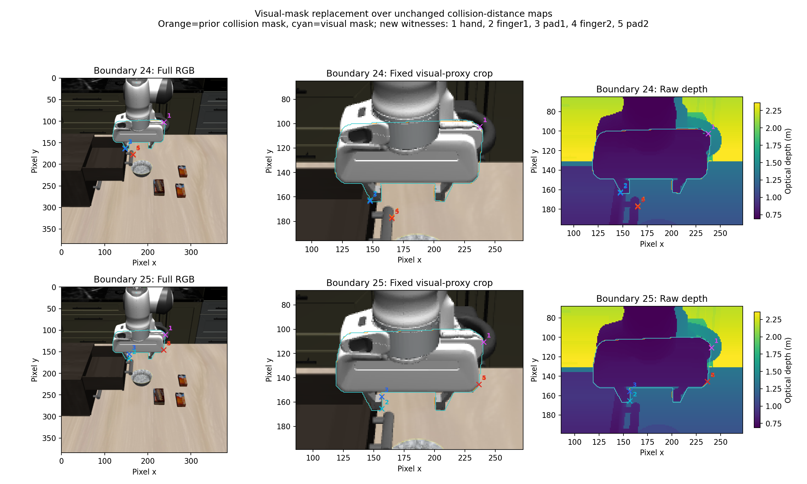
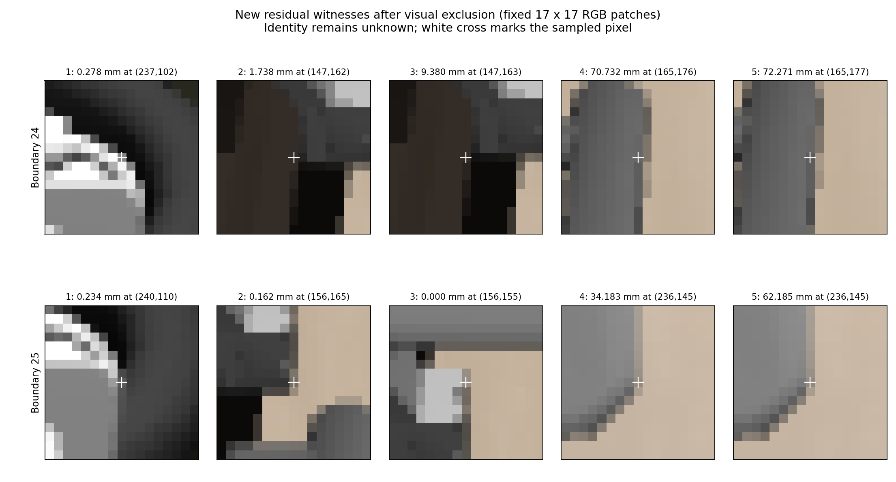

# Gripper visual geometry as a replacement self-mask

Replacing the collision-proxy mask with calibrated gripper visual-mesh
projection enclosures removed both earlier housing-edge nearest witnesses.
It did **not** resolve residual self-contamination. The new hand minima remain
below `0.3 mm` at housing/cable-side image edges, and boundary 25 acquires a new
zero-distance pad witness because the two masks are not nested. The old mask
result is intact; no union, dilation, margin or threshold adjustment was made.

The two depth/camera inputs, own-joint packets and all five collision-distance
maps are unchanged. This isolates the mask source, on development data already
inspected before the control. It establishes neither pixel identity nor an
environment clearance measurement.

## Static calibration and frozen comparison

The [protocol](../../research/gripper_visual_mask_protocol.md) freezes selection
to group-1 noncolliding mesh geometry on gripper-root descendants. Static export
commit `ea89ca8` produced exactly three visual geometries: the hand with 3,613
compiled vertices/7,078 faces, and each finger with 318 vertices/624 faces.
All are opaque. The entire prior robot body/site/collision calibration matched
exactly. Visual calibration SHA-256 is
`c86706370d8442f85365d1e1d7e962ffb0f2346c235d968146694ed6e3fb4c98`.

Static construction used one counted `mj_step1` whose time/qpos/qvel were
exactly unchanged, with simulator time zero. Integration and subsequent
stepping were blocked. There was no rendering, explicit reset, state restore,
control or physics continuation. Scene-bearing setup arrays remain outside
the estimator. No arm or task-surface geometry was exported.

Mask worker commit `9c5e40f` pins the calibration and prior input/map hashes.
Its subprocess receives only visual calibration, unchanged nine-value own-joint
packets, depth/K/T, and the sealed collision-distance/mask arrays. It never
recalculates collision distances. RGB was opened only after output sealing.
Independent review passed before the first recorded visual-mask calculation.

The projection rule is unchanged: convex enclosures of projected calibrated
vertices evaluated at pixel centers, with no expansion. These are conservative
image-space enclosures, not exact rendered segmentation. The visual mask
**replaces** the collision mask, rather than adding to it. Recorded simulator
camera and robot-base calibration are assumed, and own-joint values remain
simulator-state-derived encoder analogues. Exact render/cache alignment and
physical calibration accuracy remain unvalidated.

## Sealed result

| Mask measurement | Boundary 24 | Boundary 25 |
| --- | ---: | ---: |
| Prior collision-mask pixels | 6,169 | 6,265 |
| New visual-mask pixels | 6,191 | 6,268 |
| Newly excluded pixels | 35 | 13 |
| Newly admitted pixels | 13 | 10 |
| Old hand/union minimum excluded | Yes | Yes |
| New residual union minimum | 0.278252 mm | 0 mm |
| New hand minimum | 0.278252 mm | 0.233802 mm |

All eight old finger/pad nearest witnesses survive the replacement mask. The
boundary-25 pad-1 minimum nevertheless changes because a newly admitted point
is closer. Thus removing the former minimum does not imply a monotonically
larger residual distance or a more complete self-mask.

| Proxy | New boundary-24 minimum; pixel `(x,y)` | New boundary-25 minimum; pixel `(x,y)` |
| --- | --- | --- |
| Hand | 0.278252 mm; `(237,102)` | 0.233802 mm; `(240,110)` |
| Finger 1 | 1.738041 mm; `(147,162)` | 0.162011 mm; `(156,165)` |
| Pad 1 | 9.379926 mm; `(147,163)` | 0 mm; `(156,155)` |
| Finger 2 | 70.732011 mm; `(165,176)` | 34.183251 mm; `(236,145)` |
| Pad 2 | 72.270753 mm; `(165,177)` | 62.184888 mm; `(236,145)` |

At the fixed descriptive 1 mm level, residual counts change `22 → 6` at
boundary 24 and stay `10 → 10` at boundary 25. These are counts from unchanged
distance maps under different eligibility masks, not confidence or gate
thresholds. The complete fixed-level counts, quantiles, nearest-proxy
contributions and exact witnesses are in the
[portable summary](gripper_visual_mask_summary.json).

## Post-seal witness interpretation



The new hand minima appear at the right housing/cable-side silhouette edges
in both frames. The newly admitted zero-distance pad witness lies at the
visible light-gray pad/finger edge beside the beige background. These
appearances are consistent with an edge-sampling or model/mask mismatch, but
the control does not distinguish pixel-footprint behavior, rendered geometry
selection, geometry differences, or cache/calibration misalignment. No exact
robot/environment identity is assigned.

The other witnesses retain the earlier interpretation: dark finger/environment
boundaries are ambiguous; the boundary-24 finger-2/pad-2 points appear on a
separate vertical metal environmental feature, while their boundary-25 points
appear at the hand housing's right edge. There is still no clear attribution
of the dominant minima to an omitted arm link.



The next useful distinction concerns rendering/measurement semantics, before
changing a mask again: actual rendered geometry groups, raster/sample footprint
versus an ideal pixel-center ray, and cached-transform timing. This report does
not resolve those alternatives. No further mask variant, margin or policy was
implemented, and occluded/missing geometry remains unknown rather than free.

## Evidence and verification

Raw static export:
`/home/junhongli/projects/laya-embodied-runtime/runs/autonomous-research/gripper-visual-calibration-01`.
Raw frozen measurement:
`/home/junhongli/projects/laya-embodied-runtime/runs/autonomous-research/gripper-visual-mask-control-01`.
The original `sensor-gripper-proximity-01` directory is unchanged.

Seventeen focused tests passed, including analytic geometry/projection tests
and checks that mask selection preserves supplied distance arrays and returns
unknown for complete exclusion. The post-seal report passed **334 checks**:
hashes and seals, byte-identical sensor/map copies, unchanged own packets and
body chain, exact replacement counts, all reported quantiles/counts/proxy
contributions, nearest-pixel backprojections, original-baseline reproduction,
and old-witness exclusion flags. It did not rerun the distance estimator.

Reproduce the report into a new directory without a simulator:

```sh
OPENBLAS_NUM_THREADS=1 \
  /home/junhongli/miniforge3/envs/locateanything/bin/python \
  -m embodied_runtime.experiments.gripper_visual_mask_report \
  --source /home/junhongli/projects/laya-embodied-runtime/runs/autonomous-research/gripper-visual-mask-control-01 \
  --output /tmp/gripper-visual-mask-report-new
```
