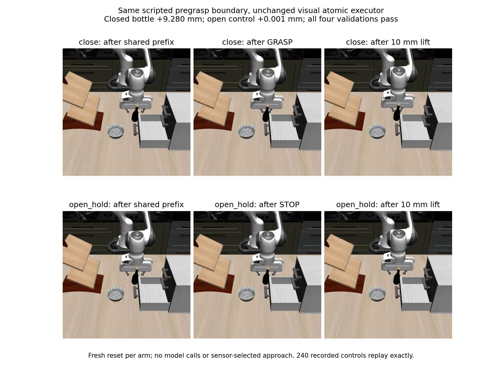

# Existing visual executor supports a qualified local bottle grasp and lift

The registered mechanical transfer passes. From the same scripted pregrasp
boundary, **GRASP then one 10 mm MV_UP** lifts the bottle **9.279539 mm**, with
bilateral fingerpad contact at all eight control endpoints and all 200 BEFORE
and 200 AFTER native lift samples. The open-jaw comparator lifts its TCP but
moves the bottle only **0.001081 mm**, with no gripper/bottle contact. All four
operations pass the unchanged visual executor's hard validation. The 240 new
controls replay exactly from fresh resets.

This qualifies one local mechanical capability of the actual visual action
interface. It does **not** establish sensor-selected approach, an autonomous
policy, Laya competence, support-free retention or full Task2 success.

## Frozen intervention and complete attempts

The [protocol](../../research/local_grasp_interface_protocol.md) and collector
were first frozen at `20d2b1a`, then reviewed and hardened at `ef58bf9`: all
observation/render operations guard integration state and selected native caches;
replay rejects changed source/configuration before constructing a world; the
positive criterion distinguishes endpoints from native-stage continuity.

Attempt01 at `ef58bf9` failed during source introspection: LIBERO was imported
before its normal package/path bootstrap. No recorder, simulator world, reset,
image or control was created. Its terminal log is retained. Infrastructure fix
`9b85ad5` calls existing `load_libero` before introspection, without constructing a
world or changing scientific conditions. Independent receipt `8374875` covers
that amendment. Import/source preflight02 passes with zero worlds/controls.
The separately named **run02** is the first physical experiment; no failed
physical attempt, outcome-driven repair or hidden retry is omitted.

Both arms use the original wine-bottle/bottom-drawer task, init0/seed1, standard
ten settling controls, native controller and assets. Original native actions
0–12 are regenerated from the archived Task2 prefix; there is no archived-control
warm start or state restore. At13, unchanged `AtomicExecutor` executes GRASP or
STOP with retained open jaws. At14, both execute MV_UP at the existing 10 mm
step. There is no model, preview, candidate search, learned estimator, new
primitive, threshold relaxation or policy-driven recovery.

The original prefix is explicitly privileged-selected and scripted. A paired
intervention at its endpoint isolates local mechanics; it does not qualify
getting from the initial RGB-D view to that endpoint.

## Physical and execution evidence

| Arm / operation | Nominal translation residual (mm) | Rotation change (degrees) | Hard validator |
|---|---:|---:|---|
| Close / GRASP | 0.220081 | 0.028737 | pass |
| Close / MV_UP | 0.600963 | 0.028998 | pass |
| Open / STOP | 0.310048 | 0.022354 | pass |
| Open / MV_UP | 0.542131 | 0.024102 | pass |

Pose-hold translation remains limited to1.5 mm, translation residual to2 mm,
and retained orientation change to1 degree. These are the original reset-derived
execution envelopes, not general safety certificates. The jaw commands remain
closed in the close arm and open in its comparator. Each operation has eight
controls; no early success or additional hold changes its length.

| Lift measurement | Close | Open/hold |
|---|---:|---:|
| TCP vertical displacement (mm) | 9.423957 | 9.484801 |
| Bottle-center rise (mm) | 9.279539 | 0.001081 |
| Bottle bottom before → after (mm) | 899.879367 → 909.225959 | 899.969050 → 899.971017 |
| Bilateral pad relation at control endpoints | 8/8 | 0/8 |
| Bilateral pad relation BEFORE native lift calls | 200/200 | 0/200 |
| Bilateral pad relation AFTER native lift calls | 200/200 | 0/200 |
| Unexpected robot contact rows | 0 | 0 |
| Official combined-task success | false | false |

Contact labels preserve Task2's existing strict **>0.05 N** normal-force rule.
The maximum gripper/bottle normal force during the closed lift is8.122119 N
BEFORE and8.122119 N AFTER; these are native contact buffers, not wrist force.
All raw contact rows/forces remain available. BEFORE/AFTER stages are separate
observations, not independent impacts or exact continuous-time contact duration.
No support-free or force-closure claim follows solely from these measurements.

Passive instrumentation records800 native calls/1600 snapshots across the four
intervention operations, with25 calls per control and Euler2 ms unchanged.
It adds no live forward or integration. The existing scratch-FK sensor reader
is retained; its scratch forward does not advance live dynamics. Integration
state and geom/site/camera/sensor/qacc caches remain unchanged around readings
and RGB-D/segmentation captures. Sensor fields retain unknown sample times and
`holding=None`. Sensor artifacts are sealed before the separate endpoint labels
are written; the mixed native/provenance journal is evaluator evidence, never
model input. The optional unexpected-contact abort is oracle-assisted diagnostic
monitoring, applied after an atomic action, not a deployed sensor safety gate.

## Independent verification and scope

Independent reviewer commit `208e693` audits all2,149 chained records, source
identities, sensor seals, commands, live validator arithmetic and all native
contact memberships. All224 comparable controls through step13 reproduce the
old paired archive exactly. All28 shared-prefix RGB/depth/K/T frames match
byte-for-byte. All240 recorded controls and every before/after verification state
replay exactly on two fresh resets under the same frozen code. The checker adds
no dynamics. See [independent findings](local_grasp_independent_findings.md).

The positive criterion was frozen before outcomes: all four hard validations
pass, close-arm bottle rise is positive and greater than open, and all eight
close-arm lift endpoints are bilateral while open has none. Native-stage
maintenance is reported separately and also passes at every recorded lift stage.
Root inspected the actual six-frame comparison, raw per-action errors and
contact reductions; official success is not used as a substitute for them.
Twenty-two focused tests passed before execution; scoped ruff and diff checks
passed. The setup correction preserves those tests and the original stop rules.

The next decisive question is target-specific sensor geometry for reaching a
graspable relation. A single-box initial RGB-D support audit will test whether
the existing perception representation contains that evidence, without fitting
a target offset to this successful scripted endpoint. No planner or new skill
library is justified by this local result alone.

Raw directories under `runs/autonomous-research/`:

- `local-grasp-interface-run-01.log`: retained zero-physics setup failure.
- `local-grasp-interface-setup-preflight-02.log`: zero-world import/source check.
- `local-grasp-interface-run-02/`: all RGB-D, controls, native contact/wrist
  snapshots, sensor seal, evaluator labels, root derivation script and figure.
- `local-grasp-interface-replay-02/`: exact240-control verification states.

Raw run SHA-256:
`9347eab2f1b48fe3799ccfbc3164f60406b6451bd194819ef66632df7d6464bb`.
The [portable summary](local_grasp_interface_summary.json) includes complete code
identity, replay identity, per-action measurements and both-stage contact counts.
