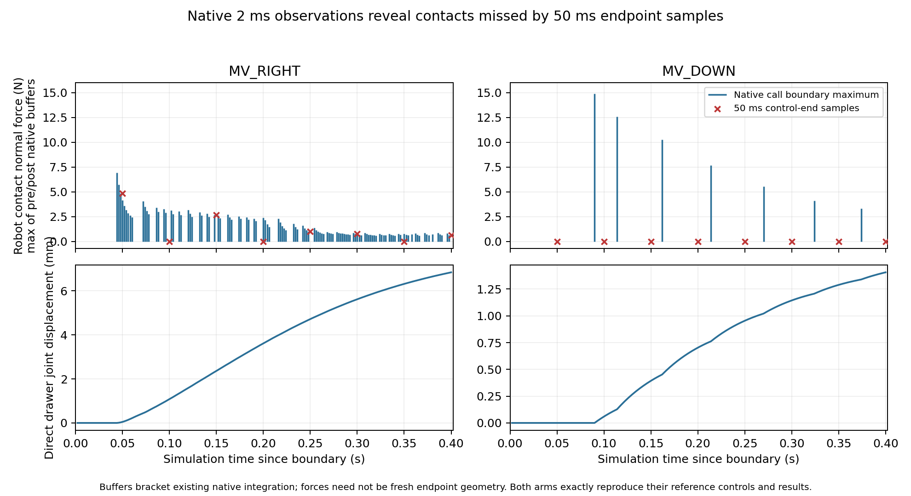

# Native contacts missed by control-end sampling

`MV_DOWN` was not physically contact-free. Its eight ordinary control-end samples
contain no robot contact, but observation around the actual native integrator
calls reveals nonhandle drawer-front/finger-body contacts in seven controls,
peaking at 14.913734 N. Both diagnostic arms reproduced every reference control
and full executor result exactly. This resolves the apparent contact-free drawer
motion as a sampling limitation; it does not isolate the sole cause of the TCP
translation residual or establish a valid manipulation skill.

The force bars use the maximum of the two native call-boundary buffers for each
2 ms interval; red crosses are the original 50 ms control-end measurements. The
lower panels use direct drawer-joint position. A post-step force buffer is not
asserted to be freshly computed endpoint geometry.

## Frozen observation and exact reproduction

The [protocol](../../research/native_substep_observability_protocol.md), source
and seven new synthetic/source tests were committed as `ef5a4e0` before preflight.
The independent joint_interface reviewer approved protocol, implementation and
tests before dynamics. Its receipt is retained in preflight01. All 31 relevant
tests passed. Preflight01 and run01 completed without failures or retries.

Exactly two arms ran, RIGHT then DOWN, with separate fresh top_drawer init0/seed1
worlds, ten standard settling controls and the exact original 200-control prefix.
All 400 prefix commands/before/after states matched. At the boundary, native
execution state, available robot proprioception and evaluator state matched the
completed seven-arm reference. No archived state/controller snapshot was restored.

The original `AtomicExecutor` and `RecordingBackend` performed eight controls per
arm, with unchanged 10 mm target, gripper, orientation, controller, horizon and
2 mm translation tolerance. Every generated command, before/after control state,
ordinary contact list and available returned robot field matched its reference
exactly. Both full executor results and evaluator endpoints also matched. There
were zero model calls, policy decisions or newly selected primitives.

The observer called each original `mj_step` exactly once, preserving arguments
and return. The actual integrator is MuJoCo Euler (enum0), timestep2 ms, with
25 integrations per50 ms control:400 actual native integrations and800 before/
after snapshots in total. The native environment and controller each call forward,
giving two existing forwards per integration (400 per arm); the logger added no
forward. `mj_step1`/`mj_step2` were not called during either native arm.

Snapshots read all contacts, including nonrobot and zero/subthreshold rows; native
six-component contact-frame force; qpos/qvel/qacc; generalized force components;
Cartesian applied forces; and cached handle geometry. Drawer qpos address37 and
DoF address33 were recorded separately. `mjSTATE_INTEGRATION` fingerprints were
identical before/after every snapshot collection. The observer never assigned
`world.obs`, refreshed derived caches or altered physics. Cached handle geometry
was identical across each call's pre/post snapshots, while direct qpos advanced;
this illustrates why cache timing is explicit in the record.

## Paired outcomes

| Measurement | MV_RIGHT | MV_DOWN |
|---|---:|---:|
| Ordinary control-end robot contact rows | 5 | 0 |
| Native integrations with a robot contact in boundary buffers | 112/200 | 7/200 |
| Pre/post robot contact sample rows | 224 | 14 |
| Maximum observed normal force (N) | 6.912957 | 14.913734 |
| First sampled contact interval, absolute simulation seconds | 10.544–10.546 | 10.590–10.592 |
| Direct drawer-joint change (mm) | 6.844671 | 1.406205 |
| TCP translation residual (mm) | 1.650032 | 2.114787 |
| Existing translation contract | valid | violation |

All observed robot contacts in both arms were the pair
`wooden_cabinet_1_g11` / `gripper0_finger1_collision`: drawer front panel and finger
body, outside the designated handle. No drawer/nonrobot contact was present in
the sampled buffers. Before/after forces differ across the native solve. The
224/14 rows are repeated samples around112/7 native integration calls, not counts
of independent impacts or exactly identical contact records.

DOWN's contact-present native call indices are45,57,81,107,135,162,187 (zero-based).
These fall once in each control1–7; control0 has neither drawer motion nor contact.
Every after-control sample remains empty.

| DOWN control (zero-based) | Drawer change (mm) | Maximum native-buffer normal force (N) | After-control contact rows |
|---|---:|---:|---:|
| 0 | 0 | 0 | 0 |
| 1 | 0.059390 | 14.913734 | 0 |
| 2 | 0.333852 | 12.564737 | 0 |
| 3 | 0.309494 | 10.255539 | 0 |
| 4 | 0.251459 | 7.657642 | 0 |
| 5 | 0.189669 | 5.547665 | 0 |
| 6 | 0.145252 | 4.100117 | 0 |
| 7 | 0.117088 | 3.339260 | 0 |

First direct drawer motion occurs in the same integration interval as the first
sampled contact for each arm, with drawer velocity zero immediately before it.
For DOWN, call45 advances the drawer0.012670 mm and velocity to0.006334777 m/s;
its drawer constraint generalized force is9.830527 N before the native step and
9.818904 N after. For RIGHT, call22 advances0.009126 mm and velocity to0.004563009
m/s. All recorded generalized applied and Cartesian applied forces are zero.
The first-moving-interval drawer actuator, passive, bias and smooth force terms
are also zero in both arms. This is contact-associated native dynamics, not a
counterfactual causal intervention separating contact from controller conditioning.

## Audit, evidence and bounded implication

The offline audit passes raw chains, frozen preflight/code/protocol and installed
stepping-source identities; all400 prefix and16 native control rows; both complete
reference results;400 native call chains and800 snapshot times/joint addresses;
contact membership/force/threshold arithmetic; and four RGB-D plus two trajectory
artifact hashes and trajectory arrays. Independent raw chronology matches the
first-contact, direct-motion and generalized-force observations. The separate
reviewer report provides its own audit result.

The evidence demonstrates temporal undersampling by the existing control-end
contact measurement at this boundary. It leaves the native translation contract
unchanged and reinforces the absence of a valid contact-free progress witness in
the original seven options. It does not justify threshold relaxation, a live
geometry gate, revised primitive or policy, or a sole-cause explanation of TCP
tracking error. Finer snapshots still do not provide continuous-time first-touch
or impulse attribution.

Historical Task1's **0 mm designated-valid closure** remains a control-end
measurement under its original semantic audit. This newly observed aliasing
motivates a separate exact observational replay of one canonical Task1 trace to
ask whether that sampling missed designated contacts. Nothing here rewrites
Task1's archived tag or establishes intended interaction in that different trace.

Raw root is
`/home/junhongli/projects/laya-embodied-runtime/runs/autonomous-research/`:
`native-substep-observability-preflight-01` (including independent review receipt),
`native-substep-observability-run-01`, and sibling logs. Run01 retains episodes,
RGB-D/native trajectory artifacts, `summary.json`, standalone timing figure, and
the read-only post-run `derive_temporal_metrics.py` / `temporal_metrics.json`.
The tracked [compact summary](native_substep_observability_summary.json) retains
paired native outcomes, per-control statistics and first-motion arithmetic.

| Identity | SHA-256 |
|---|---|
| Completed seven-arm reference | `23a5e0ea9a59317ad843141a4ec0017958d0c180fdbc7c2aed90cf41697943fa` |
| Two-arm native observations | `7fce36f5df64da7009d3ddb71b98f01d2383065c13d3b88069af39aed997337a` |
