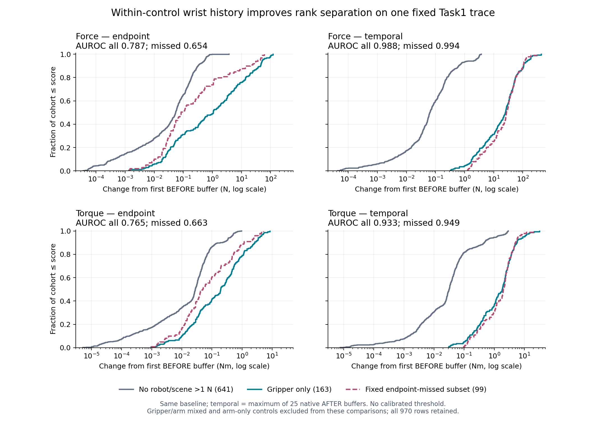

# Offline wrist history versus endpoint sampling

On the single frozen Task1 trajectory, within-control wrist history has stronger
descriptive rank discrimination for gripper/scene interaction than endpoint-only
sampling. Primary force AUROC rises from **0.787248 to 0.987634**; among the fixed
99 controls whose final contact sample misses earlier gripper contact, it rises
from **0.653918 to 0.993602**. Residual overlap remains. This is evidence for retaining
temporal observations, not a calibrated contact detector, a holding estimate, or a
live control gate.

## Frozen comparison and provenance

The [protocol](../../research/offline_wrist_history_protocol.md), producer, and six
tests were committed as `adc7eb4e448615a271e58951f19a3dbe1c64e44a` before extraction.
The independent pre-analysis review at `6b14614` approved the boundary and reran all
six tests successfully. This analysis only reads the completed canonical native
Task1 archive: no simulation object, physics step, model call, fit, calibration,
threshold selection, or feature revision was introduced.

For each 50 ms control, the first native BEFORE wrist vector is the baseline.
The endpoint feature is the norm of the final AFTER vector minus that baseline;
the temporal feature is the maximum of those same differences over all 25 AFTER
buffers. Force and torque are separate. Because the temporal score includes the
endpoint, its score cannot be lower; this algebraic property alone is not improved
discrimination. The registered AUROC comparison and observed overlap address the
actual question.

The analysis uses native local sensor-site axes, without rotation or gravity,
acceleration, dynamics, or controller compensation. Both sensors attach to
`gripper0_ft_frame`, site 6 on body 12 (`gripper0_right_gripper`), with zero static
offset and identity static quaternion. The site moves with the gripper. The force
sensor is `gripper0_force_ee`, sensor 0/address 0, three components in N; torque is
`gripper0_torque_ee`, sensor 1/address 3, three components in Nm. Actual sensor
sample times are unknown: 2 ms is the recorded native buffer-read spacing, not a
verified hardware sensor sampling rate. Native stage/cache timing is retained.

Evaluator labels use the AFTER contacts, strict normal force **>1 N**, and the
declared geometry partition. The gripper group is a downstream-contact proxy;
the arm group is upstream. This is not a fitted load-transfer model. External
scene excludes all robot geometry, and robot self-contact has cohort precedence.
Absence of >1 N contact is not literal contact freedom.

| Cohort | Controls | Role |
|---|---:|---|
| Gripper only | 163 | Primary positives |
| Arm only | 164 | Separate upstream cohort |
| Gripper and arm | 2 | Separate mixed cohort |
| No robot/scene contact above 1 N | 641 | Primary negatives |
| Self-contact present | 0 | Separate self-contact cohort |
| **Total** | **970** | All rows retained |

## Registered results

Every comparison below uses the same 641 negative controls. AUROC is the empirical
positive-versus-negative ordering with half credit for ties. Overlap counts are
positive scores within the corresponding negative cohort's observed min–max
range; they are not classification errors at an inferred threshold.

| Channel / positive set | Endpoint AUROC | Temporal AUROC | Difference | Endpoint overlap | Temporal overlap |
|---|---:|---:|---:|---:|---:|
| Force / all 163 | 0.787248 | 0.987634 | +0.200387 | 107/163 | 32/163 |
| Force / missed 99 | 0.653918 | 0.993602 | +0.339684 | 82/99 | 14/99 |
| Torque / all 163 | 0.765455 | 0.932822 | +0.167367 | 128/163 | 117/163 |
| Torque / missed 99 | 0.663342 | 0.949448 | +0.286106 | 87/99 | 72/99 |

Force positive medians rise from 1.072608 N to 25.119743 N, while negative medians
are 0.054517 N and 0.064064 N. The corresponding negative ranges are
0.000036033–3.752216 N and 0.000043442–3.755224 N. Temporal positive force ranges
from 0.321832 N to 434.089377 N, so perfect rank separation is absent. The missed
subset's medians are 0.083342 N and 27.056398 N.

The excluded cohorts are retained separately, with no downstream/upstream
blending. Their force endpoint/temporal medians are 0.084383/0.552131 N for the 164
arm-only controls and 1.024974/59.153050 N for the two mixed controls. Their torque
medians are 0.060838/0.240396 Nm and 0.677297/4.926766 Nm, respectively. Full
min/5th/median/95th/max distributions for every cohort and both channels are in
the [compact summary](offline_wrist_history_summary.json).

All 99 prospectively defined endpoint-missed controls remain in chronological
order in that summary, with primitive/control indices, native contact intervals,
all four scores, and ranks against negatives. Complete per-contact rows remain
in the sealed raw summary and labels. The first chronological case is global
control 71 (primitive 8/control 7, zero-based), 4.05–4.10 s. Its endpoint and
temporal force scores are 51.942514 N and 51.972455 N, both above every negative
score. Endpoint contact absence therefore does not by itself imply an
uninformative endpoint wrench. This first fixed case was not selected for a large
temporal benefit.

## Interpretation and limits

The temporal force representation better separates the registered contact cohorts
on this trace, including the fixed missed-contact subset. Torque also improves
rank discrimination but retains substantial overlap. The evidence supports the
value of preserving native wrist history for subsequent bounded representation
tests. It does not establish a usable decision threshold.

These 970 controls are dependent observations from one trajectory, not independent
test cases. Gravity, acceleration, moving local axes, controller transients,
preceding interaction, and native sensor/cache timing can change a score without
current gripper contact. Contact labels do not isolate contact's causal
contribution to wrist measurements. There is no claim of calibrated force,
holding, transfer to another trajectory, hardware validity, or online controller
qualification. No additional wrench variant was tuned after observing results.
The source Task1 audit found no designated fingerpad/handle contacts at any
recorded native stage; the present gripper-group association therefore does not
validate designated grasp or closure sensing.

## Seals and audits

Raw output is retained at
`/home/junhongli/projects/laya-embodied-runtime/runs/autonomous-research/offline-wrist-history-run-01`.
The journal order is `run_start → frozen_analysis → sensors_sealed → features_sealed
→ labels_sealed → termination`. The explicit sensor-only projection was sealed
before feature computation, and all 970 feature rows were sealed before label
extraction. The producer audit passes source/record lineage, projection, features,
labels, summary recomputation, and sealing order, with zero physics/model calls.

| Artifact | SHA-256 |
|---|---|
| Source native episodes | `e8e253cefe4c694c6091e1bf944a8f269cfc47c7ed08c053419d97e1a73615d4` |
| Analysis journal | `055ecd9561e4306598f95d178ed785e9c7e2fa561f3279d42358abc09dbf810d` |
| Sensor projection | `83b998611fbe72e9bbca4cd0128943244ffb485aacdf6d676ac422c2c1184cca` |
| Sensor metadata | `3106e0268dafed81ed462dc7f2da689f14dd7e9365600a239ddd9c966c0e9fa8` |
| Features | `4722f64b2102990b6472484389c66319a932560bbbc2f3d1cf0961358925dea5` |
| Gold labels | `060023831d58c0949a4eee21c9f600cc8501993c8dbc743f0c2777ca29cb5ff7` |
| Full raw summary | `c75b15a3ffbfb67a70210d2d471fc6501096d33364707dbdf6e8fd50641de8c4` |
| Frozen protocol | `2fe1d7d7ff98bd5dc82d180635a51b0e13dda93703a6d0518d3cf34ab76ac82d` |
| Tracked compact summary | `b4e0123a54b64be95ff3270cf316e85f5eb27e32729c1e383517a6046240e994` |
| Tracked figure | `78d6daa6a937e851ef107495f2556997d613b3a5775a539e07f8cbce91a63037` |

The independent stored-evidence audit **passes**, committed as `293cc62`:
`docs/evidence/autonomous_research/wrist_history_independent_review.md` and
`wrist_history_independent_audit.json` in the review worktree
`/home/junhongli/projects/laya-information-boundary-review`. It independently
streams all 100,158 source records, reconstructs all 970 sensor projections and
24,250 AFTER gold samples, and checks cohorts, missed-control intervals, features,
pairwise AUROC, distributions, overlaps, and ranks without importing the
producer's scientific functions. It also verifies the six-record analysis
journal and every artifact seal, with no physics/model/FK/projection calls.
