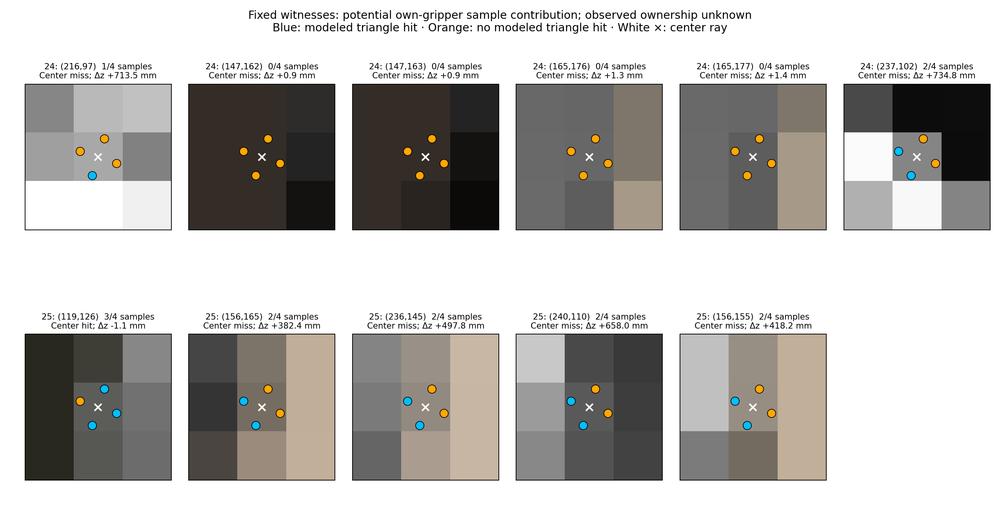

# Calibrated sample footprint and potential own-gripper contribution

All six registered centers with 382–735 mm native-to-zero depth jumps have mixed potential gripper coverage across the four calibrated samples while their center rays miss the modeled gripper. This result explains a concrete weakness in interpreting those resolved native measurements as center-ray scene points. It does not identify their actual owners or establish clearance for any candidate.

The [frozen protocol](../../research/pixel_sample_footprint_protocol.md) and producer commit `0733ea7280e6585848f58e8e29990fd3415028ab` define a geometry-only representation: preserve the native depth scalar byte-for-byte, keep its four optical sample rays separate, and calculate nearest intersections with calibrated own-gripper triangles inferred from nine own-joint values. The depth-resolve rule is unspecified. Zero/partial/all modeled sample support leaves observed ownership and unmodeled/occluded space unknown.

## Registered observations

The bit order below is the frozen OpenGL sample order: `(0.375,0.125)`, `(0.875,0.375)`, `(0.125,0.625)`, `(0.625,0.875)`. A `1` means a potential own-gripper triangle intersection, not actual ownership. These offsets map to flipped-image pixel-edge coordinates `(x+sx,y+1−sy)`, using unchanged edge-coordinate K. The reference center is `(x+.5,y+.5)`.

| Boundary | Registered pixel | Four-sample support | Center support | Zero − native depth (mm) |
|---|---|---|---|---:|
| 24 | (216,97) | 1000 | No | +713.499367 |
| 24 | (147,162) | 0000 | No | +0.908732 |
| 24 | (147,163) | 0000 | No | +0.903547 |
| 24 | (165,176) | 0000 | No | +1.308858 |
| 24 | (165,177) | 0000 | No | +1.387298 |
| 24 | (237,102) | 1010 | No | +734.777451 |
| 25 | (119,126) | 1101 | Yes | −1.123250 |
| 25 | (156,165) | 1010 | No | +382.361174 |
| 25 | (236,145) | 1010 | No | +497.823119 |
| 25 | (240,110) | 1010 | No | +658.002377 |
| 25 | (156,155) | 1010 | No | +418.181002 |

The last row is the earlier newly admitted zero-distance pad witness. No residual distance or mask was recomputed. All eleven complete 3 × 3 neighborhoods, including all 99 entries, are preserved in the [portable summary](pixel_sample_footprint_summary.json). Own-qpos and separately evaluated cached-pose support agree at every sample and center in those 99 entries.

## Whole-frame support and separate cache comparison

| Boundary | 0/4 samples | 1/4 | 2/4 | 3/4 | 4/4 | Center support | Native sample support with center miss |
|---|---:|---:|---:|---:|---:|---:|---:|
| 24 | 141,479 | 86 | 154 | 80 | 5,657 | 5,855 | 122 |
| 25 | 141,406 | 77 | 91 | 160 | 5,722 | 5,937 | 113 |

Mixed potential coverage occurs in 320 and 328 pixels respectively. These are descriptions of modeled triangle intersections, not instructions to exclude or classify pixels. The four registered pre24 small-change finger/pad centers have no modeled gripper sample hit and remain unexplained by this limited three-mesh representation; omitted self geometry, scene identity and other measurement effects remain unknown.

The evaluator used the already-sealed cached poses only after sensor output was sealed. Across each whole frame, cached versus own-qpos poses changed four-sample coverage at 7 samples in 7 pixels for boundary24 and 2 samples in 2 pixels for boundary25. Center support differed at 0 and 2 pixels. On common-hit samples, maximum absolute predicted optical-depth differences were 7.099587 mm and 16.515080 mm. For the center condition the corresponding maxima were 0.156043 mm and 0.189821 mm.

Thus the previously measured sub-0.005-pixel vertex displacement cannot be treated as a uniform bound on sampled-depth differences or as proof of identical coverage. These differences are retained even though none changes the registered neighborhoods. No cached pose entered the sensor worker and no fresh-FK image was rendered.

## Calibration correction and verification

The first attempt, `pixel-sample-footprint-01`, stopped before any coverage output because the prior visual export contained vertices and face counts but no connectivity. Its manifest, process error and sibling log remain intact. No triangle topology was inferred from a hull or fitted alignment.

Under the explicit static-calibration amendment, `gripper-visual-triangle-topology-01` compiled only two pinned own-gripper visual STL assets and three static visual geoms. It created no `MjData`, joint state, full scene, camera or renderer, and invoked no stepping or forward API. All nine exact gates passed: ordered vertices, geom-local position and geom-local quaternion for each mesh matched the unchanged sealed calibration. The export contains 7,078 hand faces and 624 faces for each finger; all indices are bounded by the exact vertex arrays. Its SHA256 is `12bedb9ef0604ba826f8e79a9a6e8d9bfabfe123211181a056ba608130c9fcc1`. The actual calibration/topology schema passed preflight before the second attempt.

The successful `pixel-sample-footprint-02` ran from the frozen code and exited 0. All source hashes passed. Its separate sensor worker accepted only native depth/K/T, static own calibration/topology, calibrated sample offsets and own-joint packets; it preserved native scalar dtype/bytes. This was code and serialized-input separation, not a filesystem sandbox. The worker output was sealed before the cached-pose/zero-image evaluator. The offline comparison imported no simulator or renderer, advanced no physics and executed no control. Both historical boundaries remain development data, and their joint values remain simulator-state-derived encoder analogues.

Sixteen footprint tests plus nine FK tests passed. The reporter passed 232 post-seal checks of hashes, scalar preservation, stored sample arrays, coverage counts, all fixed neighborhoods and numerical summaries without rerunning triangle projection. Independent prospective review receipts are `90897c1` and amendment `17c5481`; the amended review explicitly preserves the initial missed topology-schema check. The stored-result audit is reported separately by the independent reviewer.

Raw results and logs are under `/home/junhongli/projects/laya-embodied-runtime/runs/autonomous-research/pixel-sample-footprint-02` and sibling `.log`; the failed01 and static topology export are retained alongside them. The [portable summary](pixel_sample_footprint_summary.json) includes the raw artifact hashes; the [reporter](../../../embodied_runtime/experiments/pixel_footprint_report.py) reproduces the figure and stored-array checks.

## Decision value and stopping point

The measurement changes the interpretation of six registered readings: their center rays omit potential own-body contributions present at native sample locations. Together with the earlier fixed-cache sampling intervention, that makes them unsuitable as clean center-ray evidence about a scene surface. It does not turn ambiguous returns into free space, identify the four other pre24 returns, recover target extent or opposing grasp surfaces, or establish a candidate's clearance/contact outcome. No concrete motion is cleared by this result.

This geometry diagnosis is complete. No dilation, mask union, fitted uncertainty margin, pixel removal, resolved-depth replacement, policy, estimator or action gate was added. Further renderer reconstruction is not needed to answer the current decision question.
