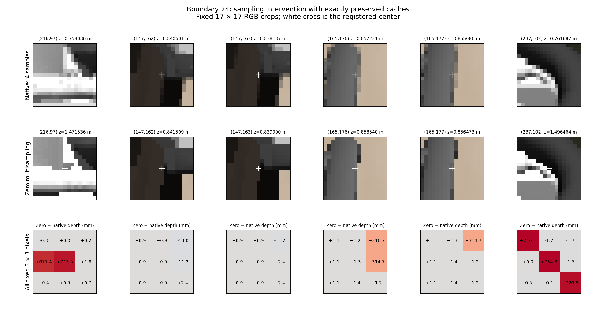
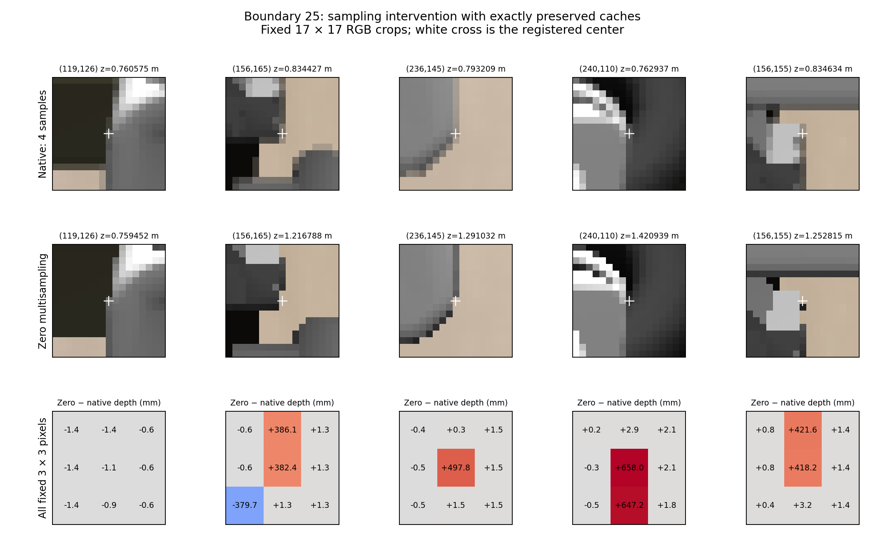

# Rendering measurement diagnosis: fixed caches, changed sampling

Changing only the reproduced framebuffer from four samples to zero multisampling changed several registered silhouette depths by hundreds of millimetres. The native images first reproduced the archived RGB, depth, intrinsics and camera transform byte-for-byte. A separate numerical comparison found a nonzero cached-pose versus own-qpos FK discrepancy, with every tested gripper vertex moving less than 0.005 projected pixel. This establishes a sampling effect at fixed caches; it does not assign every residual pixel to a physical surface or validate a replacement sensor pipeline.

The experiment followed the [frozen protocol](../../research/render_measurement_diagnosis_protocol.md), frozen evaluator commit `5b17822f853418734e880e7560ac5f52986ed5fc`, and the [source audit](render_measurement_source_findings.md). Boundaries 24 and 25 are development data. No estimator, mask, margin, distance map, threshold, policy, action gate or sensor adapter changed.

## Reproduction and information boundary

The explicit evaluator recreated the historical scene, replayed its 200 archived controls, and required exact flattened state equality at 402 gates: the initial state, before and after every control, and the pre25 endpoint. Both native captures matched the original RGB/depth/K/T dtype, shape and value hashes. Any mismatch would have stopped the experiment; no tolerance relaxation, image repair or retry occurred. The physical source used GPU4; this exact reproduction ran on GPU5, both RTX 4090 devices.

Two full `mj_copyData` snapshots, two restores, and two zero-MSAA captures passed six independent selected-array integrity checks. The checked values included time, qpos/qvel, act/act_dot, qacc/warmstart, controls, applied forces, sensordata, body/geom/site/camera poses, mocap and userdata. `mj_copyData` copies the full data structure; this is not a claim that an opaque full-MjData byte hash was exported. The state gates and copy checks were recorded by the frozen evaluator. Later reporting checked those records and sealed images; it did not independently replay the history.

Own-body FK received only the sealed robot calibration and nine archived own-joint values. These are simulator-state-derived own-joint encoder analogues, not measurements from physical encoders. Fresh own-qpos FK was compared numerically and was never rendered. No target/contact identity query or force label was used. Residual pixel identity and occluded space remain unknown.

## Actual reproduced raster context

Native requested and actual `offSamples` were both 4, and the bound framebuffer reported 4 samples. Zero-MSAA requested, actual and bound sample counts were all 0. In both conditions:

- `geomgroup = [0, 1, 1, 0, 0, 0]`; collision rendering was false and visual rendering true.
- The offscreen framebuffer was 640 × 480; the captured image was 384 × 384.
- `readDepthMap = 0`; scene flags, Euler integrator and 0.002 s model timestep matched.
- GL reported NVIDIA Corporation, NVIDIA GeForce RTX 4090/PCIe/SSE2, and `4.6.0 NVIDIA 575.57.08`.

The native sample positions, in bottom-left pixel coordinates, were `(0.375, 0.125)`, `(0.875, 0.375)`, `(0.125, 0.625)` and `(0.625, 0.875)`. These are actual queried positions in the reproduced context. Group0 was disabled, so direct rendering of the collision pads is unsupported by these flags. The source path resolves multisample buffers with `glBlitFramebuffer(..., GL_NEAREST)`; neither that call nor this result establishes an average, minimum or center-sample depth-resolve rule.

## Sampling intervention

K and T stayed exact in both comparisons. Depth values below are optical depth, and the signed witness difference is zero-MSAA minus native.

| Boundary | RGB pixels changed | Depth pixels changed | Maximum absolute depth change | Mean absolute depth change |
|---|---:|---:|---:|---:|
| 24 | 17,073 | 147,412 | 1.599933743 m | 0.003615418 m |
| 25 | 17,228 | 147,416 | 1.580974221 m | 0.003757131 m |

The large number of changed depth values also includes small raster differences. The registered center results expose their scale without selecting a favorable neighbor:

| Boundary | Pixel (x, y) | Depth change (mm) |
|---|---|---:|
| 24 | (216, 97) | +713.499367 |
| 24 | (147, 162) | +0.908732 |
| 24 | (147, 163) | +0.903547 |
| 24 | (165, 176) | +1.308858 |
| 24 | (165, 177) | +1.387298 |
| 24 | (237, 102) | +734.777451 |
| 25 | (119, 126) | −1.123250 |
| 25 | (156, 165) | +382.361174 |
| 25 | (236, 145) | +497.823119 |
| 25 | (240, 110) | +658.002377 |
| 25 | (156, 155) | +418.181002 |

The last center was the previously newly admitted zero-distance pad witness. All eleven complete 3 × 3 neighborhoods, including all 99 entries and both RGB/depth measurements, are retained in the sealed measurements. The figures show fixed 17 × 17 RGB crops and every neighborhood depth difference; inspection began only after sealing.

## Separate cached-pose versus own-qpos FK comparison

All five gripper collision geoms and three gripper visual geoms were compared using the same calibration vertices and captured camera matrices.

| Boundary | Maximum vertex displacement | Maximum projected vertex displacement |
|---|---:|---:|
| 24 | 10.928843 µm | 0.004568183 px |
| 25 | 34.748481 µm | 0.004881923 px |

The cache discrepancy is nonzero and must remain explicit. Small vertex displacement does not prove identical raster ownership at a silhouette. Nevertheless, it cannot be the intervention responsible for the native-versus-zero changes: both images in each pair used the same copied caches. No fresh-FK rendered condition was introduced, and the experiment does not completely apportion the older distance residuals between all possible measurement effects.

## Execution and verification

| Phase | Environment controls | `mj_step` | `mj_step1` | `mj_step2` | `mj_forward` |
|---|---:|---:|---:|---:|---:|
| Bootstrap | 10 | 250 | 2 | 0 | 509 |
| Historical prefix | 200 | 5,000 | 0 | 0 | 10,000 |
| Diagnostic after replay | 0 | 0 | 0 | 0 | 0 |

These count Python API calls; internal C forward work inside `mj_step` is not separately intercepted. Setup and historical replay therefore did perform physics. After replay there were zero diagnostic controls, simulation steps or forward refreshes, and no action25 or candidate continuation.

The 14 focused frozen evaluator/robot-geometry tests passed. The read-only reporter passed 239 post-seal checks, including artifact/seal hashes, native source bytes, fixed neighborhood values, context invariants, frame statistics, and reconstruction of vertex/projection discrepancy summaries from saved poses and static vertices. The independent stored-array audit in commit `605448a` also passed; its report distinguishes recorded/code-reviewed state gates from exported arrays that it independently recomputed.

The evaluator process exited 0. Its log contains ignored EGL destructor cleanup exceptions after all results were sealed. The original log is retained; the completed experiment was not rerun or repaired to hide those messages.

Raw evidence: `/home/junhongli/projects/laya-embodied-runtime/runs/autonomous-research/render-measurement-diagnosis-01`, with sibling `render-measurement-diagnosis-01.log`. Portable [summary and raw artifact hashes](render_measurement_diagnosis_summary.json) accompany the figures. The [reporter](../../../embodied_runtime/experiments/render_measurement_report.py) only reads these artifacts and static calibrations.

The result supports accounting for the native pixel sampling footprint when interpreting robot silhouette measurements. It provides no target identity, contact/clearance certificate, physical calibration result, free-space guarantee, or automatic action permission. Zero-MSAA is an evaluator condition, not a validated sensor correction.
