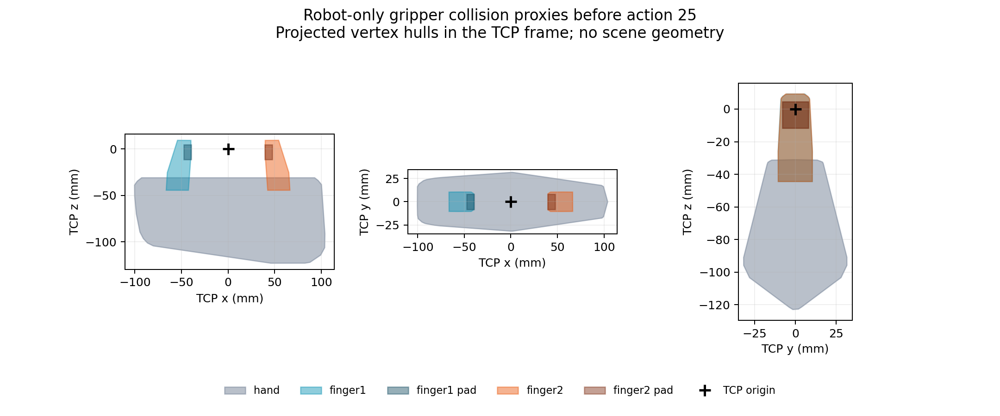

# Robot-only geometry observability

Known static robot calibration plus its nine own-joint positions recovered all
21 exported body poses, two robot site poses, and five gripper collision-proxy
poses and extents in four archived states. The independent NumPy FK agreed with
fresh same-qpos MuJoCo kinematics within `1.12e-15 m` for every position, vertex
and AABB coordinate. All eight nonrobot-state poisoning variants left the
estimated numeric output bit-identical. This supports an own-body geometry
source under known calibration; no runtime interface or controller was changed.

The inputs are **simulator-state-derived own-joint encoder analogues**, not
independent physical sensor measurements. Static calibration and the evaluator
come from the same compiled robot model, so the result validates implementation
and input dependency, not physical model or calibration accuracy. Extents were
tested for the gripper only; arm and mount bodies have poses but no exported
collision extents in this probe.

## Frozen procedure and retained setup failures

The algorithm, four source states, exact `1e-10` tolerance, poison variants and
positive controls were frozen in `ad9a826` before numerical comparison. The
[protocol](../../research/robot_geometry_probe_protocol.md) documents the
subprocess boundary and the append-only setup corrections.

| Attempt | Frozen producer | Outcome before any numerical comparison |
| --- | --- | --- |
| `robot-geometry-observability-01` | `ad9a826` | Strict stepping guard stopped LIBERO constructor `mj_step1`; manifest, protocol and failure preserved. |
| `robot-geometry-observability-02` | `09788e0` | One constructor-only `mj_step1` preserved time/qpos/qvel exactly; static export completed, then namespace-package provenance lookup failed because `libero.__file__` is `None`. |
| `robot-geometry-observability-03` | `554d2e7` | Existing namespace-aware metadata helper used; first numerical comparison passed unchanged frozen criteria. |

The corrected constructor allows one measured `mj_step1`, which computes
kinematic/contact quantities for initial placement without the integration
half. The full time/qpos/qvel arrays before and after are exactly equal and
constructor time remains zero. `mj_step` and `mj_step2` are blocked throughout;
`mj_step1` is blocked immediately after construction. No dynamic controls,
integration, rendering, explicit reset, replay or physics continuation occurred.
Constructor initialization is therefore disclosed separately from zero dynamic
steps. Its scene-bearing audit record never enters the estimator.

## Admitted information and frame conventions

Static export uses the world-parent fixed robot subtree, including its mount,
seven hinges and two finger slides. Calibration contains only parent-relative
body translations and `wxyz` quaternions, local joint axes/anchors/references,
the TCP and wrist force-frame site offsets, and the five gripper collision
shapes. The base installation transform is assumed known: position
`[-0.66, 0, 0.912] m`, identity orientation. It is taken from standard task
construction; real installation/calibration uncertainty was not measured.

The five shapes are the hand mesh (102 compiled vertices), two finger meshes
(18 each), and two exact pad boxes (8 corners each). They are model collision
proxies, not a validated complete physical robot envelope. Scene surfaces,
object transforms, target or handle geometry, contact selectors, camera data
and forces are absent from the estimator input. The force-frame output is a
pose only, with no wrench inference.

An archive adapter reads exactly flat state indices 1–9 as named own positions.
Full state size is 77 (`time + 40 qpos + 36 qvel`). The 31 nonrobot qpos and 27
nonrobot qvel entries are replaced by NaNs or a fixed large finite sequence
before extraction in the two poison variants. Time and own qpos/qvel are held
fixed. **No velocities or timestamps enter the FK process**, which receives
only `calibration` and nine-value `joint_packets` on stdin. The calibration does
not contain the privileged indexing map or full model. A guarded-index unit
test rejects even attempted reads of excluded archive coordinates.
The batch wrapper retains fixed source labels as opaque output keys (including
`first_contact_sample`); the FK function never receives or branches on those
labels. They do not supply a measured contact value or classifier input.

Rotation matrices map local column vectors into the world frame:
`p_world = position_world + R_world_from_local @ p_local`. Vertex arrays use
the equivalent row-vector expression `vertices @ R.T + position`. Hinge FK
preserves the local anchor and uses `qpos - qpos_reference`; slide displacement
uses the calibrated signed local axis. Synthetic tests cover a nonzero rotated
base, hinge anchor and reference, signed slide, sites and analytic box bounds.
The estimator has no task/robot-name-specific branch.

## Numerical and dependency results

| Selected archived state | Simulator time | Source |
| --- | ---: | --- |
| Initial | 0.50 s | Environment state, record sequence 5 |
| Before action 25 | 10.50 s | Control 0 `state_before`, sequence 617 |
| First recorded contact sample | 10.55 s | Control 0 `state_after`, sequence 617 |
| Endpoint | 10.90 s | Control 7 `state_after`, sequence 631 |

The state name “first recorded contact sample” identifies the archive record;
the estimator has no contact input and does not classify contact.

| Frozen comparison | Maximum absolute coordinate error |
| --- | ---: |
| Body/site/geometry position | `8.8818e-16 m` |
| Rotation-matrix element | `3.6637e-15` |
| Gripper collision vertex | `1.1102e-15 m` |
| Gripper AABB bound | `1.1102e-15 m` |

All 112 state/item rows passed. Sealed estimator outputs precede the evaluator
phase. For each state the evaluator creates fresh `MjData`, assigns the
archived qpos/qvel/time, and calls `mj_kinematics` only. These are **same-qpos
recomputed transforms**, not the original cached transforms used by historical
contact calculations.

All eight poison packets and outputs were exactly equal to their corresponding
unpoisoned results. The reporting audit additionally compared the parsed
float64 bit patterns, including signed zero. Positive controls at the
pre-action-25 state changed the first own hinge by `+0.01 rad` and the first
finger slide by `+0.001 m`. Their maximum absolute gripper vertex-coordinate
changes were `6.718752 mm` and `0.999999 mm`, respectively. These are synthetic
input-dependency checks, with no physical execution or feasibility claim.

The descriptive norms between recomputed and archived returned TCP positions
were `3.072 µm` initially, `57.351 µm` before action 25, and `33.795 µm` at the
endpoint. Returned observable sample times were not recorded. These values
were neither a frozen pass criterion nor a correction to the estimator, and
their cause is not identified by this experiment.

## Geometry beyond a TCP point

Before action 25, the union of the five gripper proxies spans TCP-frame bounds
`x = [-100.426, 103.990] mm`, `y = [-31.636, 31.616] mm`, and
`z = [-122.925, 9.249] mm`. Each pad box is `8 × 16 × 16 mm`. The known
finger-body shapes extend well beyond the pads and the TCP point. These are
own-body properties available without current object state.



The figure shows convex enclosures of projected known collision vertices in
the TCP frame. It contains no scene geometry, contact overlay or inferred free
space. World poses, world AABBs and TCP-frame bounds are retained in the
[portable summary](robot_geometry_observability_summary.json). The figure and
bounds do not establish obstacle visibility, swept-volume accuracy, contact
state, action admissibility, grasp retention or collision avoidance. Those
would require separate scene observations and validation.

## Evidence and reproduction

Raw evidence is preserved under
`/home/junhongli/projects/laya-embodied-runtime/runs/autonomous-research/robot-geometry-observability-03`;
the `-01` and `-02` directories and all three sibling logs are retained. The
physical source is `coarse-initial-point-02/episodes.jsonl`, SHA-256
`e09300d6ce11b86ba21339d92f52c86a24ac584f585a9fed8208ca51df7607cf`.
The successful producer commit is
`554d2e7a23cbbfadd90ceefe019c263f1e5f86ed` with a clean worktree.
Calibration SHA-256 is
`11d2d8c788439c7a10cd9a4e26022762096b712e55d9fb2d93bb51e3ee56bdaa`.

The portable summary includes all 12 raw artifact hashes, source record IDs,
the code/protocol identity, exact errors and derived bounds. A read-only
post-result audit passed **366 checks**, including artifact/seal hashes,
sanitized schema, chain ownership, numerical comparisons and dependency
controls. The nine focused synthetic tests passed. Reproduce the audit and
figure into a new output directory, without loading the simulator:

```sh
/home/junhongli/miniforge3/envs/locateanything/bin/python \
  -m embodied_runtime.experiments.robot_geometry_report \
  --source /home/junhongli/projects/laya-embodied-runtime/runs/autonomous-research/robot-geometry-observability-03 \
  --output /tmp/robot-geometry-report-new
```

This probe establishes a bounded source for current robot geometry from own
joints and calibration. It provides no manipulation-policy or physical-safety
result, and the archived physical run has not been continued.
