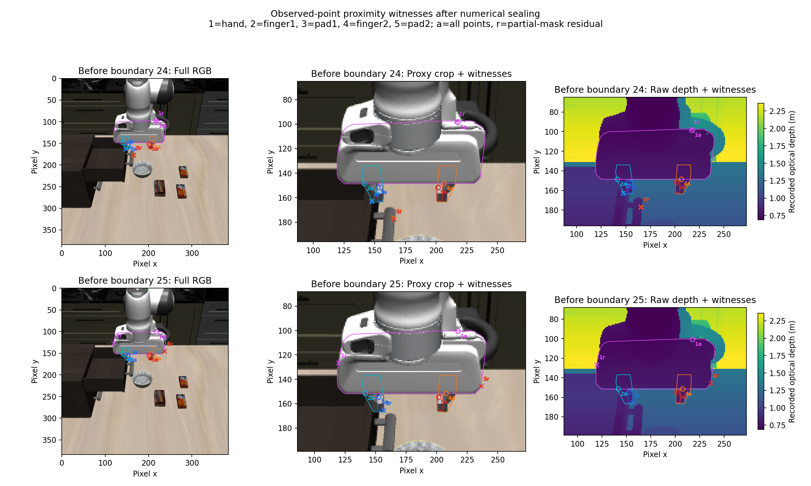
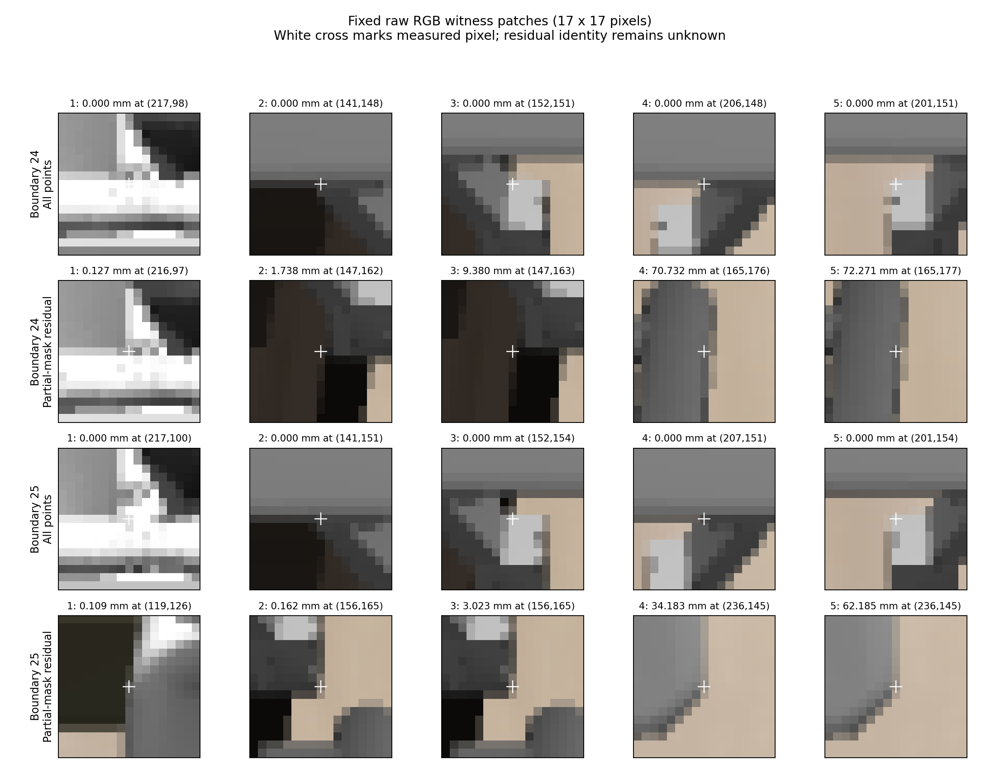

# Observed depth points near calibrated gripper proxies

Raw nearest-depth proximity is contaminated by the visible robot in these two
development frames. Every gripper proxy has a zero minimum when all depth
points are included. Excluding the five collision-proxy silhouettes removes
thousands of robot-region pixels, but the residual global minimum remains
about `0.1 mm` from the hand proxy. Its RGB witnesses appear on gripper housing
edges extending beyond the collision silhouette. The measurement is auditable,
but its minimum cannot currently be interpreted as distance to the environment.

This is a read-only diagnostic on already inspected boundaries 24 and 25,
not held-out validation. No simulator, contact oracle, policy, action filter or
new dynamics was used. Unknown and occluded geometry remains unknown.

## Frozen inputs and geometry

Instrumentation and the [protocol](../../research/sensor_gripper_proximity_protocol.md)
were committed as `f20476d` before the first numerical run. The standalone
worker receives only two recorded optical-depth arrays, their camera matrices,
the sealed robot-only calibration, and nine own-joint values per capture.
Opaque names `sample0` and `sample1` carry no source-boundary or contact label.
RGB enters only the post-seal witness inspection. No target point, scene/body
geometry, contact value, force, action choice or outcome reaches measurement.

| Development boundary | Capture | Recorded time | Valid depth points |
| --- | --- | ---: | ---: |
| 24 | `capture-000025.npz` | 10.10 s | 147,456 |
| 25 | `capture-000026.npz` | 10.50 s | 147,456 |

The nine values are **simulator-state-derived own-joint encoder analogues**,
extracted from the matching control-0 `state_before`. Source capture and state
times match exactly, but this does not independently establish cache
synchronization. The recorded simulator camera intrinsics/extrinsics and fixed
robot installation transform are assumed calibrated; physical accuracy remains
unvalidated. NaN and fixed finite poisoning of the 58 excluded nonrobot state
coordinates leaves both own-joint packets exactly equal.

All finite positive depths are backprojected at pixel centers, without target
cropping or denoising. Distances are Euclidean distances to the **solid convex
hulls** of the known hand, finger and pad collision vertices. Interior points
have distance zero. The partial mask excludes all pixel centers in the union
of the five projected hulls, regardless of depth; it can remove environmental
points in front of the robot as well. It omits arm/wrist geometry and cannot
remove all differences between rendered visual surfaces and collision proxies.
Residual identity is therefore unknown, not a scene label.

## Sealed numerical result

| Measurement | Boundary 24 | Boundary 25 |
| --- | ---: | ---: |
| All-point minimum, each of the five proxies | 0 mm | 0 mm |
| Pixels excluded by partial gripper mask | 6,169 | 6,265 |
| Residual valid points | 141,287 | 141,191 |
| Residual union minimum | 0.126722 mm | 0.109195 mm |
| Residual union 1st percentile | 48.586 mm | 47.756 mm |
| Residual points within fixed descriptive 1 mm level | 22 | 10 |
| Residual points within fixed descriptive 2 mm level | 24 | 11 |

The 1 mm counts come entirely from the hand at boundary 24; at boundary 25,
eight have the hand as nearest proxy and two have finger 1. At 2 mm the nearest
proxy contributions are hand/finger 1 = `23/1` and `8/3`. The fixed
`1/2/5/10/20/50 mm` levels are descriptive summaries, not gates. Counts depend
on pixel sampling, and the individual points are not independent evidence.

| Proxy | Boundary 24 residual minimum; pixel `(x,y)` | Boundary 25 residual minimum; pixel `(x,y)` |
| --- | --- | --- |
| Hand | 0.126722 mm; `(216,97)` | 0.109195 mm; `(119,126)` |
| Finger 1 | 1.738041 mm; `(147,162)` | 0.162011 mm; `(156,165)` |
| Pad 1 | 9.379926 mm; `(147,163)` | 3.023203 mm; `(156,165)` |
| Finger 2 | 70.732011 mm; `(165,176)` | 34.183251 mm; `(236,145)` |
| Pad 2 | 72.270753 mm; `(165,177)` | 62.184888 mm; `(236,145)` |

Every nearest witness retains its raw depth, backprojected world point,
closest solid-proxy point and proxy identity. All per-pixel/per-proxy distances
and projected masks are preserved. The per-proxy values distinguish finger
body and pad geometry, but do not establish which residual pixels are external
surfaces or whether a physical contact would occur.

## RGB/depth witness inspection after sealing



All-point zero witnesses appear within the visible robot's hand/finger/pad
region. The two residual global minima appear at the upper housing/bracket
edge (boundary 24) and left housing edge (boundary 25), immediately outside
the projected hand collision silhouette. This is consistent with gripper
visual geometry extending beyond its collision proxy, including image-edge
sampling effects. It does not identify the exact rendered body or prove the
cause of the mismatch.

The boundary-24 finger-1/pad-1 witnesses lie at a dark boundary where finger
and environment appearance meet. The corresponding boundary-25 witnesses
share one edge pixel beside the finger and beige background. These pixels are
visually ambiguous; assigning them a definite robot/environment identity from
this evidence would overstate it. The boundary-24 finger-2/pad-2 witnesses
appear on a separate vertical metal feature in the environment, while the
boundary-25 witnesses appear at the right hand-housing edge. They therefore
do not behave as a stable external-surface distance.



These are visual interpretations from raw RGB and sensor depth only. No
privileged contact-region coordinates or simulator identity labels were used
to select or classify witnesses. None of the dominant nearest witnesses
clearly establishes an omitted arm link as the source of contamination.
The strongest visual evidence concerns the gripper housing and its edges.

The result supports investigating a better calibrated visual self-mask before
using nearest observed-point distance as environmental proximity. A bounded
next comparison could use full robot visual silhouettes on the same sanitized
depth and own-joint packets, with no margin tuning. That experiment has **not**
been implemented here. Even complete self-masking would leave invisible
surfaces unknown and would not establish safe action admission.

## Evidence, checks and reproduction

Raw evidence is preserved at
`/home/junhongli/projects/laya-embodied-runtime/runs/autonomous-research/sensor-gripper-proximity-01`.
The first run completed without changing frozen geometry or thresholds.
The numerical output seal precedes RGB witness inspection. The
[portable summary](sensor_gripper_proximity_summary.json) retains the complete
numerical summaries, raw input/output hashes, source identity and RGB values at
the nearest pixels. The source archive and static robot calibration hashes
match the earlier robot-only geometry probe; exact frame and admission-map
hashes are pinned in the protocol and adapter.

Fifteen combined tests passed: six diagnostic tests covering analytic box
face/edge/corner/interior distances, rotated/translated geometry, optical
depth, invalid depth, projection outside the field of view, camera-plane
behavior and calibration rejection; plus nine prior robot-FK tests. Invalid
or fully excluded input returns unknown, never infinite clearance.

The post-seal report passed **333 checks** over artifact/seal hashes, exact
raw sensor copies, valid-depth and mask rules, all reported quantiles/counts,
nearest-proxy contributions, and nearest-pixel backprojections and distances.
An independent reviewer separately checked the input boundary and sealed
arrays without re-running the hull estimator. Reproduce the report into a
new directory without loading the simulator:

```sh
OPENBLAS_NUM_THREADS=1 \
  /home/junhongli/miniforge3/envs/locateanything/bin/python \
  -m embodied_runtime.experiments.sensor_gripper_proximity_report \
  --source /home/junhongli/projects/laya-embodied-runtime/runs/autonomous-research/sensor-gripper-proximity-01 \
  --output /tmp/sensor-gripper-proximity-report-new
```

This diagnostic supplies auditable observed-point measurements and exposes
self-contamination. It has not supplied a validated scene distance, a contact
prediction, a threshold for a gate, or a manipulation result.
