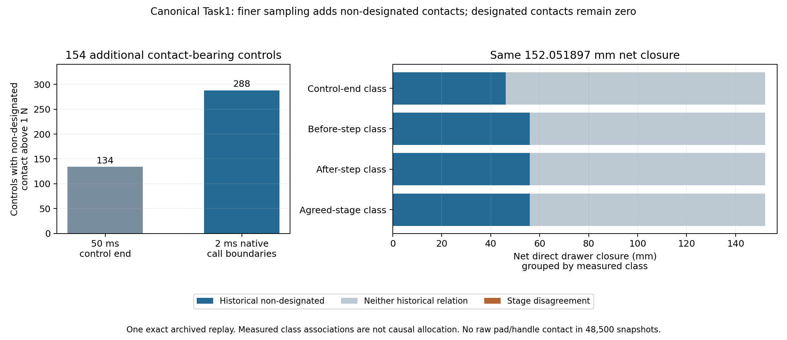

# Canonical Task1: no designated contacts in native-stage observations

Finer observation does not rescue the intended-interaction interpretation of the
canonical successful Task1 trace. Across all48,500 snapshots around24,250 actual
native integrations, there are **zero raw designated fingerpad/handle contact
rows**, including zero/subthreshold forces. Official success and152.05189674218448
mm net drawer closure reproduce exactly. The historical zero designated closure
remains supported at this finer sampling level; no continuous-time or acquired
manipulation-skill claim follows.

## One observational replay, exact recorded trajectory

The [protocol](../../research/task1_native_contact_attribution_protocol.md),
implementation and tests were frozen in `f6efbcb` before preflight or dynamics.
Independent joint_interface protocol/source/test review passed before execution;
the receipt is retained in preflight01. Sixteen focused tests passed, including
historical selector nuance, strict thresholds, stage disagreement, wrist sensor
types/indexing/frame metadata, streaming integrity and hard-stop replay gates.
Preflight01 and the sole run01 completed without a failure or retry.

Only `local-objective-task-adapter-episode-01` was replayed. Its122 trajectory
artifacts contain121 eight-control primitives and one final two-control primitive,
970 controls total. All source artifact hashes, command arrays and primitive
state chains were checked before dynamics. The other two archived repeats were
not replayed. No Laya/model call, policy, preview, candidate selection, native
token regeneration, recovery or controller/validator change occurred.

The established observational replay path used a fresh top_drawer init0/seed1
world with the original ten settling controls, then direct archived commands with
native returned-observation assignment, render=False and GPU6 environment. Every
available initial, before/after control and primitive-boundary flattened state
matched exactly. All primitive-boundary drawer qpos and official-success values
also matched. Success remained true at the original final boundary; no extra hold
or motion was added. The archive lacks full intermediate controller/observation
caches, so this establishes recorded trajectory equality, not universal hidden
cache identity.

Native stepping remained Euler,2 ms,25 integrations per50 ms control. Per-primitive
observer contexts buffered at most200 integrations and streamed sealed records.
There were24,250 original `mj_step` calls,48,500 pre/post snapshots and48,500
existing forwards (environment plus controller). No split steps, added forwards,
state restores, scratch dynamics or cache refreshes were inserted. Native
integration-state fingerprints verified that each snapshot and wrist read was
nonmutating. Drawer qpos address37 and velocity/force DoF address33 were distinct.

## Historical semantic definitions were preserved

The original policy predates the later designated-interaction measurements.
The earlier semantic audit used Jev TaskSpec `d67cb50`, SHA-256
`fb5cd2c73b27ff6ab244667a215dc0a16528eb9a52e25f72e846910dd2d14497`.
This replay used the current `11d4504` TaskSpec, SHA-256
`006395162b0ccafb5a8a632d56d6fdedf26590c788fb5ac095766c54f09dfe50`.
Preflight compared every original measurement and the designated, bilateral and
non-designated expressions exactly; later changes add effector/axis/evaluation
measurements and do not alter those contact definitions.

The native rule is **normal force strictly greater than1 N**. Designated means
either fingerpad against handle g18/g19/g20. Historical non-designated means
arm/drawer OR gripper/g11–g16 OR (gripper/handle AND no pad/handle). In particular,
simultaneous pad and finger-body contact on a handle alone is not historical
non-designated. The broader pairwise complement, robot/other-scene and robot self
contacts were counted separately. All raw contacts and six-component native
contact-frame forces, including unforced/subthreshold rows, were retained.

## Native-stage and original control-end results

There are no designated or bilateral relations in either native stage, no
simultaneous historical relations, and no raw pad/handle row at all. Each native
stage contains3,436 raw robot/drawer contact rows,3,038 above1 N. The above-threshold
rows are all non-designated: hand/g11(1,403), link7/g11(1,602), link7/g12(11), and
link7/g18(22), counted separately in each stage. Link7 contacting a handle is not
a designated fingerpad interaction. There are361 robot/other-scene rows above1 N
per stage and zero robot-self rows above1 N.

Before/after stages can describe the same integration/contact with different
solved forces, so their sample counts are never pooled as independent impacts.
The first thresholded drawer contact is primitive8/control4/substep8, interval
3.916–3.918 s. The last occurs in the original final control. Maximum observed
normal force is416.238478 N in the before buffer and415.376969 N in the after
buffer. These are native contact-buffer measurements, not calibrated hardware
force readings or newly recomputed endpoint geometry.

Finer >1 N robot/drawer contacts occur within288/970 controls, compared with134
control endpoints:154 controls contain contacts missed at their endpoints. These
newly visible contacts are non-designated. The historical control-end table
reproduces to floating-point summation precision:134 non-designated controls,
46.086120 mm net change;836 neither-relation controls,105.965776 mm net change;
designated0 mm.

Every actual integration interval contributes its direct drawer-joint change
exactly once to each separately reported partition. Positive change is closure.
These tables describe measured association, not exact causal allocation.

| Classification representation | Class | Intervals or controls | Positive change (mm) | Negative change (mm) | Net change (mm) |
|---|---|---:|---:|---:|---:|
| Before native step | Historical non-designated | 3,038 | 59.464904 | -3.511411 | 55.953493 |
| Before native step | Neither historical relation | 21,212 | 98.588642 | -2.490238 | 96.098404 |
| After native step | Historical non-designated | 3,038 | 59.483889 | -3.507000 | 55.976888 |
| After native step | Neither historical relation | 21,212 | 98.569657 | -2.494649 | 96.075008 |
| Both stages agree | Historical non-designated | 3,035 | 59.460246 | -3.506979 | 55.953266 |
| Both stages agree | Neither historical relation | 21,209 | 98.564999 | -2.490217 | 96.074782 |
| Stages disagree | Ambiguous stage difference | 6 | 0.028301 | -0.004452 | 0.023849 |
| Original control end | Historical non-designated | 134 | 49.314652 | -3.228532 | 46.086120 |
| Original control end | Neither historical relation | 836 | 108.445044 | -2.479268 | 105.965776 |

All designated-only and simultaneous rows are zero. Before and after have equal
non-designated counts but six different interval classifications; their net sums
differ by0.023395 mm. The conservative interval table preserves these six as
ambiguous. Each complete partition sums to152.05189674218448 mm net within
floating-point tolerance. Neither-relation intervals may contain subthreshold,
other-scene or inertial/constraint dynamics; the class does not mean no causal
effect of preceding contact.

## Passive wrist buffers and audits

Every native snapshot also retains the existing wrist buffers, excluded from
contact classification: `gripper0_force_ee` (sensor0,address0,type4,three N values)
and `gripper0_torque_ee` (sensor1,address3,type5,three Nm values). Both use local
site6 `gripper0_ft_frame` on body12 `gripper0_right_gripper`, with zero static site
offset and identity site quaternion. Sensor types were validated before units
were assigned. Cached site world pose, native buffer read time and unknown actual
sample time remain explicit. There was no calibration, estimator, force/contact
classifier or wrench/label association analysis in this experiment.

The bounded offline audit passes all100,158 raw record hashes/chain, source and
trajectory identities, frozen code/protocol/preflight/stepping-source identities,
970 exact control chains,122 primitive outcomes,24,250 native call chains,
48,500 snapshot times/addresses/sensor dimensions, and every partition's direct
joint arithmetic. A separate raw-only timing script checks the154 missed-contact
controls and all first/last, pair and force statistics without physics calls.
The independent joint_interface streaming audit also passes all100,158 records,
exact command/trajectory reproduction, contact partitions, wrist metadata and
closure sums, and confirms zero raw designated rows in both stages. Its checker
imports no producer helpers. The additional timing script is separately derived
and is not included in that completed independent audit.
The independent checker/report are retained in `laya-information-boundary-review`,
commit `0dc276f`: `embodied_runtime/experiments/task1_substep_evidence_audit.py`,
`docs/evidence/autonomous_research/task1_substep_independent_review.md` and
`task1_substep_independent_audit.json` in the same evidence directory.

The result strengthens the bounded interpretation that this frozen official
success lacks measured intended fingerpad/handle interaction. It does not turn
the closure partition into a causal decomposition, prove absence between all
possible finer times, validate the old skill, or authorize a policy repair.
The historical evidence and tags remain unchanged. Any subsequent wrist-history
observability comparison can use these retained buffers offline, with its own
prospectively fixed sensor-only features and separate contact evaluator.

Raw root:
`/home/junhongli/projects/laya-embodied-runtime/runs/autonomous-research/`;
`task1-native-contact-preflight-01` (with review receipt),
`task1-native-contact-run-01` and sibling logs. Run01 retains1,255.7 MiB of raw
episodes, audited `summary.json`, `derive_contact_timing.py`, `contact_timing.json`
and the standalone figure. The tracked [summary](task1_native_contact_attribution_summary.json)
preserves every partition, per-primitive totals, timing, sensor metadata and hashes.

| Identity | SHA-256 |
|---|---|
| Canonical source episodes | `9b77651de9474ecb8cdf24d67ea54a71bfc8d19be33a4e3c1d5ee70c514cc3f2` |
| Canonical source manifest | `a19ddc51c95e094be6d4dbac3fbb1271902de30ede8f630d432c8e40f9ec4b2a` |
| Canonical reference evidence | `063ad9585ca4bd5c9c5e7dbedff39efe522d51261a5a5e2e8246a94653cba008` |
| Native-contact replay episodes | `e8e253cefe4c694c6091e1bf944a8f269cfc47c7ed08c053419d97e1a73615d4` |
