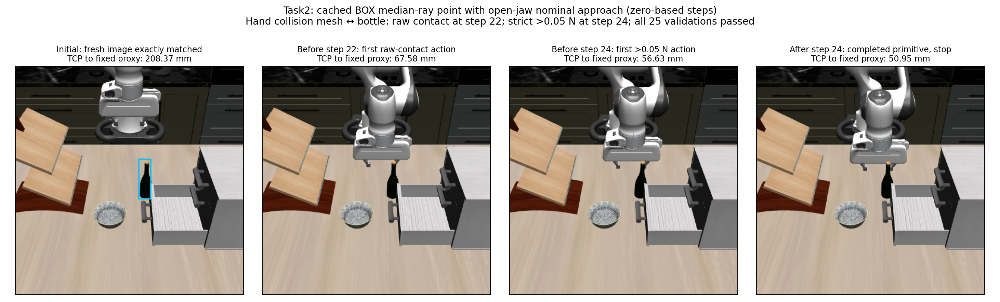

# Task2 cached BOX point: open-hand approach boundary

The unchanged nominal point rule approached the fixed sensor proxy from **208.37 mm to 50.95 mm**, with all **25 execution validations passing**, but encountered the bottle with the hand collision mesh. **First raw contact occurred during zero-based step 22 (`MV_FWD`, the 23rd action); the first strict `>0.05 N` threshold crossing occurred during step 24 (`MV_DOWN`, the 25th action).** The existing threshold monitor completed that entire primitive and stopped before another action. It did not prevent the earlier subthreshold contact.

All step numbers below are zero-based. The cyan rectangle marks the original BOX on the initial image only. Later images are recorded evidence, not new perception inputs. The figure uses actual captures; it does not identify the physical contact location from pixels.

## Condition and result

One fresh Task2 wine-bottle/bottom-drawer world used seed 1 / init 0 and the standard ten settling controls. Initial RGB, depth, K and T matched the original cached perception source in **dtype, shape and bytes**. There were **zero new model calls**. The frozen point remained `[-0.12371558041536501, 0.05615888976955092, 0.9855272687809821] m`: the original BOX-center ray at the fixed inner-crop median depth, retaining the provider convention and mixed support. It is not a measured bottle surface, rigid-object center, pad center or grasp pose.

The unchanged six 10 mm world translations plus STOP, `geometric_effects`, canonical rule, backend, controller and executor selected 16 DOWN, 6 FWD and 3 LEFT translations. All 25 completed actions passed their unchanged validator. The independent audit measured maximum per-action translation residual **1.279 mm** and rotation change **0.227°**, within the original limits. There were **200 native controls, 5,000 integrations, 10,000 BEFORE/AFTER stage samples and 26 RGB-D captures**. The jaws remained commanded OPEN, with terminal observed joint aperture **79.998 mm** (sum of the absolute returned finger-joint positions). No GRASP, lift, recovery or subsequent action occurred.

| Step | Selected token | TCP-to-proxy before → after | Raw robot contact in this action |
| --- | --- | --- | --- |
| 21 | MV_DOWN | 73.234 → 67.582 mm | None |
| 22 | MV_FWD | 67.582 → 62.200 mm | First hand/bottle rows, below threshold |
| 23 | MV_LEFT | 62.200 → 56.628 mm | Hand/bottle rows, below threshold |
| 24 | MV_DOWN | 56.628 → 50.951 mm | First strict >0.05 N crossing; completed then stopped |

## Raw contact and threshold are separate boundaries

The initial raw robot-contact rows and initial above-threshold robot-pair baseline were both empty. The only robot pair appearing anywhere in the recorded raw native trace was **`gripper0_hand_collision` (75) / `wine_bottle_1_g6` (134)**. This is the hand/palm collision mesh, classified `other_gripper/bottle`, not a fingerpad, finger body, self collision or unrelated obstacle.

| Boundary | First recorded native sample | Normal force |
| --- | --- | --- |
| First raw pair | Step 22, control 7, index 186, BEFORE, reported time 9.672 s | 0.017555968957 N |
| First strict >0.05 N pair | Step 24, control 0, index 3, BEFORE, reported time 10.106 s | 0.081747742603 N |

For each boundary, the immediately preceding AFTER sample has the **same reported timestamp** as the qualifying BEFORE sample. Native contact/force buffers have stage-dependent cache semantics; these timestamps do not establish continuous-time physical onset.

The hand/bottle pair contributes **249 raw contact rows per stage**: 13 at step 22, 164 at step 23 and 72 at step 24. In the final primitive it exceeds 0.05 N in **40 BEFORE and 40 AFTER samples** out of 200 each, with peak forces **0.185976166 N BEFORE** and **0.185836401 N AFTER**. Above-threshold rows occur in controls 0–6. Final AFTER at 10.5 s still retains a raw pair at **0.035534751 N**, below threshold. There are no raw pad/bottle, gripper/other-scene, arm/scene or self-contact rows, including below-threshold rows. All eight controls and 200 integrations of step 24 completed; the stored termination reason `new_robot_contact` refers to the frozen threshold rule.

## Validation, replay and limits

The producer passed **23 focused tests**; independent prospective review passed 10 wrapper tests and actual-source/schema checks before dynamics. The separate stored-evidence result audit passed after collection: journal chain, initial bytes, all rule choices, 200 reconstructed commands, validator results, all raw contacts and terminal remainder. Reviewer result receipt commit: **`409e8c2`**; prospective receipt: **`cbf132a`**.

The one fresh replay of this run's recorded controls passed under the frozen code/environment: **200 exact controls with before/after state and own observations, 10,000 exact native snapshots including integration fingerprints, and 26 byte-identical RGB/depth/K/T captures**. No policy or model ran during replay. The observer remained installed, so this verifies reproduction rather than an observer-removal intervention. The independent reviewer separately checked stored replay states/fingerprints; full contact and image equality additionally relies on reviewed replay instrumentation and recorded gates, because replay did not duplicate all contact/image artifacts. Replay completed before reporting edits.

This single trajectory shows that progress toward this mixed-support point and passing motion validators do not establish the needed jaw/object relation. It reached a hand/bottle threshold boundary while the TCP remained about 51 mm from the proxy. No contact-free STOP, grasp readiness, environmental clearance, task success, alternative-action success or general failure of other approaches is established. Oracle contact classification only recorded/evaluated the boundary and stopped after a completed primitive; it did not select an action. Inherited backend/executor privileged feature reads remain disclosed in the [frozen protocol](../../research/task2_box_point_boundary_protocol.md). Exact initial image matching does not establish later target stationarity, sensor calibration or object ownership.

## Reproducible artifacts

- [Machine-readable summary and full action-distance table](task2_box_point_boundary_summary.json).
- [Stored-only reporter](../../../embodied_runtime/experiments/task2_box_point_boundary_report.py).
- Collection freeze: **`aee75a9` → `9de837c8a1348d8eac16bbe4616b40bcf0b0613f`**.
- Raw collection: `/home/junhongli/projects/laya-embodied-runtime/runs/autonomous-research/task2-box-point-boundary-run-01`.
- Raw replay: `/home/junhongli/projects/laya-embodied-runtime/runs/autonomous-research/task2-box-point-boundary-replay-01`.
- Source perception: `task2-box-support-run-02`; original RGB-D: `interaction-observability-paired-01/close/0000.npz`, under the same raw research root. Raw collection/replay sibling logs are retained.

| Artifact | SHA-256 |
| --- | --- |
| Collection `episodes.jsonl` | `f834673a379523f8c90619d2fd00dd69174f4dd7499cb91a8340742de225e771` |
| Replay `result.json` | `5c3a02fb731d3d8c120ec6f89327762b942d36ab62716a48552ebfc348faa5f9` |
| Final no-world preflight 02 | `990fef13e93223ee2cfd670233c8343e5b8650993125b96e752037506dfac646` |
| Original RGB-D frame | `3753552576da3254ecac0e061bc75910be598550b6efd1d2415f76710aa27969` |
| Cached BOX model output | `c0545950996092c7ea05d7e10cf115ff0ed3ec318d1b08ff729300d1ee8bb944` |
| Cached sensor representation | `be102057222f2442ead64c8416709d5b2fd792b134271b49f9d8b14722507ead` |
| Cached BOX journal | `51dd621269c6da151c39e9b1bd9b0cdf15a890eb2e4af28a59caaea065201a3b` |

First raw-contact record: `8f7eca440cfab6444448a8cc96b2e09343d3673d77651ae649fc34926186322e`; preceding AFTER: `bc97ff947d2608f72991bb3b5cc528d7521daa3c7cfe846493f78af5c1bdc193`. First threshold record: `4946e3bdab28d1674a04e56702c0dab781bfe5a2f4fd0c10133d5517784a57c7`; preceding AFTER: `85e87e4589044b8cfc6551b94f5f4797924c7c01a3ed2dab5cb4042dd3caba6c`.
