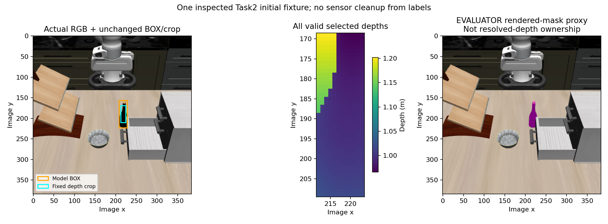

# Task2 BOX: plausible bottle point, mixed candidate depth support

One fixed LocateAnything call returned a visually plausible wine-bottle box. The
unchanged provider's median-depth point has bounded support: the center sample
and both median contributors agree with the archived bottle-label proxy. However,
the fixed interior crop visibly contains tabletop beside the narrow bottle neck.
The first representation failure is treating that whole crop as bottle-only
geometry. No pixels, prompt, point, or depth rule were corrected after this result.



The actual RGB and a nearest-neighbor enlargement of the exact fixed crop were
inspected separately from the evaluator overlay. Light tabletop enters the upper
left portion of the crop; the dark bottle neck/body occupies most of it. This is
assistant visual inspection, not a new segmentation annotation. Boundary pixels
remain ambiguous, and neither RGB inspection nor the rendered mask establishes
the surface supplying each depth value.

## Fixed condition and preserved setup failure

The [protocol](../../research/task2_initial_grasp_geometry_proposal.md) uses one
already-inspected development image, the close arm's initial capture from
`interaction-observability-paired-01/close/0000.npz`. It performs one RGB-only BOX
call, then records the unchanged provider point P and explicit candidate RGB-D
support G. There are no dynamics, new captures/renders, scene constructors,
raycasts, segmentation fallback, jaw-span inference, fitted offset, or pregrasp
target. This is not a held-out generalization test or an approach result.

The first setup attempt at `277842b` stopped before inference because the
processor's NumPy image-grid metadata was sent to a tensor-only audit serializer.
Its journal preserves `model_calls_started=0`; it has no `call_started`, generated
response, feature extraction, or mask analysis. The parent authorized a separately
numbered continuation after the minimal existing tensor-or-array serialization
fix. Actual processor-only preflight independently verified the native array
`[[28, 28]]` and 237 input tokens, with no model construction or inference.

Successful attempt 02 ran clean freeze **`ba7ab2e6d58932cef893f4d3549cd550279b2d65`**.
Nine synthetic tests passed. Independent prospective reviews are `bd3389b` and
the amended receipt `5999d47`,
`docs/evidence/autonomous_research/task2_box_support_independent_review.md` in
`/home/junhongli/projects/laya-information-boundary-review`.

The existing LocateAnything checkpoint content ID is
`4b5384cddedaa8d10e7205536ebde4893d8e20c396ad861dda2a32ed3bbcd10f`.
It was checked before loading against the prior archived identity. GPU0, BF16,
the existing native hybrid greedy settings and 256-token cap were retained.
There was exactly **one model inference across both attempts**, no inference
retry, and zero physics/render calls. Native library warnings and the existing
SDPA fallback remain in the log; no model or tokenizer setting was changed.

## Model and sensor result

Prompt: `Locate a single instance that matches the following description: the wine bottle.`

Raw output:

```text
<ref>the wine bottle</ref><box><542><408><596><582></box><|im_end|>
```

The 12 generated tokens end in EOS; the cap was not reached. Audited return
latency was 0.501 s. The full RGB, input-token and processed-pixel fingerprints,
actual output tokens and unparsed raw return are retained. Parsing a box does
not supply semantic confidence.

| Field | Fixed output |
|---|---|
| Continuous pixel box | `[208.128, 156.672, 228.864, 223.488]` |
| Provider integer box | `[208, 156, 228, 223]` |
| Fixed interior crop, half-open | `[212, 169, 224, 210]` |
| Valid selected pixels | 492/492 |
| Median depth | 1.001205564 m |
| Depth min / max | 0.965799034 / 1.201672196 m |
| Depth MAD / standard deviation | 0.010881424 / 0.066850699 m |
| Point P, world coordinates | `[-0.123715580, 0.056158890, 0.985527269] m` |
| Center sample pixel | `[218, 189]` |
| Center sample depth minus median | −7.359087 mm |

The center ray is `[218, 189.5]` under the original provider convention. P remains
that ray at the crop median depth; it is not silently replaced by a measured
center-pixel depth or by a surface centroid. G preserves each selected pixel's
RGB, depth and backprojected surface point with the separately declared raster
center convention `(u+0.5,v+0.5)`. Spatially different median contributors are
not assumed to be the center ray's surface.

The lower/upper median ranks each have one contributor: `[222,198]` at
1.001150012 m and `[214,193]` at 1.001261115 m. Their dark RGB values are retained
in the [summary](task2_box_support_summary.json). Both contributor sets are exact,
with all equal-value ties preserved by the frozen rule.

## Limited rendered-mask comparison

All sensor outputs were sealed before loading the already archived ID-rendered
bottle mask. The mask is a membership proxy, not resolved-depth ownership.
MSAA, mixed raster coverage, render/depth staging and unknown cache sample times
remain material limitations, including for apparently interior pixels. The
synthetic camera/depth calibration is shared, not independently validated.

| Registered proxy comparison | Result |
|---|---:|
| Selected pixels agreeing with bottle proxy | 414/492 (84.146%) |
| Visible proxy pixels covered by crop | 414/777 (53.282%) |
| Selected pixels in one-pixel-eroded proxy interior | 373 |
| Selected pixels in fixed one-pixel boundary band | 65 |
| Selected pixels outside one-pixel-dilated proxy | 54 |
| Box-center sample proxy agreement | True |
| Lower median contributor proxy agreement | 1/1 |
| Upper median contributor proxy agreement | 1/1 |

These are overlap and agreement counts, not semantic-purity estimates or
confidence scores. The erosion/dilation only stratifies the evaluator proxy;
it never cleans the sensor input. Exact depth ownership remains `null`. The
visible tabletop and substantial exterior-proxy component give a concrete
reason not to treat the entire ROI cloud as bottle geometry. Median robustness
does not establish that P is a calibrated rigid grasp point.

The bounded conclusion is a plausible semantic target and point, alongside an
explicit failure of bottle-only support for the richer ROI representation.
Neither representation qualifies an approach. A separately frozen physical test
could use this exact P with live own-proprioception and the existing deterministic
seven-option approach, preserving the possibility of failure. It must not infer
a grasp offset from the successful scripted preclose context or repair the point
using evaluator labels.

## Seals and audit

Raw attempts, logs and processor preflight remain under
`/home/junhongli/projects/laya-embodied-runtime/runs/autonomous-research/` as
`task2-box-support-run-01`, `task2-box-support-run-02` and
`task2-box-support-processor-preflight-01.json`. The successful journal order is
`run_start → manifest_update → rgb_input_sealed → manifest_update → call_started
→ generation_return_sealed → model_output_sealed → sensor_outputs_sealed → termination`.
The separate evaluation-start receipt records the completed sensor/journal hashes
before opening the mask.

| Artifact | SHA-256 |
|---|---|
| Initial RGB-D source | `3753552576da3254ecac0e061bc75910be598550b6efd1d2415f76710aa27969` |
| Attempt 01 journal, zero model calls | `beca3ce339b2764f6c05f6f38ae6db5d6bab42362f2e2ffa3d7d1be5b799db3d` |
| Attempt 02 journal | `51dd621269c6da151c39e9b1bd9b0cdf15a890eb2e4af28a59caaea065201a3b` |
| Raw generation return | `e07af5170746b3d8bb2ba4353c8dda1a13e6309e9e9f48395257de63441cc9ae` |
| Audited model output | `c0545950996092c7ea05d7e10cf115ff0ed3ec318d1b08ff729300d1ee8bb944` |
| Sealed sensor representation | `be102057222f2442ead64c8416709d5b2fd792b134271b49f9d8b14722507ead` |
| Archived rendered-mask proxy | `2a474be6d469dc2df45edfb03c97b23a1adf021f9a48551994a619f501a0b747` |
| Proxy analysis | `c1d84224030e94dda9e5ec58525dce598128b8278cdfeab82b881676c4c9f599` |
| Figure | `6fc3b27f1ac71917ecc46569e5257ce1b3ae6bc90c307d6aff9d67d33eff0bd3` |
| Portable summary | `722e84d81c889056c611ca10bce9f220ac7c4a2b5146aea1b3c42493c8007f98` |

The producer's stored-sensor audit passes. The independent stored-only review
also passes the complete journal/seals, one-call token evidence, all 492
RGB/depth contributors, crop/depth summaries, median sets, proxy labels and
independently computed 3 × 3 strata. It does not rerun projection or inference;
provider-coordinate parity rests on the independently reviewed unchanged source
and prior focused test. The durable result receipt is **`7bb92f4`**, containing
`embodied_runtime/experiments/task2_box_evidence_audit.py`,
`docs/evidence/autonomous_research/task2_box_independent_audit.json`, and the
expanded `task2_box_support_independent_review.md` in the reviewer worktree.
Supplemental visual inspection is separate from its arithmetic audit.
