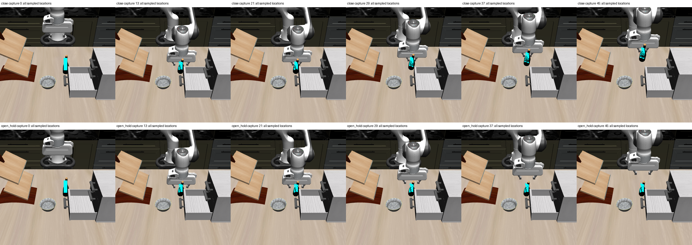
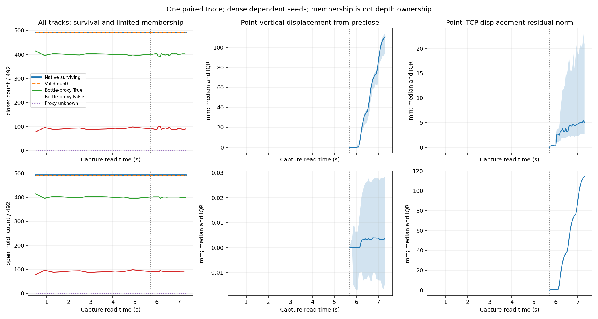
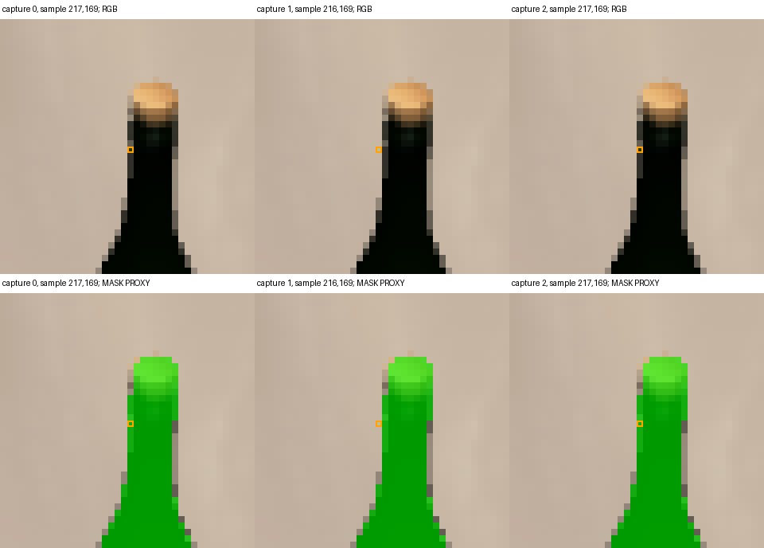

# Initial BOX tracks: co-motion survives, depth association has a boundary

The sealed initial BOX initializes a dense population whose median distinguishes
the close/lift and open-jaw lift traces without assistant-selected landmarks.
All 492 tracks in each arm remain native-successful with valid depth at all 46
captures. This perfect survival does not certify semantic or depth support:
78 seeds start outside the bottle-mask proxy, and the first observed proxy
departure occurs during the first approach step in both arms.

That earliest departure is specifically a **subpixel-to-depth association
boundary**, not demonstrated loss of the whole LK patch's identity. The unchanged
floor rule changes the sampled depth pixel when a nearly stationary coordinate
moves just below an integer. No rounding, track, depth or summary was repaired.
This earns a descriptive motion cue with explicit support uncertainty, not a
holding classifier, calibrated confidence or validated object pose.

## Complete population and measured contrast

The [frozen protocol](../../research/task2_initial_box_temporal_probe_proposal.md)
uses every one of the 492 original valid inner-crop pixel indices, one unchanged
single-seed LK trajectory per arm. The 14 reset/approach captures are 0.4 s
apart, followed by 32 close/hold/lift captures at 0.05 s. No new model, capture,
physics, renderer, FK, reseeding, ROI correction or setting change was used.
The initial source image and outcomes were already known development data.

All 984 trajectories / 45,264 rows are retained and sealed before mask
evaluation. Every per-frame denominator is 492; the preclose cohort is also
492 because none failed before capture 13. There is **no native failure event**:
its first-failure field is null, not an omitted example. Depth-unknown counts
are zero for this run, although their schema and failure semantics were tested.

| Recorded quantity | Close/lift | Open hold/lift |
|---|---:|---:|
| Native survivors and valid depth, every capture | 492/492 | 492/492 |
| Initial proxy True / False | 414 / 78 | 414 / 78 |
| First approach capture proxy True / False | 396 / 96 | 396 / 96 |
| Preclose proxy True / False | 401 / 91 | 401 / 91 |
| Final proxy True / False | 402 / 90 | 399 / 93 |
| Seeds with any observed True→False departure | 34 | 32 |
| Preclose→final median point vertical displacement | 110.376 mm | 0.003887 mm |
| Its interquartile range | 94.518–113.648 mm | −0.013944–0.028541 mm |
| Median 3-D point–TCP displacement residual | 5.036 mm | 114.329 mm |
| Its interquartile range | 2.747–20.838 mm | 114.301–114.356 mm |

These motion summaries include the entire registered population without mask
filtering. Proxy counts are agreement with archived rendered labels, not exact
depth ownership or semantic-purity estimates. An initially outside pixel is
not called a departure: departure requires an earlier observed proxy True.

The original RGB sheet and all-sample overlays were inspected separately.
The bottle visibly rises with the close-arm gripper and stays on the tabletop
in the open arm. All sampled locations are drawn at captures 0, 13, 21, 29,
37 and 45; no successful track was selected for this comparison.

The curves retain every capture and the fixed 492 denominator. Shading is the
25th–75th percentile, not confidence. Motion-panel vertical scales differ by
arm; their units and the exact table values above govern comparison.

## First association departure, separately from native failure

Both arms have the same earliest departure: seed 5, initialized at `(217,169)`,
capture 1 at read time 0.9 s. The LK coordinate is
`(216.99996948242188,169.00015258789062)` with forward/backward residual
**0.0001220703125 px**. Native status remains successful. The historical floor
rule samples `(216,169)` rather than `(217,169)`.

| Capture | Sample pixel | Depth | Proxy membership |
|---|---|---:|---|
| 0 | `(217,169)` | 0.975021720 m | True |
| 1 | `(216,169)` | 1.201672196 m | False |
| 2 | `(217,169)` | 0.975021720 m | True |

At capture 2, LK X is just above 217 and the original pixel is sampled again.
The enlarged raw RGB shows the one-pixel choice at the left neck boundary;
the separate green overlay shows the limited membership proxy. Both arms'
first-departure figures are byte-identical because this is their common prefix.

This establishes an unstable sampled-depth association under negligible LK
motion, without establishing large optical-flow drift or whole-patch identity
loss. The earlier assistant-selected cap's open-arm failure at step 14/control
5 remains separate adverse evidence; a new dense median does not erase it.
The former cap and this population differ in seed location, count, time and
tracking horizon, so this is not an isolated initializer ablation.

## Integrity and limits

Clean sensor freeze **`9a34f29`** passed five focused tests and independent
prospective review **`ee05831`**; that reviewer ran 12 focused/helper tests.
The actual source preflight did no LK or projection. Exactly one registered
batch ran, with no retries. The sensor seal preceded the separate evaluator;
reporting only reads stored rows and masks, without rerunning tracking.
The independent stored-result audit **`b06377f`** verifies all 45,264 rows,
saved-TCP/depth/delta arithmetic, summaries, proxy membership and departures
without rerunning LK. It distinguishes fidelity to the frozen floor rule from
the newly exposed coordinate-association concern.

Neighboring seeds share overlapping LK windows and dependent surface errors.
They are one paired trajectory, not 984 independent trials. Unchanged native
survival cannot resolve boundary sampling, object identity, occlusion, support,
slip or retained load. Initial/preclose membership and unknown exact cached
sample times remain material. No transfer to a smaller lift or an unseen scene
was tested. A coordinate-association check would require a separate reviewed
condition; the present artifacts remain unchanged.

Raw directory: `/home/junhongli/projects/laya-embodied-runtime/runs/autonomous-research/task2-box-temporal-run-01`.
Its `report/` retains original RGB, both departure sheets, complete curves,
first-native-failure nulls and figure hashes. The [portable summary](task2_box_temporal_summary.json)
contains all 46 sensor/proxy summary rows per arm and exact first-departure rows.

| Artifact | SHA-256 |
|---|---|
| Run journal | `0e7bd76d3f6b11244729bc767ec1b1f9a2625aa6069e494adf9743ea5900cf05` |
| Sensor seal | `bae9793115ededab12b6b5bca242af9cdb0c2ed8c1e8d62219af3bbce65cc30b` |
| Sensor summary | `4b46a6bddaa87b545de1f6d5f31e1aa6f77836e9b904fe5e71877cd47d6ce933` |
| Post-seal proxy membership | `be859c241cfae6e2da5446a0a9429c89b50e70b1d57eeea1de1f26298eba4ea2` |
| Portable summary | `7aebe2bea0d28d8418bf25a79919cb7203353c3ba0729972db4013776cf55a33` |
