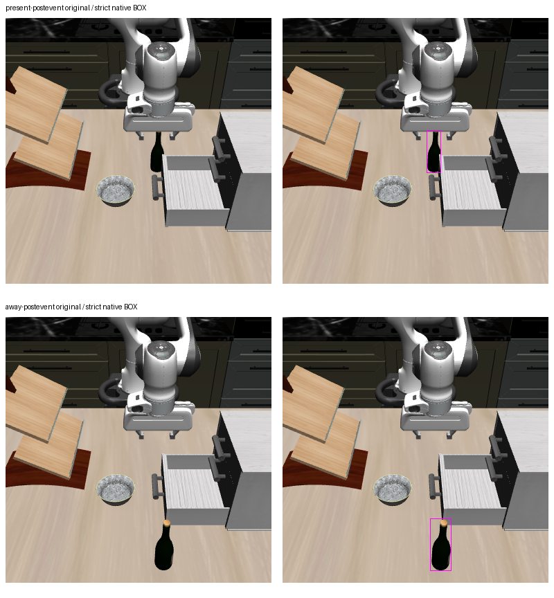

# Two current native BOX inputs for support refresh

Both fixed post-event full RGBs produced one strict-admitted whole-bottle BOX,
with 12 generated tokens and terminal EOS. The independent
[stored-output audit](task2_closed_empty_current_box_independent_audit.json)
passes exact 237-token inputs, processor metadata/visual tensors, settings,
raw output tokens, strict admission, cold processes, journals and exit receipt.

| Full RGB | Native normalized BOX | Continuous pixel BOX | Integer full support bounds |
| --- | --- | --- | --- |
| present-postevent | `[542,422,594,582]` | `[208.128,162.048,228.096,223.488]` | `[208,162,228,223)` |
| away-postevent | `[556,760,635,955]` | `[213.504,291.840,243.840,366.720]` | `[213,291,243,366)` |

```text
present: <ref>the wine bottle</ref><box><542><422><594><582></box><|im_end|>
away:    <ref>the wine bottle</ref><box><556><760><635><955></box><|im_end|>
```



This is the unchanged root-inspected sheet from
`task2-current-box-root-inspection-01/full-rgb.png`; both original left panels
were byte-compared with the sealed 384×384 RGB inputs. Root's separate visual
finding is that both regions enclose the visible bottle with background slivers;
the present box's upper boundary is near the gripper. A BOX is a semantic region,
not segmentation or proof that its depth samples belong only to the bottle.

The sole question was the historical native object-level template:
`Locate a single instance that matches the following description: the wine bottle.`
The two new calls used original BOX **hybrid** mode, distinct from the separately
admitted **slow POINT** goals. They retained the same checkpoint/environment,
BF16/eval, 256-token cap and greedy settings; both cold processes used GPU2 and
seed1. The historical initial BOX used GPU0 and did not record seed1, so this is
not a bitwise repeat of that historical call. Model inputs contained only full
RGB and the fixed question. The original hybrid POINT failures remain unchanged.

This stage establishes two admitted current image regions. It read no depth,
extracted no support, created no BOX-median goal and executed no action. The
[protocol](../../research/task2_closed_empty_current_box_protocol.md) defines the
separate downstream contrast: hold current slow POINT and own state fixed while
replacing the historical support cloud with current full-rectangle observed
depth. That comparison and its geometric limits belong to the support report;
these BOX outputs alone establish neither a decision improvement nor safety,
contact, grasp quality or holding.

Freeze `428d78e7a9bd473ffac95d480d165c0f7288a905`; 89 focused tests and Ruff passed.
CPU preflight made zero model constructions/calls. The root-reviewed batch
completed with exactly two cold calls, exit0, no retries and zero physics/render
calls. Raw batch:
`/home/junhongli/projects/laya-embodied-runtime/runs/autonomous-research/task2-closed-empty-current-box-run-01`.

| Artifact | SHA-256 |
| --- | --- |
| CPU preflight01 | `7671ec4ce265d0d41898d91de15a3ca520bb5c6c1e6265d581c7eb22c4b20dac` |
| Prospective review/release | `cbad04d2b5fb136773f5457053b88d5e7c6cc75595a33e8cd8d33c06de7ed95b` |
| Batch journal | `b8bff413de03d13dcc042a52c4c20315573508bcc029c6a92472cd150cc483c4` |
| Exit receipt | `cf5cfd12af633c3c0692c12436c8818b7a292379f9e30d8b87cb0cfb15a0b86f` |
| Independent audit | `5494709f2e60c1160cc6642a46800f20eac702cb7508f857487bda4d94a25264` |
| Reused RGB inspection sheet | `f1dab347363b28ec141d3e4a901bc2e948fd2a1565492854df58f89f0fe7f78d` |
