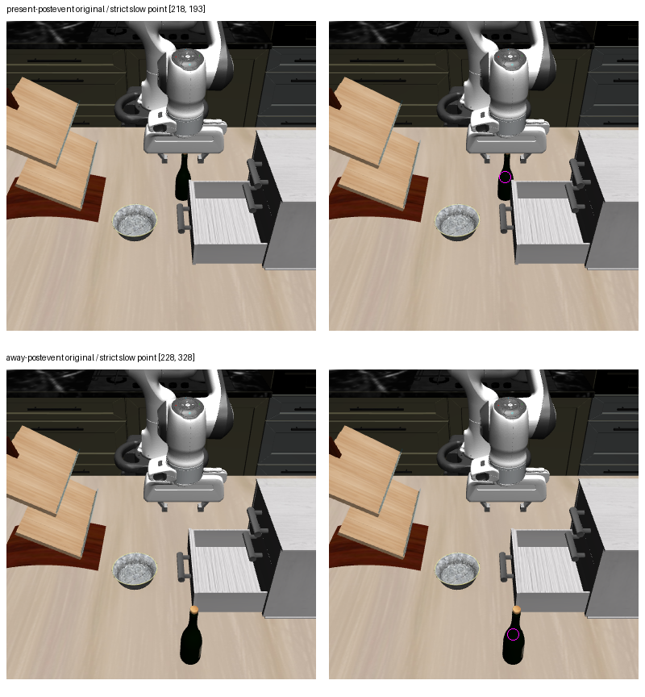

# Task2 two-image slow POINT development control

Changing only native `generation_mode` from `hybrid` to `slow` produced a
strict-admitted whole-return point on both selected post-event images. Present
is unchanged. Away changes from malformed nonadmission to one complete point.
Both slow returns end in EOS after 10 tokens, below the unchanged 256-token cap.
The independent [saved-output audit](task2_closed_empty_slow_point_independent_audit.json)
passes all settings, inputs, loaded configurations, journals, raw returns,
tokens, parser results and archived baseline bindings.

| Fixed full RGB | Archived hybrid whole return | New slow whole return | Slow pixel `[x,y]` |
| --- | --- | --- | --- |
| present-postevent | Admitted single point, 10 tokens/EOS | Same admitted point, 10 tokens/EOS | `[218,193]` |
| away-postevent | Malformed; point plus two boxes, 22 tokens/EOS; point remains null | Admitted single point, 10 tokens/EOS | `[228,328]` |

The new raw responses are:

```text
present: <ref>the wine bottle</ref><box><568><503></box><|im_end|>
away:    <ref>the wine bottle</ref><box><594><856></box><|im_end|>
```

The away coordinate matches the numerical point prefix of the archived hybrid
response. Its admission comes from the new complete slow response. The original
hybrid return remains malformed, including its degenerate third box; no prefix
or individual candidate was salvaged.



Left panels are the original uncropped 384×384 RGB; right panels overlay only
the admitted points. This is the exact sheet inspected by root, copied from
`task2-closed-empty-slow-point-root-inspection-01/full-rgb.png`; the original
left-panel pixels were checked byte-for-byte against both sealed RGB inputs.
Root's separate visual finding is that both points lie on the visible upper
bottle body, and the away bottle is visibly moved. This image inspection does
not establish material correspondence, depth ownership, holding or grasp quality.

This is a two-image development control selected after the sealed hybrid
failures, using the archived hybrid outcomes without contemporaneous repeats.
The sole question remains `Point to: the wine bottle.` Full RGB, processor text,
229 input token IDs, attention masks, image grids, BF16 pixel values, checkpoint,
GPU2, seed1, loaded configuration, parser and remaining generation settings are
unchanged. The [protocol](../../research/task2_closed_empty_slow_point_protocol.md)
freezes one cold process per case, raw/token sealing before analysis and no
retries. There were exactly two model calls, zero physics/render/evaluator calls
and exit0. No prelift model calls were repeated. The original physical matrix
remains `interrupted_incomplete`; its separately qualified observational source
and second away verification retain their original provenance.

This establishes sensitivity to the whole decoding procedure on the selected
away image. It does not establish general slow-mode superiority, a proven MTP
bug, an actual hybrid fallback path or a syntax-only mechanism: per-step hybrid
traces were not recorded. A comparison to the historical cached whole POINT
changes observation and decoding mode together, so it is not a pure freshness
contrast. A valid fresh semantic point also does not refresh the old BOX support
used by downstream geometric checks.

Implementation freeze: `e4ce123f391969f542dbb8985cf3282a181103eb`; 56 focused tests
and Ruff passed. CPU preflight made zero model constructions/calls, and the
independent exact review reproduced both inputs with model construction blocked.
Raw batch: `/home/junhongli/projects/laya-embodied-runtime/runs/autonomous-research/task2-closed-empty-slow-point-run-01`.

| Artifact | SHA-256 |
| --- | --- |
| CPU preflight01 | `35ff93678d77b147bf1f5e0f4767de9ea2e62d915e2f2db3526eeeece2ce1903` |
| Prospective review | `8ae31671ab20adf91cc29413e2a0fc078f1307ce4f4d86f3197e30cee1165757` |
| Batch journal | `f89ad281cc4e7ac168047c31d33a1c1b54db84700a1f7ad1091833b061422316` |
| Exit receipt | `685db30481a548fe1c08a494c58172a1c7cd959915ec3eafcab2d96d599e8c89` |
| Independent audit | `e034ead7baad4f3dd24bb992aa556897563e08d5fb9cae034fd93485d575c251` |
| Reused RGB inspection sheet | `a41c1d8ad7a407ffb8c758c21f4c2c5f72b0157c1dcf7eaa9e6d796fa8d038ab` |
