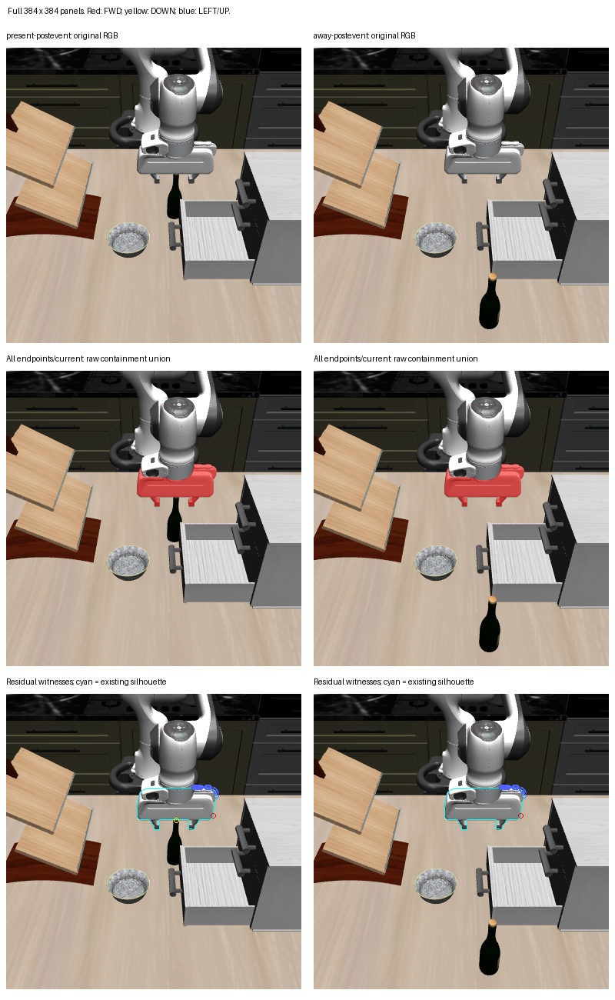

# Current depth changes the guard, but visible robot edges still determine choices

The raw full-frame depth representation vetoes all six translations and selects
STOP in both postevent scenes. The existing partial gripper silhouette exclusion
changes the away choice to DOWN and leaves the present choice at STOP. Its sole
FWD witness in both images is at the apparent right hand-housing edge. This
establishes sensitivity to the current depth representation, without establishing
environmental ownership, clearance or a useful route to the target.

This was one stored-only calculation from code `5131099`, with the two current
slow POINT goals, exact returned own state and already placed five-proxy geometry
held fixed. The goal is the current wine-bottle POINT in both representations;
the stale guard is a previously computed reference. No model, world, dynamics,
rendering, FK or physical action was performed.

| Frame | Unguarded | Original stale BOX guard | All current depth | Outside existing partial silhouette |
| --- | --- | --- | --- | --- |
| Present postevent | DOWN | FWD | STOP | STOP |
| Away postevent | FWD | FWD | STOP | DOWN |

Both full-depth clouds contain 147,456 valid samples. Both partial masks remove
4,402 pixels, leaving 143,054; no depth thresholds, margins or mask methods were
changed. Both raw clouds contain 3,070 points inside the current own proxy union.
STOP is the unchanged current solid and remains available as termination.

| Nominal endpoint | Raw present | Raw away | Outside silhouette present | Outside silhouette away |
| --- | ---: | ---: | ---: | ---: |
| FWD | 3,057 | 3,057 | 1 | 1 |
| BACK | 461 | 461 | 0 | 0 |
| LEFT | 2,764 | 2,764 | 6 | 6 |
| RIGHT | 2,681 | 2,681 | 0 | 0 |
| UP | 2,368 | 2,368 | 19 | 19 |
| DOWN | 2,555 | 2,554 | 1 | 0 |
| STOP/current | 3,070 | 3,070 | 0 | 0 |

These are distinct pixel counts for the union of five separate solids, not
independent observations. Complete per-proxy membership, all witness pixels,
raw depth/world points and every candidate score remain in the sealed arrays
and JSON. All residual containment occurs in the hand proxy. The raw and
partial-support choices use the unchanged strict nominal distance improvement
rule, including its tuple tie-break. Present has only FWD and DOWN as improving
translations, and both retain a residual witness. Away improves most with FWD,
but its single residual witness excludes that move; DOWN remains an improving
unexcluded alternative. No candidate was executed.

The top row preserves each complete 384 by 384 RGB image. The middle row overlays
the union of all current/endpoint containment pixels; they lie predominantly on
the visible hand and fingers. The bottom row shows the existing silhouette
outline in cyan and every residual witness: FWD red, DOWN yellow, LEFT/UP blue.
The actual residual FWD pixel `[269,158]` is the same apparent housing-edge pixel
in both scenes. LEFT/UP witnesses follow the upper and right housing boundary.
The sole present DOWN witness `[221,164]` is at the visible bottle-top/gripper
boundary and disappears after relocation. These are RGB interpretations; exact
pixel ownership is unknown. Neither the silhouette nor these observations
constitute a robot/environment classifier.

Root independently inspected this exact six-panel sheet at original resolution
and confirmed the broad visible hand/gripper overlap, residual housing-edge
locations and present-only bottle-top/gripper-boundary witness. Root's
interpretation also preserves unknown exact depth ownership and collision
causality.

The partial silhouette removes pixels irrespective of depth, so it can remove
external foreground. Rendered robot surfaces can also extend beyond collision
proxy silhouettes. The surviving FWD veto therefore remains a concrete
counterexample to treating this residual cloud as verified environmental
support. Current depth provides current observed surfaces, but this result does
not supply a drop-in scene-safety guard or a physical goal-refresh benefit. The
independent semantic BOX comparison can test a different support representation
without changing this result.

Raw output is
`/home/junhongli/projects/laya-embodied-runtime/runs/autonomous-research/task2-current-depth-diagnostic-01`.
It was initially written within the reviewer worktree and moved intact to this
canonical location at root's request. All sealed file hashes remained equal.

- Input four-record result SHA-256: `126a8f18bfd9f9b8ef716c2977e1c7df7cafea8af03748f428250ad3b4a25901`.
- Request: `23559a90620495bc8e13cff539b9b936876288690b9e078cfcbb576b0dc6baf9`.
- Features: `03ccb1da3f9c21718cc4f28ba04b77516c41564b5f45d7fb9ba332a37404b832`.
- Numerical seal: `9da7c9abd2dad1f5d5f20415b0ae8ffb93bc6cd63df07ecfbb65f37b3650c3ce`.
- Figure: `816e8b896aad6ceb4cb65af0ff24e9ce623c23eea075bbea1e480c170d2e07fd`.

Verification: ten synthetic containment cases matched the existing full
distance helper, both saved unguarded/stale choices reproduced exactly, all
reported membership counts and every witness index matched the sealed arrays,
and Ruff passed. Geometry was computed once. The original physical matrix
remains interrupted/incomplete with composite observational qualification;
read time is 12.10000000000071 s and exact image/depth/own sample times remain
unknown. No current support, ownership or safety claim is supplied by the
earlier replay qualification.
