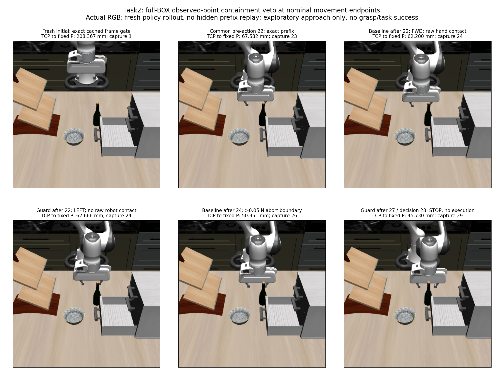

# Task2 endpoint-containment veto: contact-free recorded approach, point-rule stall

The fresh guarded episode completed **28 movements with all validators passing and zero raw robot-contact rows**, then selected terminal STOP at decision 28. TCP distance to the unchanged P fell **208.367 →45.730 mm**. The unguarded baseline completed 25 movements and stopped at its hand/bottle force-threshold boundary,50.951 mm from P. This is one exploratory partial-observation guard comparison; it does not establish clearance, grasp readiness or task success.

All steps are zero-based. Images are actual captures, selected by exact execution/decision boundary timestamps and checked one-based capture sequences. The common pre-action 22 frame is capture 23; both after 22 frames are capture 24. Baseline terminal is capture 26 at 10.500000000000176 s; guarded terminal is capture 29 at 11.700000000000577 s. Decision 28 STOP uses that last frame and executes no hold. Images do not determine contact; native stage records supply those labels.

## Narrow intervention and actual divergence

Fresh normal Task2 seed 1/init 0 plus ten settling controls exactly reproduced the original cached RGB/depth/K/T arrays before action. No archived state restoration, hidden prefix replay, model call, support update, target shift or mask cleanup occurred. P remained the original BOX-center ray at the fixed inner-crop median depth. All 1,340 full-BOX observed points and all five separate own gripper proxies were used; live returned grip-site position, eef-body quaternion with audited body-to-site mount, and signed jaw positions placed the proxies. Exact observation sample time is unknown.

Only movements whose nominal 10 mm endpoint contained an observed point under the original halfspace helper convention were excluded. No sweep or physical margin was added. All seven candidates, scores, exclusions and witnesses remain in raw evidence; the unchanged point-distance rule chose from the eligible subset with its original strict-improvement and tie semantics. STOP remained an admitted terminal option even if its zero-displacement geometry diagnostic had contained a point.

The first changed decision was **pre-action 22, FWD→LEFT**, matching the prospective prediction. FWD alone was excluded at that boundary by full-support index 53, pixel(221,158), in the hand proxy. The first 22 actual actions exactly match the historical baseline in **176 controls before/after states and own packets,8,800 native snapshots,23 byte-identical captures, executor results and endpoints**. The original full canonical inputs also match through decision 22. This confirms an actually shared prefix generated by the fresh policy, without replaying it during collection.

| Step | Guard selection | Movement exclusions | TCP→P before→after mm | Nominal / actual reduction mm |
| --- | --- | --- | --- | --- |
| 22 | LEFT | FWD | 67.582234→62.666199 | 5.233267 /4.916036 |
| 23 | DOWN | FWD | 62.666199→57.599637 | 5.217799 /5.066562 |
| 24 | LEFT | FWD | 57.599637→53.513741 | 4.397066 /4.085895 |
| 25 | DOWN | FWD | 53.513741→49.397987 | 4.239818 /4.115755 |
| 26 | LEFT | FWD,DOWN | 49.397987→46.614695 | 3.085785 /2.783291 |
| 27 | LEFT | FWD,DOWN | 46.614695→45.729795 | 1.136699 /0.884901 |
| 28 | STOP; no execution | FWD,DOWN | 45.729795→45.729795 | 0 /0 |

The complete sequence contains 17 DOWN, 5 FWD and 6 LEFT actions. After divergence, the same-state unguarded rule would still select FWD at every recorded decision; those counterfactual choices were not executed in this episode.

## Terminal boundary

STOP was selected because none of the eligible translations strictly improved nominal TCP→P distance. It was not an all-movement veto or a force-monitor stop. At the terminal orientation/jaws, FWD and DOWN were excluded by 7 and 1 observed points respectively, all in the hand proxy; the other four movement endpoints and current-position diagnostic contained none. The remaining moves increased nominal distance. Target-minus-TCP was `[42.42521855870013,0.6423669183698855,-17.05585865241288] mm`.

| Terminal candidate | Nominal endpoint TCP→P mm | Nominal reduction mm | Contained observed points | Eligible |
| --- | --- | --- | --- | --- |
| FWD | 36.643004 | +9.086791 | 7 | No |
| BACK | 55.133642 | −9.403847 | 0 | Yes |
| LEFT | 46.672977 | −0.943182 | 0 | Yes |
| RIGHT | 46.947433 | −1.217638 | 0 | Yes |
| UP | 50.322274 | −4.592480 | 0 | Yes |
| DOWN | 43.012753 | +2.717041 | 1 | No |
| STOP | 45.729795 | 0 | 0 | Terminal; no execution |

This establishes the new observed boundary of this greedy point rule with this guard. It does not establish whether changing orientation, routing, the point objective or another horizon could resolve the geometry. Cached unsegmented visible support does not describe the complete target or scene. No follow-up policy patch, recovery, grasp or physical rerun was made.

## Evidence and verification

The run contains 11,793 chained records: 29 decisions,28 completed actions,224 controls,5,600 integrations,11,200 native BEFORE/AFTER snapshots and29 RGB-D captures. The initial robot-contact baseline and every recorded native robot-contact set are empty, including subthreshold contacts. All 28 unchanged executor validations pass. The original passive strict >0.05 N monitor never triggered; it would still have finished an already-started primitive before stopping. Native cache stages are not continuous-time contact-onset measurements.

The single fresh recorded-control replay passed under the identical clean producer freeze: **224 exact before/after controls and own observations,11,200 exact native snapshots,29 byte-identical RGB/depth/K/T captures**. No policy, geometry selector or model was rerun. The native observer remained installed. Replay completed before report edits. No calculation failure, retry or physical rerun occurred.

Producer freeze: `ecb24a8a63be92548cf6e20f18d99e77206efbb3`. Prospective independent PASS: `f4c8baf`, including 22 focused tests and exact full-support/calibration/preflight checks. The producer's 14 selector/baseline tests and the report capture-boundary regression test pass. Current static source compatibility is conditional on the sealed own calibration; historical asset-byte identity and current compiled mesh equivalence are not asserted.

Independent stored-result and report closure: `ab839a1` (integrated `c3e53f0`).
The reviewer recomputed all 29 × 7 × 5 saved-vertex containment cases, eligible
rule choices, complete journal/control/native-contact counts, historical prefix,
exact replay and portable capture references. Root separately inspected the
actual six-panel RGB figure and terminal candidate table. See the
[independent review](task2_endpoint_containment_veto_independent_review.md) and
[machine-readable audit](task2_endpoint_containment_veto_independent_audit.json).

- [Full-precision summary, complete decision table and capture references](task2_endpoint_containment_veto_summary.json).
- [Frozen protocol](../../research/task2_endpoint_containment_veto_protocol.md).
- [Stored-only reporter](../../../embodied_runtime/experiments/task2_endpoint_containment_veto_report.py).
- Raw collection: `/home/junhongli/projects/laya-embodied-runtime/runs/autonomous-research/task2-endpoint-containment-veto-run-01`.
- Raw replay: `/home/junhongli/projects/laya-embodied-runtime/runs/autonomous-research/task2-endpoint-containment-veto-replay-01`.
- Both sibling logs and original baseline artifacts are retained.

| Artifact | SHA-256 |
| --- | --- |
| Collection journal | `17f504c75f9898ec515f474588dac730503c5bd4bef85c3782310b09212de36b` |
| Replay result | `341abd1d43e7a7c114cc764cef8506196b7cc8dc1f664d4fdf2f70b602a42def` |
| No-world preflight01 | `c286500ab44c0c829096f3273c7d1ce94ad41d3703e5a7fa130258e153229448` |
| Original baseline journal | `f834673a379523f8c90619d2fd00dd69174f4dd7499cb91a8340742de225e771` |
