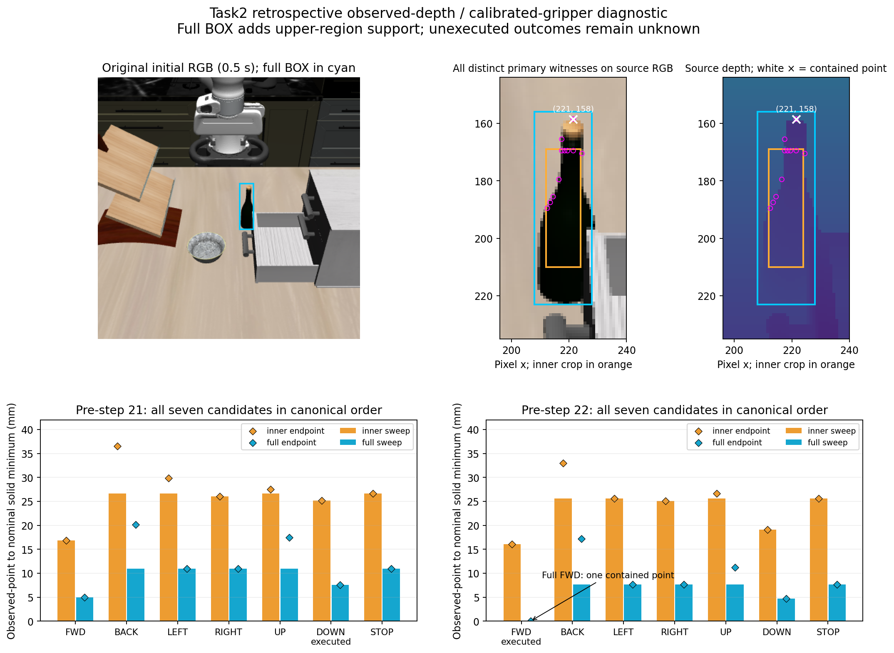

# Task2 observed-depth support versus nominal gripper sweeps

**Adding the original BOX's upper-region depth samples exposes one point inside the pre-step-22 FWD hand-proxy endpoint and sweep.** The original inner crop contains no intersecting point and remains **16.081 mm** from its nearest swept proxy. At the preceding pre-step-21 snapshot, the actually executed DOWN sweep has no contained point under either support. This is a specific retrospective agreement with the recorded raw contact boundary, not validation of a seven-way contact classifier or a safe alternative action.

The source image is the original 0.5 s capture. Cyan is the full BOX, orange the fixed inner crop, magenta circles are **all 11 distinct primary witness pixels** across both snapshots, both support sets, all seven candidates, all three modes and all five proxies. The white cross is the only distinct contained pixel. Plots preserve canonical candidate order; diamonds show endpoint minima and bars show swept minima. RGB/depth displays and overlays do not change numerical input.

## Registered comparison and measurements

The [frozen protocol](../../research/task2_observed_surface_sweep_protocol.md) uses two stored returned-own-observation packets: zero-based **pre-step 21** and **pre-step 22**, both control 0. Their measured actions were respectively **MV_DOWN with no raw robot pair** and **MV_FWD with the first raw hand/bottle pair**. The later **step 24 MV_DOWN first >0.05 N crossing** is a different boundary. No new dynamics, rendering, policy, model query, target update, mask or candidate execution occurred.

Input support contains **492 inner-crop points** and **1,340 full-BOX points**, with original row-major half-pixel backprojection and the unchanged 0.01–5 m depth rule. Every inner row matches saved G exactly and is an exact full-support subset. No identity-based cleanup occurred; these remain generic observed-depth proxies with unverified ownership.

All five sealed collision proxies were placed from the same returned grip-site position, corrected eef-body orientation and signed jaw packet: hand, two finger bodies and two pads. Each separate convex proxy received the same seven 10 mm world translations/zero-displacement STOP. A sweep is the exact convex swept solid under the nominal rigid translation; the five-proxy union uses minimum distance/OR containment and preserves the gaps between jaws. Snapshot orientation/jaw values are held fixed in this geometric approximation.

All numbers below are union distances in **mm**. “Unknown” means that candidate was not executed at that snapshot; it does not describe feasibility. Every candidate's complete current/endpoint/sweep per-proxy data, witnesses, ties and pixel arrays remain retained.

| Pre-step | Candidate | Inner sweep | Full sweep | Inner endpoint | Full endpoint | Full sweep contained points | Observed outcome |
| --- | --- | ---: | ---: | ---: | ---: | ---: | --- |
| 21 | FWD | 16.859 | 4.948 | 16.859 | 4.948 | 0 | Unknown |
| 21 | BACK | 26.650 | 10.980 | 36.531 | 20.111 | 0 | Unknown |
| 21 | LEFT | 26.650 | 10.975 | 29.822 | 10.975 | 0 | Unknown |
| 21 | RIGHT | 26.050 | 10.980 | 26.050 | 10.986 | 0 | Unknown |
| 21 | UP | 26.650 | 10.980 | 27.503 | 17.490 | 0 | Unknown |
| 21 | DOWN | 25.198 | 7.557 | 25.198 | 7.557 | 0 | Executed: no raw robot contact |
| 21 | STOP | 26.650 | 10.980 | 26.650 | 10.980 | 0 | Unknown |
| 22 | FWD | 16.081 | **0.000** | 16.081 | **0.000** | **1** | Executed: first raw hand/bottle pair |
| 22 | BACK | 25.589 | 7.677 | 32.983 | 17.214 | 0 | Unknown |
| 22 | LEFT | 25.570 | 7.677 | 25.570 | 7.686 | 0 | Unknown |
| 22 | RIGHT | 25.077 | 7.668 | 25.077 | 7.668 | 0 | Unknown |
| 22 | UP | 25.589 | 7.677 | 26.620 | 11.253 | 0 | Unknown |
| 22 | DOWN | 19.137 | 4.668 | 19.137 | 4.668 | 0 | Unknown |
| 22 | STOP | 25.589 | 7.677 | 25.589 | 7.677 | 0 | Unknown |

Current union distances are **26.650 / 10.980 mm** (inner/full) at pre-21 and **25.589 / 7.677 mm** at pre-22. There is no current containment. No inner-crop point is contained in any current, endpoint or sweep; no full-BOX point is contained in any condition except pre-22 FWD endpoint/sweep. Thus the possible all-seven-sweeps-zero degeneracy from starting overlap is absent here.

## The witness and what it establishes

The sole contained sample is source pixel **(221,158)**, center **(221.5,158.5)**, depth **0.966480910778 m**, world point `[-0.13719116338778747, 0.061508817852240764, 1.057485005518255] m`. It is outside inner bounds `[212,169,224,210)`. Its source RGB location appears in the cap/upper region; RGB appearance is not a resolved-depth ownership proof. The pre-22 FWD containing proxy is **`gripper0_hand_collision`**. The inner-crop primary swept witness is **(217,169)** against **`gripper0_finger2_collision`**, at 16.081 mm. No pad containment or qualified grasp relation follows.

The separate historical evaluator records **zero raw robot rows at step 21** and **26 at step 22** (13 BEFORE + 13 AFTER), solely `gripper0_hand_collision` / `wine_bottle_1_g6`. First raw row is BEFORE, control 7, index 186, reported 9.672 s and normal force 0.017555968957 N. This is below the later >0.05 N stopping threshold. Cached native stage times and returned sensor packets do not identify an exact continuous-time onset or exact contact pose.

The full support's lower minima are automatic for a superset and are not themselves evidence of better prediction. More specifically, **all 14 full-support swept minima use the same pixel (221,158) and hand proxy**. This result therefore concerns one additional observed sample combined with own-hand geometry; it does not validate a dense object-shape estimate. That sample is also contained in the nominal **endpoint**, so this case does not establish added discriminating value from continuous sweep calculation over an endpoint test. No perturbation robustness, contact threshold, causal necessity or held-out performance was tested.

Initial support is about 8.4/8.8 s old at the selected read boundaries under an unverified static-scene assumption. Exact returned observation times are unknown. Current static XML body/joint/pad/site and reviewer parent/geometry-owner checks match the sealed own calibration, but historical XML/STL asset-byte identity is unproven; compiled hull vertices were not reexported. Camera calibration, finite/mixed depth samples, partial visibility and nominal-versus-controlled trajectory differences remain limits. A positive distance for another candidate cannot certify absence of physical contact. STOP is zero nominal displacement here, not a tested hold.

## Verification and artifacts

**23 analytic/helper tests passed** independently and for the producer. The actual-source preflight passed exact inner-G/subset and current static compatibility checks without own placement or proximity computation. Prospective review **`c062ed6`** admitted one offline computation at producer freeze **`cb394fdaaa90f4dd0ba984f657130c70bcae9dad`**. That computation completed normally with all **14 sample/candidate NPZs plus the full feature JSON**.

Independent stored-array audit **`6cb5825`** passed all 15 seals, input/own-packet/subtree/support identity, every per-proxy/union summary, ties/witnesses, current/STOP equality, support/sweep inequalities and complete separate evaluator rows. Stored closest-point norm residuals are at most **5.55e-17 m**. The source-reviewed adapter writes a complete feature seal before evaluation; artifact hashes are verified, but there is no timestamped event journal independently attesting that ordering. Separate interpretation memo **`49c324b`** confirms the single-pixel, endpoint-equivalence, superset and unknown-counterfactual limits without new feature computation.

- [Portable complete summary, per-proxy results and all-seven table](task2_observed_surface_sweep_summary.json).
- [Stored-only reporter](../../../embodied_runtime/experiments/task2_observed_surface_sweep_report.py).
- Raw directory: `/home/junhongli/projects/laya-embodied-runtime/runs/autonomous-research/task2-observed-surface-sweep-run-01`; sibling log retained. `request.json`/`admission.json` preserve input and selection metadata; `features/` contains all arrays; `evaluator-after-seal.json` contains only the declared executed-action comparison.
- Feature seal SHA-256: `2272dd32051a5965b1188360c993bf89e0b1a77d9f569b053351b5e65c8e9601`.
- Full feature JSON SHA-256: `4468151c3cf9e9abecb199131189fab02752ebdd7bf179234d30725c7bc9a55b`.
- No-own-geometry preflight 01 SHA-256: `27a3fbdf90db23bc900f1e90fffc1de71cb393f30ab215cafa8e6004c6ac5489`.

This closes the registered offline comparison. It neither changes the point rule nor executes or certifies an alternative approach.
