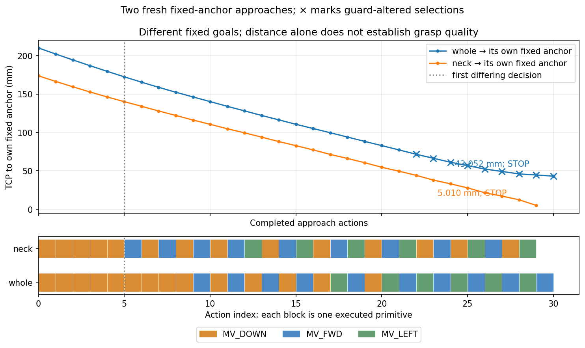

# Two fixed POINT anchors under the unchanged approach rule and BOX guard

Both fresh episodes stopped normally and reproduced exactly in separate raw-control
replays. The whole-anchor episode stopped 43.051502 mm from its own point because
the endpoint guard excluded the improving move. The neck-anchor episode stopped
5.009756 mm from its own point inside the original ±5 mm **axis** stopping cell;
the unguarded rule also chose STOP. There is no radial 5 mm admission threshold.

These distances refer to different goals. The actual terminal TCP positions are
only **9.021938 mm apart**, and both are close to the fixed neck point. The result
demonstrates a change in approach-rule behavior from the supplied semantic anchor,
not neck-grasp superiority. No grasp or lift was attempted.

## Matched collection, first divergence and endpoints

| Measurement | Whole POINT | Neck POINT |
|---|---:|---:|
| Initial TCP distance to own anchor | 209.961883 mm | 173.664388 mm |
| Final TCP distance to own anchor | 43.051502 mm | 5.009756 mm |
| Executed approach primitives | 30 | 29 |
| Controls | 240 | 232 |
| Native BEFORE/AFTER snapshots | 12,000 | 11,600 |
| Captures | 31 | 30 |
| Terminal decision index | 30 | 29 |
| Terminal unguarded rule | MV_DOWN | STOP |
| Guard altered a selected token? | yes, first at decision22 | no |
| Execution-contract violations | 0 | 0 |
| New-contact abort | no | no |
| Separate exact replay | PASS | PASS |

Each arm freshly reset seed1/init0 and performed the original ten settling
controls. Its initial RGB/depth/K/T bytes matched the original fixture before
approach movement. Both used the same 1,340 full-BOX support points, own geometry,
endpoint veto, seven candidates, 10 mm executor and unchanged stopping limits.
There were no model calls, retries, pose adjustments or archived-control warm starts.

The first five executed actions were MV_DOWN in both arms. At **decision5**,
with the same returned own packet, proxy vertices and endpoint exclusions,
whole selected MV_DOWN while neck selected MV_FWD. The independent audit confirms
the complete five-action/six-capture prefix is exact. The fixed goal coordinates
change the original distance ranking at this shared state; no other arm's result
was used in selection.

At termination, P−TCP was [1.242094,2.691127,−42.949352] mm for whole and
[3.603273,1.965320,−2.872560] mm for neck. The latter satisfies the unchanged
axis stopping-cell condition; neither STOP denotes holding, grasp readiness,
physical clearance or task success.

## Complete terminal candidate comparison

Values are nominal TCP distances to each arm's own fixed point, in millimetres.
Every option and exclusion remains in the raw and portable decision trace.

| Option | Whole nominal distance | Whole excluded / points | Neck nominal distance | Neck excluded / points |
|---|---:|---|---:|---|
| MV_FWD | 43.915714 | no / 0 | 7.282321 | no / 0 |
| MV_BACK | 44.477788 | no / 0 | 14.041478 | no / 0 |
| MV_LEFT | 43.584507 | no / 0 | 9.262358 | no / 0 |
| MV_RIGHT | 44.802392 | no / 0 | 12.822014 | no / 0 |
| MV_UP | 53.032243 | no / 0 | 13.511065 | no / 0 |
| MV_DOWN | 33.082393 | yes / 32 | 8.224746 | yes / 36 |
| STOP | 43.051502 | never vetoed / 0 | 5.009756 | never vetoed / 0 |

Whole's improving DOWN option is excluded, while every eligible movement worsens
its distance. Neck's DOWN option is also excluded, but it already worsens distance;
all six moves worsen distance before the veto. STOP executes no hold primitive.

## Different anchors versus different terminal poses

This descriptive cross-distance table uses only the two stored terminal TCPs and
the two already-fixed anchors. It adds no pose, target selection or new trial.

| Stored terminal TCP | Distance to whole anchor | Distance to neck anchor |
|---|---:|---:|
| Whole approach endpoint | 43.051502 mm | 6.129808 mm |
| Neck approach endpoint | 44.635655 mm | 5.009756 mm |

Neck-endpoint minus whole-endpoint translation is approximately
[−9.001398,−0.475640,+0.379440] mm. In particular, their terminal heights differ
by only 0.379440 mm. Own-anchor 43-versus-5 mm should not be read as a corresponding
physical grasp improvement. Independent actual-RGB and finite-gap interpretation
is reported separately; no grasp outcome is available from this pair.

## Evidence and independent closure

Scientific freeze `fb7899bef22e6473aed30e7dd0051568bd7db7f7` stayed clean through
all four stages. Prospective PASS `1c884d2` bound admission SHA256
`753fd32754c67265956c845db0d689f7ca41e2ad1aa1155cb75ee6aecdb14fef`.
The later report generator only reads sealed evidence.

Independent raw/replay audit **PASS `f958094`** checked all 2,860,900 endpoint
membership entries across 61 decisions, 59 executed primitives, 23,600 native
snapshots, and both exported replays. It found zero raw robot contacts in the
recorded native evidence, verified every validator result, and confirmed the
first shared-state divergence. Its JSON SHA256 is
`0cd47a1433ac25d14b45aa942a17d7322e19865804c33b3adb2fee25a2d2d56e`.
This integrity PASS is not a physical-clearance or manipulation-success claim.

Raw directory:
`/home/junhongli/projects/laya-embodied-runtime/runs/autonomous-research/task2-point-anchor-approach-run-01`.
The [summary](task2_point_anchor_approach_summary.json) preserves full precision,
initial gates, both complete terminal decisions, source/replay identities and
the shared-state divergence. The [full traces](task2_point_anchor_approach_traces.json)
retain every decision/candidate/effect/exclusion, action result and endpoint.
Existing executor `success` fields in those raw results remain evaluator-only.

| Artifact | SHA256 |
|---|---|
| Batch journal | `36a1a4a15cbbc9a9beb54e4ac63f5362220be075a8fc012a618dc98f9e88e4ad` |
| Whole journal | `690f81aef2fe5b3d2b5aee09d72f269dfbf7f37ee24c1f9a83c061f7ce4b4541` |
| Neck journal | `3e335ff3d4791f43b74750216fd928470145ea0d34d5a03fbeaba3f2ff492ae8` |
| Whole replay result | `d784b0bc206fcbe07fc376426610b47e9f10fc38ae23d9a67ae3838dc9aaedd0` |
| Neck replay result | `0134e2abf91aeabb8bc36880a77b3e237f7711e2e88ca38bbed0faadbae5326b` |

Portable-report and actual-RGB/gap review passed at `f908941`; see the
[independent review](task2_point_anchor_approach_independent_review.md) and
[image interpretation](task2_point_anchor_approach_interpretation_findings.md).
No additional physical action follows from this report; the first declared
endpoint of each arm is retained unchanged.
