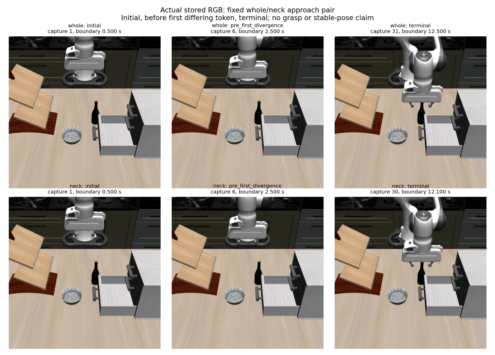

# Actual paired approach images and point-to-gap interpretation

**The terminal images look very similar. The neck arm places its own cached POINT inside the modeled open pad gap; the whole arm's own POINT remains outside it.** These are different point-goal results, not evidence that the neck endpoint has superior grasp mechanics. The whole arm may already be positioned near the visible neck despite its blocked whole-bottle goal. Neither arm has executed a grasp or a lift.

I opened the final figure and both original-resolution terminal RGB images independently. In both terminal views, the hand partly occludes the upper neck/cap and the visible fingers flank that area. This supports only a qualitative alignment reading: the image does not establish bilateral pad contact, enclosed target extent, resolved-depth ownership or holding. The original source RGB and depth were also inspected; whole pixel (219,190) has depth 0.9939957857131958 m, neck pixel (219,173) has depth 0.9737445712089539 m. Those cached sensor points are not newly measured endpoint features.

## First divergence and why the arms stop

The first different selected token is **decision 5: whole DOWN, neck FWD**. Before it, the two conditions have exactly matching initial own packets, all five actions' control/native data, and all six RGB/depth/K/T captures. Endpoint-exclusion evidence at the shared decision boundary is identical; only the goal-dependent candidate distances differ. This is the cross-arm divergence, distinct from each arm's internal guarded-versus-unguarded divergence.

The pre-divergence frame is recorded **capture 6**, at **2.4999999999999463 s**, before either different action executes. Terminal whole is capture 31 at 12.500000000000844 s, after 30 completed movements. Terminal neck is capture 30 at 12.10000000000071 s, after 29 movements. Capture IDs are one-based and were read from records, not inferred from action indices.

| Condition | Final TCP-to-own-P distance | Selected / unguarded token at final state | Interpretation |
| --- | ---: | --- | --- |
| Whole | 43.05150150002782 mm | STOP / DOWN | The endpoint guard blocks the original rule's remaining improving move. |
| Neck | 5.009756389283383 mm | STOP / STOP | The original axis rule already has no strict improving move. |

Both termination reasons are recorded as `rule_no_strict_nominal_improvement`. That shared string hides the different guard/unguarded comparisons above. STOP executes no hold. The endpoint packet, final image, successful replay and executor validation do not establish temporal stability or a qualified grasp pose. The producer's separate report preserves complete action/distance/candidate traces; this interpretation does not rerun policy.

## The existing own-pad diagnostic

At only the predeclared initial, pre-first-divergence and terminal packets, the unchanged `returned_packet_relation` maps each arm's own fixed P into its returned grip-site frame. The returned position is already the site origin; only the audited body-to-site orientation mount is applied. Signed finger joints determine the finite gap. No object pose, fitted target extent or refreshed support enters the calculation.

| Terminal condition | Own P in grip-site XYZ, mm | Finite gap X interval, mm | Existing finite-prism predicate |
| --- | --- | --- | --- |
| Whole | (2.685382187408, 3.629561299789, 42.814095677540) | [−39.498483487279, 39.499430134350] | false |
| Neck | (1.963968646593, 3.761027201309, 2.663674271786) | [−39.498514901788, 39.498606775707] | true |

The unchanged pad bounds are site Y∈[−8,+8] mm and Z∈[−11.6,+4.4] mm. Whole fails the finite Z interval; neck satisfies all three intervals. Both initial and pre-divergence own points are outside the finite prism. Full-precision outputs and signed joints are retained in the summary. Exact own-sensor sample times are unknown; listed times are recorded control/capture boundaries.

The image comparison remains essential: different own-P distances and different own-P prism membership do not establish different physical graspability. This diagnostic has not evaluated the neck point at the whole endpoint, reconstructed a bottle, selected a pose, or declared a winner. A later matched closing/lift versus open/lift test would address closing-dependent local mechanics at both endpoints; it would require its own fixed evidence contract and is not an outcome of this pair.

## Limits and retained evidence

The approach guard uses the original static unsegmented full-BOX cloud and nominal endpoint solids; it does not certify swept paths or full-scene clearance. Contact claims require the separate complete native BEFORE/AFTER audit, including subthreshold rows. This interpretation does not replace that audit or infer holding from a thresholded contact-stop field. No new model, dynamics or rendering call was made; images are stored RGB.

The [predeclared interpretation plan](../../research/task2_point_anchor_approach_interpretation_plan.md) and [stored-only utility](../../../embodied_runtime/experiments/task2_point_anchor_approach_interpretation.py) select the same three boundaries for both conditions. Both source collections terminate normally and both archived verification replays report PASS before the final utility runs. The raw derived receipt retains the complete source decisions; the portable summary retains the boundary, terminal-candidate and own-pad evidence without copying raw NPZ frames.

- [Portable interpretation and separately sealed visual receipt](task2_point_anchor_approach_interpretation_summary.json).
- Original-resolution unmarked [whole terminal](task2_point_anchor_approach_interpretation_whole_terminal.png) and [neck terminal](task2_point_anchor_approach_interpretation_neck_terminal.png).
- Raw pair: `/home/junhongli/projects/laya-embodied-runtime/runs/autonomous-research/task2-point-anchor-approach-run-01`.
- Raw derived interpretation/visual receipt: `/home/junhongli/projects/laya-embodied-runtime/runs/autonomous-research/task2-point-anchor-approach-interpretation-01`.

| Artifact | SHA-256 |
| --- | --- |
| Pair journal | `36a1a4a15cbbc9a9beb54e4ac63f5362220be075a8fc012a618dc98f9e88e4ad` |
| Whole journal | `690f81aef2fe5b3d2b5aee09d72f269dfbf7f37ee24c1f9a83c061f7ce4b4541` |
| Neck journal | `3e335ff3d4791f43b74750216fd928470145ea0d34d5a03fbeaba3f2ff492ae8` |
| Raw interpretation | `bfb681e9913dfb154843542685b6ee140e90200b90601188e15b1e7160e90aea` |
| Visual inspection receipt | `d81ded0ce630defbf78443348ee41815488fbbf35e67af29ed3c31d44daddea1` |
| Final actual-RGB figure | `f320b40ee5d7d9fbf7c220a487d4e0ff7351d31df1daff7c2f130578d0f87e6d` |
