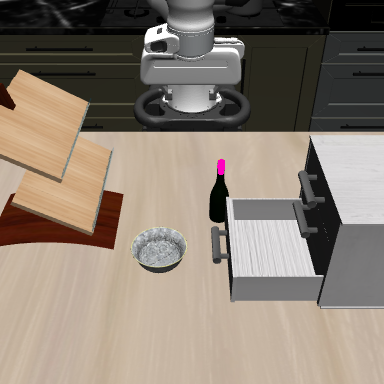

# Matched original-rule goal cells for whole and neck POINT anchors

**The whole-bottle POINT cell has 104 shared hand-proxy witnesses; the neck POINT exact center has zero observed-point containment.** For neck, four registered corners have containment and four have none, with no common eight-corner witness. This is a fixed-geometry guard comparison, not evidence of physical clearance, a feasible route or grasp readiness. Both anchors were retained; none was selected by this calculation.

| Anchor | Exact-center contained points | Same-point/same-proxy pairs at all eight corners | Whole-cell certificate |
| --- | ---: | ---: | --- |
| Original BOX median-ray P, sealed historical reference | 137 | 123 | Excluded under frozen guard |
| Native whole-bottle POINT | 129 | 104 | Excluded under frozen guard |
| Native neck POINT | 0 | 0 | No common-witness certificate; inconclusive |

The original BOX row is the previously sealed calculation, not a third newly evaluated condition. The two new anchors come from the independently admitted native POINT calls: whole pixel (219,190) and neck pixel (219,173), each projected using its containing pixel's depth and pixel center. The semantic description is researcher-specified; sensor admission does not verify region identity or depth ownership. The [POINT source report](task2_point_region_control_findings.md) preserves the original prompts, raw returns and visual reading separately.

## Same rule, support and fixed geometry

Each new condition used exactly nine prescribed placements: TCP=P_i and eight world-axis P_i±5 mm corners. The 5 mm half-width remains half the unchanged 10 mm axis move under the original point-distance rule. The finite-gap objective was not used. All 1,340 original full-BOX points, five separate own proxies, prior guarded terminal orientation and signed jaws were identical across conditions. The fixed orientation/jaws are prior terminal measurements, not measurements from an approach to either new anchor.

| Placement index | TCP offset from that anchor, mm | Whole union | Neck union |
| ---: | --- | ---: | ---: |
| 0 | Exact center: (0,0,0) | 129 | 0 |
| 1 | (−5,−5,−5) | 143 | 31 |
| 2 | (−5,−5,+5) | 116 | 0 |
| 3 | (−5,+5,−5) | 143 | 31 |
| 4 | (−5,+5,+5) | 116 | 0 |
| 5 | (+5,−5,−5) | 140 | 24 |
| 6 | (+5,−5,+5) | 104 | 0 |
| 7 | (+5,+5,−5) | 140 | 24 |
| 8 | (+5,+5,+5) | 104 | 0 |

Every positive count in this table is hand-proxy containment. Both finger and both pad counts are zero at all 18 placements. These are observed-point containment counts, not physical contacts. Every point/proxy boolean, index list, full-precision TCP position and original helper result is retained.

For the whole anchor, the same 104 point/hand pairs persist at all eight corners. For a fixed observed point q and oriented convex proxy C, translations that contain q form the convex set `q−C`. Containing every cell corner therefore includes their convex hull. Positive corner unions alone would not suffice if their witnesses changed. The exact-center row is measured separately and is not part of the eight-corner intersection; the two anchors are never intersected with each other.

The stored numerical check uses one fixed facet system per proxy across all 18 placements and matches all **120,600 containment entries**. Maximum proxy translation residual is **2.220446049250313e−16 m**. The 104 whole-anchor common pairs have strictly positive minimum signed corner-facet slack, ranging from **0.00008890641665942889 to 0.009695951533394698 m** (0.088906–9.695952 mm). Each pair's exact-center slack and all eight ordered corner slacks are retained. Neck has no common pairs and its witness-slack extrema are null. These are numerical geometric slacks, not physical margins or uncertainty bounds.

Independent stored-result PASS `f927482` verifies all entries, lists and vertices using one fixed facet system from the **historical original BOX exact-P geometry**, independently of the producer's new whole-anchor reference. Its whole-anchor slack extrema are **0.00008890641665940807 and 0.00969595153339467 m**. Maximum disagreement with the producer's minimum facet slacks is **1.2212453270876722e−15 m**. The audit supports the bounded whole-cell statement and confirms the unchanged neck exact-center flag is false. Evidence-integrity PASS is separate from either anchor's geometric outcome.

## Original RGB and complete witness overlays

| Original unmarked RGB | Whole: all 104 common source pixels | Neck: zero common source pixels |
| --- | --- | --- |
|  |  |  |

The unmarked image reproduces every cached RGB value. The whole overlay changes exactly all 104 common source pixels to magenta. The neck overlay is byte-identical to the unmarked image because its common set is empty. These overlays show geometric witnesses, not the anchor locations or verified object segmentation. No mask cleanup, support filtering, new rendering or image inference was applied.

## Interpretation, provenance and retained evidence

Changing to the explicit neck anchor removes the exact-center observed-point veto in this matched offline geometry. It does not make the entire ±5 mm neck cell free of containment: all four lower-world-Z corners remain positive. Absence of a common witness is insufficient to infer a feasible cell, route or physical pose. The partial unsegmented cloud, calibrated convex proxies, fixed orientation/jaws and unknown source sample times remain limitations. The calculation supplies no holding, fit, clearance, grasp or task-success evidence.

The scientific freeze is `77523e59b2a66dd13665a15e996048198526ad4f`. Producer focused tests passed 25 cases; the independent prospective review passed 33 focused cases and checked all source/helper identities. Source POINT admission/result/report PASS is `77c415d`, with receipt SHA-256 `c083504fe4574f01a472c4cf957a61ff016055ebc069b4fcb23f752d8bc467d1`. Source-only preflight SHA-256 is `05880a632bb46b5ca9e8d08fc839f794acc41594c35e6476481b5bc0d3d5bb8c`. Independent prospective PASS `53efefd` preceded the single whole→neck worker. It completed with no retry, model call, simulator construction, rendering, robot action or automatic extension.

- [Full-precision summary, both complete nine-row results, numerical witness checks and embedded independent audit](task2_point_anchor_goal_cells_summary.json).
- [Complete 2×9×1,340×5 tensor and all 18 placements](task2_point_anchor_goal_cells_containment.npz).
- [Independent review](task2_point_anchor_goal_cells_independent_review.md) and [audit](task2_point_anchor_goal_cells_independent_audit.json).
- [Frozen protocol](../../research/task2_point_anchor_goal_cells_protocol.md) and [stored-only reporter](../../../embodied_runtime/experiments/task2_point_anchor_goal_cells_report.py).
- Raw source request, individual complete results/proxy vertices, tensors and recursive seal: `/home/junhongli/projects/laya-embodied-runtime/runs/autonomous-research/task2-point-anchor-goal-cells-run-01`.

| Artifact | SHA-256 |
| --- | --- |
| Feature seal | `2e849dd465a93c6f41a72a3bec31ba1ae5a63b2c3f39345db326daf19fe9c0e5` |
| Geometry request | `3c4ed225b8af20aa7d97a2c63cfad753bf562dbea11b57d1527b70c166c34fc1` |
| Combined result | `4e9e687e2fef7825ffdcde5e3fd07b946a7827b035a1e05beb4a76da4f787e06` |
| Complete combined tensor | `a9f972d8898e1640e49d2e1828cecbe1fb415849d12578029674c0235cd8ff94` |
| Independent numerical audit | `bf1ce72a79fd50c796b68e3d41d6b73b474184a8c89501cc3b93d4af1861627c` |
