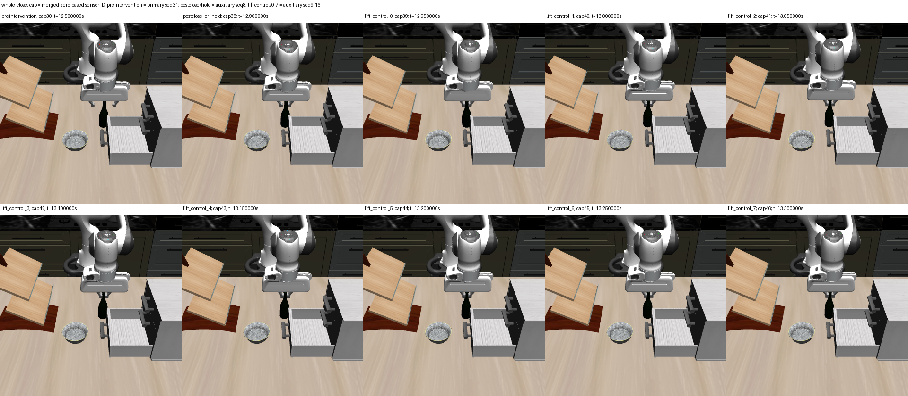
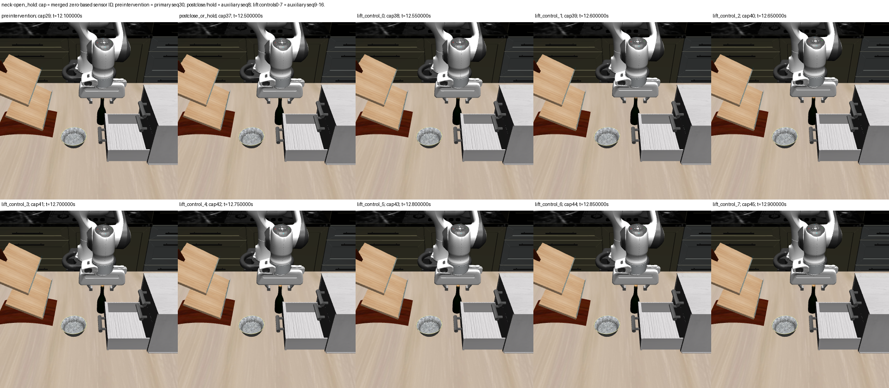

# Original-RGB inspection of the fixed POINT-anchor mechanical matrix

All **40 prespecified original RGBs** were inspected after their respective
collections sealed: preintervention, postclose/hold, and all eight lift endpoints
for each of the four cells. Both close cells visibly narrow the finger spacing
near the upper bottle neck. Both open-hold cells retain separated fingers.
The small apparent image motion differs descriptively between close and open,
but these views do not establish holding, support clearance, grasp success or
which anchor is better.

The four unscaled ten-image sheets were viewed in full; preintervention,
postclose/hold and final lift were also viewed individually for every cell.
Every exported individual PNG exactly reproduces its saved384×384 RGB array.
There is no crop, mask, colored overlay, resampling, point tracking, pose fit or
new render. The additional title strip on each final sheet clarifies the two
capture-number conventions; it does not change any original image pixel.

## What is visible

| Cell | Observed image sequence |
| --- | --- |
| Whole-close | Fingers move inward toward the upper neck. Across lift endpoints, hand and visible dark bottle outline appear slightly higher relative to the cabinet background. |
| Whole-open_hold | Fingers remain separated. The hand appears slightly higher during lift while the bottle body stays at approximately the same image height relative to the cabinet. |
| Neck-close | Fingers move inward near the upper neck; hand and bottle outline appear slightly higher during lift. Small silhouette changes do not resolve slip or small tilt. |
| Neck-open_hold | Fingers remain separated; hand rises visually while the bottle body remains at approximately the same image height. More of the small cap/top becomes visible below the palm by the final frame. |

The visible bottle bodies remain near upright, without an obvious large lateral
tilt in these views. This is a qualitative visual statement; no bottle rotation,
tilt angle or image displacement was measured. The hand obscures the cap and
upper-neck interface to varying degrees. Exact pad contact and bottle support
or clearance are not resolved. Similar close-cell appearances do not supply an
anchor ranking. Raw mechanical criteria and any later co-motion measurements
are separate evidence and were not used to select these frames.

## Fixed boundaries and original source IDs

Figure headers `capN` refer to the **merged, zero-based sensor-manifest ID**.
The source camera sequence is separately one-based. Every complete source row,
path, hash, phase, action/control and full-precision read time is retained in the
[portable summary](task2_point_anchor_grasp_rgb_summary.json).

| Anchor | Boundary | Merged ID | Original stream / sequence |
| --- | --- | ---: | --- |
| Whole | Preintervention |30| primary /31|
| Whole | Postclose/hold |38| auxiliary /8|
| Whole | Lift controls0–7 |39–46| auxiliary /9–16|
| Neck | Preintervention |29| primary /30|
| Neck | Postclose/hold |37| auxiliary /8|
| Neck | Lift controls0–7 |38–45| auxiliary /9–16|

Preintervention is the last approach endpoint before the scripted jaw action.
The approach STOP itself executes no hold. The later open-hold intervention
explicitly executes eight controls. No duplicate primary suffix endpoint is
inserted into the merged chronology.

## Completed source admission, without temporal extraction

The matrix at raw `task2-point-anchor-grasp-transfer-run-01` completed all four
fresh collections and all four verification replays under producer freeze
`1702cb2739bfdb2817a329c8047e16bcb7836657`. Source admission was performed only
after that completion. The matrix journal hash is
`39d2a972869d98944bdfb29cce721174cdb9d617ec3696b5139ac5ffd8b139f4`.

Each sensor manifest, sensor seal, source-journal linkage hash and NPZ hash
verifies. Primary and all16 auxiliary replay checks pass for each cell. The
merged sensor populations are47/47/46/46 captures. Within-anchor close/open
prefixes match exactly in RGB/depth/K/T and saved own packets/read times for31
whole frames and30 neck frames; the first six whole/neck sensor frames also
match. All four initial arrays equal the original sealed BOX seed image.
Returned own-TCP provenance and unknown exact sample/cache times are retained.
Evaluator-bearing cell journals were hashed for linkage, not decoded by the
sensor adapter; no evaluator labels or masks enter its input.

The future fixed estimator population remains492 seeds per cell,1,968 tracks
and91,512 rows, with the preintervention boundary as the sole preclose reference.
Those are prospective counts, **not extracted results**. No LK, projection,
displacement, classifier, model, physics or render call occurred in this work.
The source contains no bottle masks: proxy membership and departure analysis
are unavailable. The source receipt does not authorize feature extraction; the
later execution wrapper still requires its own frozen reviewed admission.

Raw image/report directory:
`runs/autonomous-research/task2-point-anchor-grasp-rgb-inspection-01`.
It preserves40 individual originals, four original inspection sheets, each
cell's independent visual receipt, four final labeled sheets and the complete
source-admission receipt. No source NPZ was duplicated or modified.

| Artifact | SHA-256 |
| --- | --- |
| `source-admission.json` | `6d283ad5d098ea1e532e82aaf95464df796a01a1cce05e96dd9dae1a9e969681` |
| `rgb-source-report.json` / tracked portable summary | `582f4e87b23cd3aca461ebe6845506d113d919b83139642b24af9cb00b81152b` |
| Final whole-close sheet | `d1f973737c3db45ab40611402ad7b3acbe25432ff1300f597b01275fe0dfbb52` |
| Final whole-open_hold sheet | `bd2b7817219d25f26a6a1c83bec18c71bd3d8a3cf486dd62d1ffd02f9a1ff1da` |
| Final neck-close sheet | `b84aa3cc25969982ac207bbd230391ce6217a5bf90406369d7bfaa3b0226665a` |
| Final neck-open_hold sheet | `72272d0074c4dc5e46d1579c5c4303f574ad8f206cee429cd048fdcde0c920b8` |

The prospective exporter has a passing synthetic boundary/pixel-preservation
test. The source adapter's21 focused synthetic checks pass, and all four reused
temporal helper source hashes remain unchanged. Scientific mechanical closure
is owned by the independent raw audit; this report closes image inspection and
source-schema checks only.
