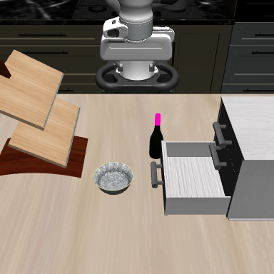

# Task2 point-goal cell conflicts with the fixed-orientation guard

**The entire original point-rule stopping cell is excluded by the observed-point guard at the terminal orientation and jaw positions.** There are **123 identical observed-point/hand-proxy pairs contained at all eight cell corners**. Independent fixed-facet verification found every witness strictly inside without the numerical tolerance: their minimum corner-to-facet margins range from **0.292925 to 17.087352 mm**. This is a conditional result for the frozen observed support and convex proxies, not physical or global task impossibility.

| Original unmarked source RGB | All 123 common source pixels in magenta |
| --- | --- |
|  |  |

Both images come from the original cached RGB-D frame, not a new renderer. The left PNG reproduces every RGB value exactly. The right changes exactly the 123 common source pixels; no mask cleanup, point selection or support filtering is applied. These pixels retain their original depth/world coordinates and do not constitute verified object segmentation.

## Nine placements and the stronger certificate

For a nominal axis move of size h, the squared-distance change is `h² ∓2h(P_i−TCP_i)`. A strict improvement exists on axis i iff `abs(P_i−TCP_i)>h/2`. With the unchanged 10 mm moves, the original unguarded rule's nominal stopping cell is therefore **P ±5 mm on each world axis**. The 5 mm half-width is analytically derived, not fitted to this result.

The single offline calculation placed the same five separate proxies at exact P and the eight corners below, retaining the terminal returned eef-body quaternion, audited body-to-site mount and signed jaws. It used all 1,340 original full-BOX observed points with the unchanged containment helper, no margin or sweep.

| TCP offset from P, mm | Hand | Finger1 | Pad1 | Finger2 | Pad2 |
| --- | ---: | ---: | ---: | ---: | ---: |
| Exact P: (0,0,0) | 137 | 0 | 0 | 0 | 0 |
| (−5,−5,−5) | 152 | 0 | 0 | 0 | 0 |
| (−5,−5,+5) | 125 | 0 | 0 | 0 | 0 |
| (−5,+5,−5) | 152 | 0 | 0 | 0 | 0 |
| (−5,+5,+5) | 125 | 0 | 0 | 0 | 0 |
| (+5,−5,−5) | 150 | 0 | 0 | 0 | 0 |
| (+5,−5,+5) | 123 | 0 | 0 | 0 | 0 |
| (+5,+5,−5) | 150 | 0 | 0 | 0 | 0 |
| (+5,+5,+5) | 123 | 0 | 0 | 0 | 0 |

These are contained observed-point counts. Exact-P intersection alone is weaker, and positive unions at all eight corners would also be insufficient if they involved different points or proxies. Here, each of 123 fixed point/hand pairs independently persists at every corner. For fixed observed q and fixed oriented convex proxy C, translations t with `q in C+t` form the convex set `q−C`. Containing every corner therefore includes their convex hull: the whole cell.

The original full-support index 53, pixel (221,158), is one such witness, with minimum corner-facet margin 3.010958 mm. The largest minimum margin is 17.087352 mm at index 133, pixel (221,162). All 123 pairs and individual margins are retained; the conclusion does not depend on selecting either example.

## Meaning and verification

The earlier guarded trajectory stalled 45.730 mm from P. This calculation shows that, for this fixed terminal orientation/jaw state and this guard, rerouting alone cannot make the original nominal stopping cell admissible. It does not explain every detail of the earlier route or exclude solutions with different orientation, jaw state, target/interface semantics or planning horizon. The partial unsegmented cloud and calibrated convex proxies remain modeling assumptions; no physical collision or full scene-clearance certificate is claimed.

The prospective freeze was `60ad6d7dd69aa5deb7be0dfe999e26fd417dd75e`; four synthetic tests and the no-outcomes preflight passed. Independent prospective PASS was `cb2d2ee`. One real-source calculation completed with no retry, simulator construction, model call or robot action.

Independent result PASS `b60bf3e` recomputed **all 60,300 boolean entries** using one fixed facet system per proxy at exact P and shifted query points at the corners. Every list matched. Maximum proxy translation residual was 2.220446049250313e−16 m; all 123 common witnesses had strictly positive margins without the 1e−12 containment tolerance. This supplies the numerical support for the whole-cell statement.

- [Full-precision summary, all nine results and all 123 witnesses/margins](task2_point_goal_cell_summary.json).
- [Complete 9×1,340×5 containment tensor and placements](task2_point_goal_cell_containment.npz).
- [Frozen protocol](../../research/task2_point_goal_cell_protocol.md) and [stored-only reporter](../../../embodied_runtime/experiments/task2_point_goal_cell_report.py).
- Raw request, proxy vertices, tensor and feature seal: `/home/junhongli/projects/laya-embodied-runtime/runs/autonomous-research/task2-point-goal-cell-run-01`.

| Artifact | SHA-256 |
| --- | --- |
| Feature seal | `190a9423fc1d984d011ba9428c122a87a8ef5419b806c52a3f3dc8a4b3c34bd9` |
| Raw result | `4ffa028909dff507fb43173e161fc73eff315fe047b0de477bb9cb5432c7f88b` |
| Complete containment tensor | `2fafbc642c12b1f623d51c7cef488e4a16abeea6b120f494b8bb7581f420a78a` |
| Independent numerical audit | `eaf14227c8afb4954370f82be98176e28dc2c2c01832c08b749857bf983b3c46` |
