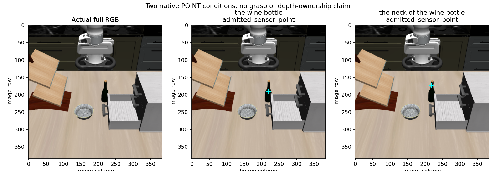

# Two native POINT descriptions on the fixed Task2 image

Both registered calls completed with EOS and passed the unchanged native POINT
sensor-admission rules. On the actual RGB, the whole-bottle point is on the wider
upper body near the shoulder, and the explicitly requested neck point is on the
narrow neck below the cap. This supports use of researcher-specified part text
on this one fixture. It does not demonstrate independent region choice,
planning, grasp quality, or physical feasibility.



## Native outputs and sensor admission

| Fixed question | Native normalized point | Selected pixel | Tokens | Terminal EOS | Length-limited | Admission |
|---|---|---|---:|---|---|---|
| `Point to: the wine bottle.` | (571,496) | (219,190) | 10 | yes | no | admitted sensor point |
| `Point to: the neck of the wine bottle.` | (571,451) | (219,173) | 13 | yes | no | admitted sensor point |

Raw responses, preserved before audit/parsing:

```text
<ref>the wine bottle</ref><box><571><496></box><|im_end|>
<ref>the neck of the wine bottle</ref><box><571><451></box><|im_end|>
```

Actual generated token IDs:

```text
whole: [151672,1782,13078,16486,151673,151668,152248,152173,151669,151645]
neck:  [151672,1782,12975,315,279,13078,16486,151673,151668,152248,152128,151669,151645]
```

The parsed continuous raster coordinates are (219.264,190.464) and
(219.264,173.184). The unchanged native rule takes their containing pixels,
samples that depth, and projects pixel centers (219.5,190.5) and (219.5,173.5).
No clipping, nearest-depth search, BOX support crop, or correction is applied.

| Condition | Depth (m) | World X (m) | World Y (m) | World Z (m) |
|---|---:|---:|---:|---:|
| whole | 0.993995786 | -0.116734696 | 0.058971098 | 0.988358331 |
| neck | 0.973744571 | -0.123374914 | 0.057769650 | 1.028814562 |

The [portable summary](task2_point_region_control_summary.json) retains full
precision, raw return representations, all input/generated tokens, calibration
identities, loaded configurations, process IDs, and artifact hashes. Admission
means one completed native point with valid sensor geometry; semantic confidence,
resolved-depth ownership and grasp quality remain null.

## Evaluator and actual RGB reading

Both containing pixels are **True / proxy_interior** in the separately opened
whole-bottle rendered membership proxy. This is whole-object image membership,
not a neck label or ownership of the sampled resolved depth. The evaluator has
no neck truth annotation. Its limitations include MSAA depth/label ambiguity,
shared synthetic calibration and unknown cached RGB/depth sample times.

After both sensor seals and evaluator completion, Codex opened the actual
uncropped three-panel RGB figure through `view_image`. The whole marker is
visibly on the wider upper-body/shoulder area; the neck marker lies on the narrow
neck below the cap, 17 array rows higher with the same column. The separately
sealed `visual-inspection.json` records this qualitative reading. It is not an
independent human adjudication and changes neither admission nor sensor outputs.
The evaluator JSON's earlier “pending” visual-inspection field is preserved;
the later receipt supplies that inspection without rewriting the evaluator.

The original neck BOX failure—42 BOX records, 260 actual tokens, no EOS—remains
unchanged. This pair shows that this native POINT interface produced a usable
completed coordinate for the explicit neck wording on the fixed image. It does
not establish general accuracy, repeatability, the cause of the earlier BOX
failure, or better grasp performance. No point was selected for execution.

## Execution and provenance

- Scientific freeze `d4045496dc330529eb8f637bd46d556fc9bc0598`; root prospective
  PASS `e3672e756eeebefb17d7fcc6e1580fb5f077b538` before either call.
- Producer and independent real processor-only preflight JSONs are identical:
  SHA256 `34bac09d5a1170fe88f339c5896147944533b4b94f989d277762d2781a8aa498`.
  Focused tests: 53 pass, including 15 new cases; lint and diff checks pass.
- Exactly two calls, whole then neck, fresh Python/model process IDs 802086 and
  802640 on the same rechecked idle GPU1. Both preserve the existing checkpoint,
  loaded configuration, BF16/eval, native greedy hybrid256 settings and seed1.
  No warm-up, retries, salvage, physics or render calls occurred.
- Actual input token counts 229/232; image grid [[28,28]] and BF16 pixel values
  match across conditions and match reviewed preprocessing before each call.
  Exact float32 representation of BF16 pixels has shape [784,3,14,14] and SHA256
  `c059d37db2735649adc392507e9a5ca54c3204229f6f0076fa020ff51fb6b3e5`.
- Raw run:
  `/home/junhongli/projects/laya-embodied-runtime/runs/autonomous-research/task2-point-region-control-run-01`.
  Sibling `-review.json` / `-review.md` preserve the prior review and GPU snapshot.
  Each native return precedes its sensor seal; both sensor results precede the
  separate evaluator. The evaluator and visualization never feed generation.
- Batch journal SHA256:
  `57d9ddcd1348303254d32cf844b0a29e75b90c4eef585a8add4c72afd30b508d`.
  Whole sensor SHA256:
  `87fb2c2b9587ae1cd08f85d4bf331288c20b4b50b65aa6f0132b78294eb3cef5`.
  Neck sensor SHA256:
  `fd6edea327618a8bb86a52dafe48fe2d857a2e71fa7677bdcadb89d65657fd0d`.
  Figure SHA256:
  `89abdd7933dfb996fb0742a804fcf1ca5fe0a70ca15fc3fa6e900f157c653fd4`.
  Visual receipt SHA256:
  `7553fa263d7605faf1634db85ba01c21d2c783b1f2da8ffc803e37e37cfbcc84`.

Independent result/report audit is pending. This report adds no further call,
target selection, controller, physical experiment, or automatic extension.
