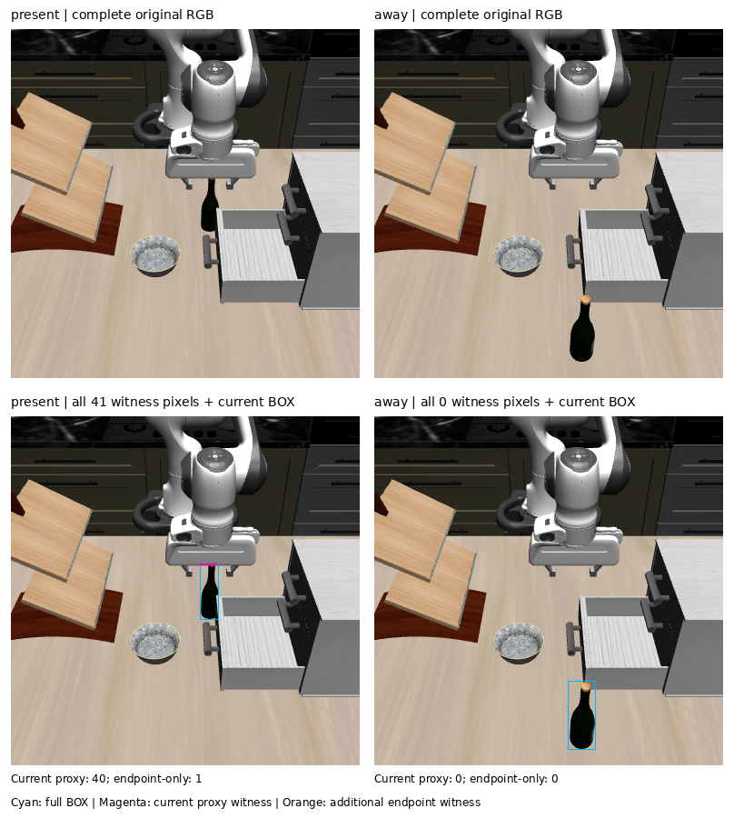

# Current full-BOX support at both fixed postevent boundaries

**Current support changes the present-scene fresh-goal choice from `MV_FWD` to
`STOP`; the relocated-scene choice remains `MV_FWD`, with the stale `MV_DOWN`
veto removed.** This is an offline comparison of partial observed support,
not a physical result or clearance certificate.

The independent native BOX audit passed at reviewer commit `fe2a236`, receipt
SHA256 `5494709f2e60c1160cc6642a46800f20eac702cb7508f857487bda4d94a25264`.
Root inspected both complete original RGB inputs with the exact returned
rectangles: each encloses the visible bottle and includes background slivers.
The admitted native returns each have 12 tokens and terminal EOS; there were
two cold model calls in the upstream BOX experiment. This support computation
made no model, processor, render, physics, FK, POINT-projection or action call.

## Fixed population and arithmetic

Exactly four rows, present then away and old then current support, preserve all
28 candidate records. Fresh-slow POINT source rows 1 and 3 from
`task2-postevent-slow-point-decision-run-01/result.json` fix each paired goal,
own packet, five separate gripper proxy solids, canonical state/effects and
nominal goal scores. The two old decisions are reused from that sealed result;
only two current support extractions and two guard/selection calculations ran.
Three focused synthetic tests passed before the clean `65a30c1` freeze.

Current support uses the strict whole-return BOX admission and matching original
RGB-D/K/T capture. Established integer truncation yields these half-open ROIs:

| Scene | Current full ROI | Pixels / valid points | Depth range, m |
| --- | --- | ---: | --- |
| present | `[208,162,228,223)` | 1,220 / 1,220 | 0.936561–1.218985 |
| away | `[213,291,243,366)` | 2,250 / 2,250 | 0.683119–0.892508 |

Every finite depth in inclusive [0.01, 5] m is retained in row-major order with
+0.5 pixel centers through unchanged `support()`. No inner crop, median goal,
mask, segmentation, self-removal or translated stale cloud is used. Both current
support packets are admitted; neither arm is missing or empty. The adapter
retains null guarded tokens and null vetoes for unknown support rather than
converting an invalid/empty cloud to clearance or STOP.

The unchanged `EndpointSelector` functions `endpoint_exclusions` and
`select_remaining` operate directly on saved own proxy vertices, avoiding new
FK. Historical canonical metadata is preserved exactly and explicitly labeled
as source metadata; the new row's `support_arm` and `support_status` describe its
actual support.

## Choices and all containment counts

| Scene / support | Unguarded | Guarded | Excluded translations |
| --- | --- | --- | --- |
| present / old 1,340 points | DOWN | FWD | DOWN |
| present / current 1,220 points | DOWN | STOP | FWD, LEFT, RIGHT, DOWN |
| away / old 1,340 points | FWD | FWD | DOWN |
| away / current 2,250 points | FWD | FWD | none |

Tokens in the table abbreviate the existing `MV_` prefix.

| Scene / support | FWD | BACK | LEFT | RIGHT | UP | DOWN | STOP |
| --- | ---: | ---: | ---: | ---: | ---: | ---: | ---: |
| present / old | 0 | 0 | 0 | 0 | 0 | 36 | 0 |
| present / current | 40 | 0 | 40 | 40 | 0 | 41 | 40 |
| away / old | 0 | 0 | 0 | 0 | 0 | 36 | 0 |
| away / current | 0 | 0 | 0 | 0 | 0 | 0 | 0 |

These are union counts over five separate solids; no inter-proxy gaps are filled.
STOP is never vetoed, including its 40 contained points in the present scene.
Present current support leaves BACK, UP and STOP eligible. Their nominal
distances to the fixed fresh point are 0.05464894, 0.06109532 and 0.05134923 m,
respectively; neither remaining move improves on STOP. The 40 FWD-contained
points lie in the hand proxy, spanning image pixels `[208,162]` to `[227,163]`.
This is geometric containment evidence, not verified material ownership.

The original-resolution sheet retains both complete original images and both
BOX overlays, including the away panel with zero witnesses. Every present
witness is marked: 40 current-proxy points in magenta and the one additional
endpoint witness in orange. The magenta strip lies at the upper BOX edge along
the visible gripper/neck image boundary; material ownership remains unresolved.
Both original panels were verified pixel-exact and the complete sheet was
actually viewed. The image SHA256 is
`21504b55970a72df5e87cc6eac3db9c8fa938c85aa1e37cde8e657868ff8dd60`;
the [overlay index](task2_postevent_box_support_overlay_index.json) preserves all
41 indices/pixels and all seven per-candidate index sets, without new geometry.

Away current support leaves all seven candidates eligible. FWD has nominal
distance 0.35042828 m versus STOP 0.36036706 m. The removed old DOWN veto does
not change the fresh goal's first choice. All raw rows retain the selector's
`terminal_reason="rule_no_strict_nominal_improvement"`; this dormant reason
label indicates actual termination only where the selected token is STOP.

## Interpretation and immutable evidence

Refreshing the BOX and depth changes the present guard substantially and removes
the stale downward witness after relocation. BOX support is still a rectangle
of observed returns with unknown depth ownership; absence of a contained return
does not establish scene-wide safety, continuous-path clearance or holding.
The support comparison changes semantic ROI and depth jointly while keeping
the fresh-slow POINT fixed. It is not the earlier cached-hybrid/fresh-slow goal
comparison and does not isolate a pure freshness effect.

The away fixture was predeclared for the held two-action retargeting proposal.
Its current support has no endpoint veto, so the previously saved unguarded
cached DOWN and fresh FWD preferences predict a first-boundary goal contrast.
No matched-goal physical trial has run, and no common initial FWD should be
forced. The physical proposal remains held for separate authorization.

Raw directory: `runs/autonomous-research/task2-postevent-box-support-run-01`.
The original physical source matrix remains `interrupted_incomplete`; the
composite source remains `observational-source-qualified`.

| Artifact | SHA256 |
| --- | --- |
| `source-binding.json` | `75e290803f79b8d82959c14b3358719ad406a5ba55700687af46f1d5d03bd87c` |
| `result.json` | `27de4407329ce72ebc520a81f2e56bf63b0cd9834aa5618c437866d781c19440` |
| `feature-seal.json` | `a42204c7b2a1a159c40a858efb494a99a7af9a9ab7bcc937a85b7cd8243bc64f` |

The source binding includes the exact prior POINT result/seal, old guard
manifest, native BOX artifacts, independent audit, both same-frame source
archives, root RGB inspection files, helper hashes and archived run source.
The result preserves full current point clouds, all proxies/containment indices,
nominal scores, candidate/effect records and nullable admission semantics.
