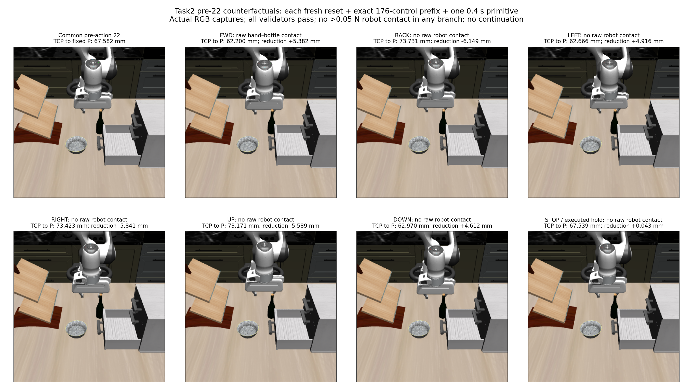

# Task2 pre-22: seven qualified physical counterfactuals

**LEFT and DOWN advanced the unchanged point objective without a raw robot-contact row during their measured 0.4 s primitives.** Their actual TCP-to-P reductions were **4.916035785 mm** and **4.612389597 mm**. FWD reproduced the archived hand/bottle contact exactly and reduced distance by **5.381981514 mm**. Every branch passed the unchanged motion validator; none exceeded the strict 0.05 N robot-contact threshold. No branch continued beyond its one primitive.

These are actual recorded RGB frames, inspected after the batch. The common start is zero-based pre-action 22; panels then follow canonical candidate order. Images contextualize the measured changes; contact classification comes from the separate raw native evidence, not visual ownership inference.

## Exact boundary qualification

Each of seven branches constructed a fresh Task2 seed 1 / init 0 world, followed the standard reset and ten settling controls, then **explicitly replayed the original 22-action / 176-control prefix**. No archived trajectory state was restored. Every initial state/own packet/group/native snapshot and each prefix control-before/after state, previous/returned own packet, all **8,800 native stage samples** and all **23 initial/prefix RGB-D captures** matched the archived source exactly. Current assembled XML/relevant compiled-model identities agreed across fresh branches; this does not assert historical asset-byte identity.

FWD ran first and qualified the original continuation: **all eight commands and control states/own packets, 400 complete native BEFORE/AFTER snapshots, full executor result and endpoint RGB/depth/K/T matched original step 22 exactly**. The other six branches then executed through the same unmodified executor/controller from the independently reproduced boundary. The test is declared retrospective counterfactual mechanics, not a fresh sensor policy or hidden warm start.

The batch completed **67,188 chained records**, **1,232 prefix controls +56 probe controls**, **32,200 integrations /64,400 native stage samples**, and **168 RGB-D captures**. Seven normal reset/ten-settling-control sequences are additional setup. There was no failure, retry, recovery, new inference, candidate filtering, fitted margin or policy change.

## All seven outcomes and point progress

P remains `[-0.12371558041536501, 0.05615888976955092, 0.9855272687809821] m`, the original mixed-support BOX-center-ray/crop-median proxy. Common initial TCP-to-P distance is **67.582234335 mm**. Positive reduction means progress toward P, not bottle-surface or grasp progress. Nominal reduction uses the existing world-axis 10 mm translation (zero for hold); actual reduction uses the recorded returned TCP endpoint. Unrounded values and full validator/control evidence are in the [portable summary](task2_pre22_counterfactual_summary.json).

| Candidate | Raw robot pair(s) | Raw rows BEFORE / AFTER | >0.05 N pairs | Validator | Nominal reduction (mm) | Actual reduction (mm) | Actual final distance (mm) |
| --- | --- | ---: | --- | --- | ---: | ---: | ---: |
| FWD | Hand / bottle | 13 / 13 | None | PASS | +5.637360070 | +5.381981514 | 62.200252820 |
| BACK | None | 0 / 0 | None | PASS | −6.563226401 | −6.148948752 | 73.731183086 |
| LEFT | None | 0 / 0 | None | PASS | +5.233267303 | +4.916035785 | 62.666198550 |
| RIGHT | None | 0 / 0 | None | PASS | −6.223748522 | −5.841106641 | 73.423340976 |
| UP | None | 0 / 0 | None | PASS | −5.868050937 | −5.588838873 | 73.171073207 |
| DOWN | None | 0 / 0 | None | PASS | +4.814628129 | +4.612389597 | 62.969844737 |
| STOP / executed hold | None | 0 / 0 | None | PASS | 0.000000000 | +0.043304533 | 67.538929802 |

The sole robot pair is **`gripper0_hand_collision` / `wine_bottle_1_g6`**, classified other-gripper/bottle. FWD first records it at BEFORE, control 7, index 186, reported **9.672 s**, force **0.017555968957 N**. Peak AFTER force is **0.017556175735 N**. It is below the fixed strict threshold throughout this branch. No fingerpad, other-scene, arm or self-contact row appears in any probe. Native buffer-stage times do not establish exact continuous-time onset.

The executed STOP branch is an **eight-control hold diagnostic** using the unchanged executor. Its target was the current returned TCP position; dynamics produced about 0.0525 mm total translation and 0.0433 mm reduction toward P. This is drift during hold, not evidence of policy progress. The original point-approach loop would terminate immediately upon choosing STOP, without executing any hold. That analytical no-further-action behavior is recorded separately; there was no eighth world.

## Comparison with the already frozen geometric flags

The [prior offline comparison](task2_observed_surface_sweep_findings.md) was sealed before these new physical branches. Flags below mean at least one retained depth point is inside a separate calibrated nominal proxy/union under the existing numerical convention, without a fitted physical margin. Current-pose flags are false for both supports in every branch.

| Candidate | Inner endpoint / sweep flag | Full endpoint / sweep flag | Measured raw robot contact | Measured >0.05 N robot contact |
| --- | --- | --- | --- | --- |
| FWD | False / False | True / True | Hand / bottle | None |
| BACK | False / False | False / False | None | None |
| LEFT | False / False | False / False | None | None |
| RIGHT | False / False | False / False | None | None |
| UP | False / False | False / False | None | None |
| DOWN | False / False | False / False | None | None |
| STOP / executed hold | False / False | False / False | None | None |

At this one exact boundary, the full-BOX endpoint and sweep flags identify the only candidate with a measured **raw** robot-contact row. The inner crop misses that event. Previously unexecuted candidate outcomes are now measured for this particular boundary/horizon; they are not generally qualified actions. Since all force-threshold outcomes are negative, the geometric flag is not evidence of predicting a >0.05 N crossing here.

The earlier full-support witness remains one point, pixel **(221,158)**, against the hand proxy. Endpoint and sweep already contain that same point, so this batch provides no extra discriminating benefit for the sweep over the simpler endpoint measurement. Lower full-versus-inner distances follow from support inclusion; the useful observation is the frozen containment flag's agreement with this newly measured candidate set, not the automatic decrease in minimum distance. All candidates, including disagreements and non-progressing moves, are retained.

This one-pose, one-trial-per-candidate comparison does not establish robustness, general contact detection, whole-scene clearance, successful continued approach, grasp readiness or a safety-certified filter. The initial depth remains partial and stale, ownership unverified, own-pose times unknown, and nominal endpoint geometry only approximates actual controller/orientation/jaw motion. Contact-free LEFT/DOWN here does not authorize treating later LEFT/DOWN motions as contact-free. No continuation or tuning followed this result.

## Validation and artifacts

Producer and independent reviewer passed **17 focused tests**. Actual-source/import preflight constructed no world and passed the frozen original identity checks. Prospective review commit **`d809214`** admitted the single batch at **`69d649111e3272c17b7ffd1f6db4a7908927ee78`**. Independent stored-result audit **`b6a6659`** passed all 67,188 records, seven exact prefixes, FWD continuation, native/control/capture lineage, command arithmetic, validators and raw/threshold summaries. The report also verified the complete journal chain and all 168 capture hashes.

An initial report draft selected the preceding frames by mistakenly treating the camera's 1–24 capture sequence as zero-based. That draft plot, summary, reporter and a correction receipt are preserved under raw `report-attempts/attempt-01`. This report selects the common start and endpoints by exact executor before/after timestamps and additionally asserts camera sequences **23 / 24**. A regression test checks both gates. Physical evidence, contact/progress numbers and the experiment were unchanged; no physics reran.

- [Frozen protocol](../../research/task2_pre22_counterfactual_protocol.md) and [stored-only reporter](../../../embodied_runtime/experiments/task2_pre22_counterfactual_report.py).
- Raw directory: `/home/junhongli/projects/laya-embodied-runtime/runs/autonomous-research/task2-pre22-counterfactual-run-01`; sibling log retained.
- Journal SHA-256: `35f1dee4edfcf4c3d5e059e6db3533d8df9876d0aff7b6adbbdfad7fda2f76d8`.
- No-world preflight 01 SHA-256: `0eccbeb023faf2ebe8baa14d6044850e802165c50f6ddfdb55abd66bec8324ad`.
- Original approach journal SHA-256: `f834673a379523f8c90619d2fd00dd69174f4dd7499cb91a8340742de225e771`.
- Prior surface feature JSON SHA-256: `4468151c3cf9e9abecb199131189fab02752ebdd7bf179234d30725c7bc9a55b`; feature seal SHA-256: `2272dd32051a5965b1188360c993bf89e0b1a77d9f569b053351b5e65c8e9601`.
