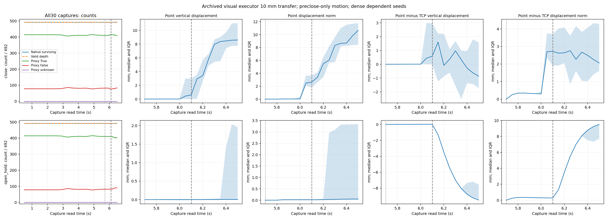
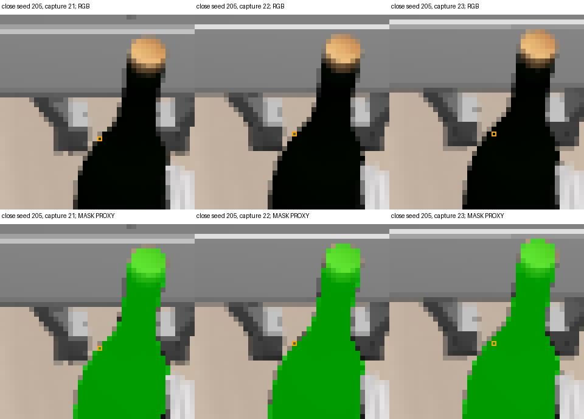
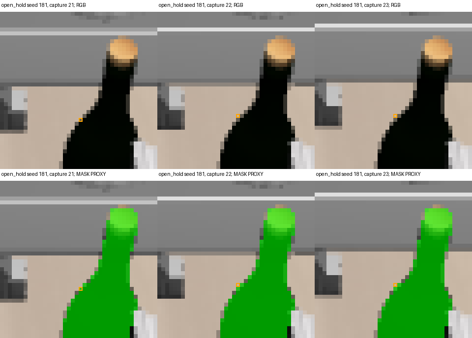

# A descriptive co-motion contrast survives the archived 10 mm transfer

The frozen initial-BOX population shows a close/open motion contrast in the
existing visual executor's short lift: final median surface-point rise is
**8.585 mm close versus 0.003835 mm open**, while median 3-D point–TCP
motion residual is **2.064 versus 9.502 mm**. Native LK still reports success
for every track, including boundary samples that depart from the bottle proxy.
This is one descriptive sensor transfer result, not a holding classifier,
identity guarantee, retained-load test or general grasping result.

The [protocol](../../research/task2_short_lift_transfer_protocol.md) and adapter
were frozen at `4e661c7b1649b887d585a6bb3b016afc414effc1`, with independent
prospective PASS `12575f3` and 14 focused tests passing. The source-only
preflight verified all 60 frame hashes and exact 14-frame RGB/depth/K/T prefixes
against the earlier paired archive. The single offline batch completed once
with no model, physics, renderer, FK, recovery, threshold fitting or retry.
All **29,520 rows = 492 seeds × 30 captures × 2 arms** were sealed before
separate evaluation of all 60 archived masks.

## Fixed population and measurement

The archive is `local-grasp-interface-run-02`; run 01 remains the preserved
zero-physics setup/import failure. Captures 0–13 cover reset and the shared
approach, 14–21 cover close/STOP, and 22–29 cover the actual visual AtomicExecutor
MV_UP controls, nominal 10 mm. Capture read times are 0.5 s at reset, 5.7 s at
preclose 13, 6.1 s after close/STOP 21 and6.5 s at final 29. Exact observation and
cached-geometry sample times remain unknown.

All 492 initial seeds remain, including 78 initially outside the bottle proxy.
The original single-seed LK and its permanent native-failure semantics are
unchanged. Every one of 13,776 shared-prefix rows agrees exactly with the
original sealed native track in all nine native fields. Nearest integer-center
association uses the already justified `floor(x+0.5)` rule; backprojection
separately retains `(selected_index+0.5)`. No label selected seeds or changed
association, tracking, projection, validity or cohort membership.

The source has **no initial own-TCP packet**. Initial own TCP and its timestamp
remain null; no evaluator recovery, old endpoint, reset substitute or new FK
was used. Motion references only fixed preclose capture 13 and is absent before
that capture. All 492 reference surfaces and all 492 current surfaces are valid
at every evaluated motion capture. All per-metric counts are 492 with zero
missing at/after 13; before 13, counts are 0/missing 492 with reference unavailable.
All 30 frames/arm retain 492 native survivors, no native failures, no unknowns
after failure and 492 valid depth samples. Identity and holding stay unknown.

## Motion and limited proxy counts

All distances below are relative to capture 13. IQR means q25–q75 across the
full 492 dependent seeds; it is not uncertainty over independent trials.

| Final capture 29 quantity | Close | Open/hold |
|---|---:|---:|
| Saved own-TCP vertical displacement | 9.451 mm | 9.495 mm |
| Median point vertical displacement [IQR] | 8.585 [7.726,11.035] mm | 0.003835 [−0.009958,1.957] mm |
| Median point displacement norm [IQR] | 10.662 [8.409,11.777] mm | 0.049081 [0.020178,3.340] mm |
| Median point minus TCP vertical displacement [IQR] | −0.866 [−1.725,1.584] mm | −9.491 [−9.505,−7.538] mm |
| Median point–TCP displacement residual norm [IQR] | 2.064 [1.614,4.285] mm | 9.502 [7.692,9.529] mm |
| Proxy True / False / Unknown, denominator 492 | 409 /83 /0 | 402 /90 /0 |
| Seeds with any observed departure after earlier proxy True | 23 | 23 |

Before the lift, at capture 21, median point rise is 0.595 mm close and 0 mm open;
median 3-D residual is 2.723 mm close and 0.279 mm open. These preclose-relative
curves therefore include the close/STOP interval, as registered. They are
not re-referenced at lift onset. Proxy True counts at initial/preclose/after
close-or-STOP/final are 414/410/414/409 in close and414/410/410/402 in open.
Initially outside seeds remain in every summary; no proxy-conditioned motion
summary is substituted.

The [portable summary](task2_short_lift_transfer_summary.json) retains all 30
per-capture motion/count records, fixed reference counts, exact prefix agreement,
first failures/departures and neighboring rows. Plot panels use their own
vertical scales; compare numeric values and units rather than apparent slope.

## Actual images and persistent support departures

The original full-frame RGB at 0/13/21/29, all 16 lift RGB frames and all sampled
locations were inspected separately from proxy overlays. The close images show
bottle/nearby-gripper motion over the short lift; the open images show gripper
motion near the bottle boundary. The subtle image change and overlapping local
support do not establish independent object identity or depth ownership.
[All original lift frames](task2_short_lift_transfer_original_lift_rgb.png)
remain available without markers or masks; raw `report/` also retains the fixed
checkpoint RGB and all-location sheet.

Both arms' earliest overall proxy departure is the already observed shared
approach event: seed 124, capture 6, selected `(216,178)`, depth 1.171729684 m,
forward/backward residual 1.140162706 px, native success. This was not repaired or
removed for the transfer. The first native failure is null in both arms.

The first adjacent True→False proxy transition within the lift occurs at
capture 22 in each arm, with the frozen lowest-seed tie rule:

| Arm and seed | Capture 21 sample/depth | Capture 22 sample/depth | Capture 22 FB residual | Capture 21→22→23 proxy |
|---|---|---|---:|---|
| Close, 205 | `(213,191)`, 0.991939247 m | `(213,190)`, 0.995271683 m | 0.000485652 px | True→False→True |
| Open, 181 | `(213,191)`, 0.994872630 m | `(213,190)`, 1.134052873 m | 0.004370731 px | True→False→False |

These marked samples lie at the bottle shoulder boundary, near moving gripper
pixels. Close seed 205 moves from LK coordinate `(213.497192,190.712891)` to
`(213.484207,190.337875)`; open seed 181 moves from
`(212.631393,190.742508)` to `(212.756042,190.477417)`. Nearest-center sampling
crosses the half-index boundary in each case. The open sample also undergoes a
large depth change. Small forward/backward residuals coexist with these proxy
departures. No residual cutoff, alternative tracker or repaired seed follows.
The observations establish changed sampled support, not proven whole-patch
identity loss or a resolved replacement surface.

## Scope, provenance and evidence

This transfers a frozen measurement to the actual short visual-executor lift.
It is **not a clean amplitude-only ablation** of the earlier long native lift:
executor, control sequence, displacement and horizon differ. Fewer departures
than a longer archive cannot establish better tracking. The shared scripted,
privileged-selected approach and highly dependent overlapping LK windows remain.
Raster/mask boundaries, occlusion, slip, mixed initial support, unknown RGB-D
cache timing and unresolved surface ownership limit interpretation. No holding
threshold, discrimination accuracy, independent replication or Task2 completion
is inferred.

Raw output:
`/home/junhongli/projects/laya-embodied-runtime/runs/autonomous-research/task2-short-lift-transfer-run-01`.
The sibling `.log` preserves the single execution. Source archive and failed
run 01 setup evidence remain unchanged. Reporting reads only sealed rows, source
RGB and post-seal proxy artifacts; the scientific freeze remains unchanged.

| Artifact | SHA-256 |
|---|---|
| Source-only preflight | `ae08cc80cbc3938a3cca39ce9781a78fadf57be78f923ab1f36543b7972b23d7` |
| Journal | `6cbd58b87ac3bbcc7c819f7b61acf0bd88ea32a8e0bb397f7f84c07b1b24c81e` |
| Sensor seal | `3388cc54c79f29feb9a1ca313a88ac5e6d4f50c0d7a1b324574f8a4a002dcf4e` |
| Close tracks | `e8956f3a49dd4b3d8613ec7eee6b9184c80d2e30943acafbd07d7bdebacd9ac6` |
| Open tracks | `e1719f178d23ed5b1d4704a93f9d229eda8aee52488732c473a369f982432c62` |
| Sensor summary | `dccb7c666604aad96d2f77b06779dbd5d4d8e1fc39eaaa60e74ab89b8a1e567e` |
| Native-prefix agreement | `74dab4435519f56c947f5918115a4aad8635c055ac6a9d32393cd7e8f29ded52` |
| Post-seal proxy membership | `3d189667cf4b067de8776d5af8430d9d280bfdf252b2aeea8dce4aca6b003afc` |

Independent closure: reviewer commit `0144331` passed every one of the 29,520
rows, all 13,776 native-prefix rows, null initial TCP, preclose-only metrics,
cohorts/missing counts and every mask row. Report `e668980` and the portable copy
passed; all 16 original lift frames, complete curves, all locations and both
lift-departure panels were independently inspected. No correction or retracking
was needed. Review:
`docs/evidence/autonomous_research/task2_short_lift_transfer_independent_review.md`
in the `laya-information-boundary-review` worktree.
