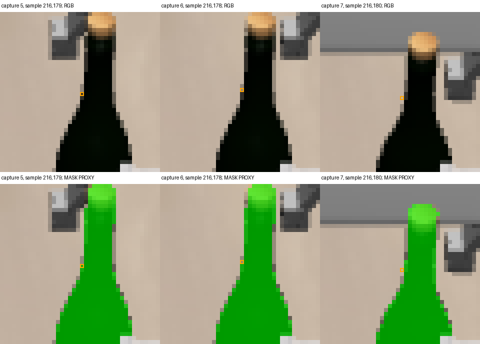

# Same tracks: center-index association removes the epsilon switch

Changing only the discrete pixel association to `floor(x+0.5)` removes the
first epsilon-induced depth switch in the sealed tracks. The broad close/open
co-motion contrast remains, and later proxy departures remain. This isolates
a measurement-contract issue; it does not certify track identity, depth
ownership or holding. Historical floor results are preserved unchanged.

The [protocol](../../research/task2_track_coordinate_association_protocol.md)
was frozen at **`dc1ec6c`** and independently approved before alternative
outcomes. The installed OpenCV 4.11.0 image-coordinate formula and a tiny
synthetic `getRectSubPix` check establish integer array-index centers. Analytic
tests check symmetric ±epsilon, half-pixel neighbor crossings, ties and bounds.
The rule was justified by that convention, without selecting it from mask
scores. Nine focused tests passed. The separate existing depth backprojection
still uses `(selected_index+0.5)`; no interpolated depth, fitted shift or camera
change was introduced.

All **45,264 original rows** retain their native LK coordinates, statuses,
errors, residuals, seeds and timing fields. There was no retracking, model,
physics or renderer call. Historical floor sampling reproduced every stored
surface row before the new association was computed. Alternative sensor
outputs were sealed before the same archived mask evaluator ran.

## Same-row contrast

Both conventions retain 492 native survivors and 492 valid depth samples in
both arms at every capture. Initial references and fixed preclose cohorts are
unchanged in size. Motion summaries remain unfiltered by evaluator membership.

| Quantity | Historical floor: close / open | Center-index nearest: close / open |
|---|---|---|
| Initial proxy True, denominator 492 | 414 / 414 | 414 / 414 |
| Capture 1 proxy True | 396 / 396 | 414 / 414 |
| Preclose proxy True | 401 / 401 | 410 / 410 |
| Final proxy True | 402 / 399 | 419 / 402 |
| Seeds with any observed proxy departure | 34 / 32 | 30 / 25 |
| First observed departure | Seed 5, capture 1 / same | Seed 124, capture 6 / same |
| Final median point Δz from preclose | 110.376 / 0.003887 mm | 110.935 / 0.003971 mm |
| Final median 3-D point–TCP residual | 5.036 / 114.329 mm | 4.404 / 114.329 mm |

The initial 78 outside-proxy seeds are unchanged and never silently removed.
At capture 1, 371/492 selected pixels and 338/492 depth values change in each
arm. At the final capture, changed pixels number 336 close and 323 open; changed
depths number 318 and 309. These are exact paired change counts, not accuracy
scores. Complete per-capture counts and both sets of motion summaries remain
in the [portable comparison](task2_track_association_summary.json).

For the fixed original witness, seed 5 at capture 1 has the same LK coordinate
`(216.99996948242188,169.00015258789062)` in both conditions. Historical floor
selects `(216,169)`, depth 1.201672196 m, proxy False. Center-index nearest
selects `(217,169)`, depth 0.975021720 m, proxy True—the same sample as the
initial frame. This removes that specific discrete sampling switch without
altering the optical flow or using a label to repair the point.

## Remaining first departure

Both arms' new earliest departure is seed 124 at capture 6, in their shared
approach prefix. Capture 5 maps to `(216,179)`, depth 0.992484868 m. At capture
6 the stored native-successful coordinate is
`(216.08856201171875,178.00608825683594)`, mapping to `(216,178)`, depth
1.171729684 m, outside the bottle proxy. Its forward/backward residual is
1.140162706 px; no residual cutoff was added. The roughly one-pixel transition
differs from the former epsilon-only switch, and remains adverse support
evidence under the convention-consistent association.

The original RGB, all sampled locations at fixed checkpoints and remaining
first-departure images were inspected separately from mask overlays. The
gripper enters the local visual neighborhood during the approach; the marked
samples lie at the bottle boundary. The observation establishes changed
sampled support, not replacement geometry or whole-patch identity loss.
There is still no native LK failure event; all such first-failure fields remain
null. No further repair follows automatically.

## Scope and evidence

This is a matched retrospective reassociation of one dense, dependent track
population, not a second tracking condition or independent replication.
Overlapping LK windows, sparse approach cadence, unknown render/depth cache
times, mixed initial support, raster/mask ambiguity, occlusion and slip remain.
Proxy agreement is not depth ownership or confidence. The old assistant-cap
trace was not reprocessed or folded into this condition; its earlier adverse
evidence remains separately qualified. Smaller-lift transfer is still separate.

Raw output: `/home/junhongli/projects/laya-embodied-runtime/runs/autonomous-research/task2-track-association-run-01`.
The `report/` directory retains complete population/location curves, both arms'
remaining-departure figures, original RGB and exact first-failure rows. The
original `task2-box-temporal-run-01` artifacts are unchanged.

| Artifact | SHA-256 |
|---|---|
| Journal | `b68ddf216f1164273301d58f35caf2a9b53f79d32b6e0c3e152a61ac7d20cbb3` |
| Alternative sensor seal | `d0bbf1a0671a34c8af96e10fd50321697200d5c07d775eb44b7f83c09862ec22` |
| Alternative sensor summary | `282cbb97218622bf9575863bebd0c299461107d7f0aa29a2e3e6dd4773f847fa` |
| Post-seal proxy membership | `5fadd07e60a134a305333056b844b22e828377a805087f7efefd1e2b055ec051` |

Independent closure: reviewer commit `9d24e28` verified every one of the
45,264 rows, native-field preservation, selected pixels/depth, deltas/cohorts,
all summaries, paired change counts and every proxy row without retracking.
Reviewer commit `315adc6` then passed this report, portable comparison and
figures, including original RGB and remaining-departure inspection. Review:
`docs/evidence/autonomous_research/task2_track_coordinate_association_independent_review.md`
in the independent `laya-information-boundary-review` worktree. No correction
or further scientific computation was needed.
