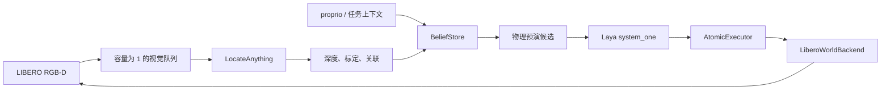

# Laya Embodied Runtime：交接与执行手册

> 更新时间：2026-09-21（Asia/Shanghai）  
> 代码仓库：<https://github.com/LilRodriguez/laya-embodied-runtime>（私有）  
> 工作分支：`master`  
> 本文只记录已核实的工程状态与下一步操作；不把尚未跑通的接口描述成实验结果。

## 0. 交接目标与边界

这个仓库要搭建的是 **Laya 决策 + Show-Harness 风格原子动作 + 多速率观测融合** 的 LIBERO / MuJoCo 实验外围，而不是无人机系统，也不是 Jev 的复刻。

最终闭环应为：

```text
LIBERO RGB-D / proprioception / task context
        │（各自频率、各自时间戳）
        ▼
BeliefStore：晚到拒绝、TTL、语义置信度融合
        ▼
候选动作生成：Show-Harness token + Jev-LIBERO 物理预演约束
        ▼
Laya system_one：只在合法候选中选一个原子动作
        ▼
AtomicExecutor → LiberoWorldBackend → robosuite / MuJoCo
        ▼
执行反馈、成功谓词、下一帧观测
```

这里的关键科学边界必须保持清楚：

- `jev-libero` 的 simulator state / `World.features()` 可以用于执行器标定、候选物理预演和 oracle 上界；它不能被写成“视觉方法”的输入或结果。
- LocateAnything-3B 是 2D 语言定位模型。它加上 RGB-D 后能生成带不确定度的 3D 观测，但不会自动给出物体跟踪、抓取可行性、碰撞检查、任务成功或下一步动作。
- Laya 是候选集上的结构化选择器。它不应直接输出连续 7D robosuite action；执行器只接受已验证的离散原子 token。
- 目前尚没有端到端 LIBERO 成功率表。下文的“已完成”仅表示相应代码或环境检查已完成。

## 0.1 交接时的一页状态表

| 领域 | 当前状态 | 可核验证据 | 下一步门槛 |
|---|---|---|---|
| GitHub | 私有仓库已创建、已推送 | `master` / `origin/master` 均为 `61e37ff` | 服务器安全同步这两个落后提交 |
| Runtime 合同 | 已实现，历史单测为 6 passed | `tests/test_runtime.py`、`tests/test_vision.py` | 在服务器同步后复跑；不把 mock 当实验 |
| LIBERO 后端 | 适配器代码已提交，真实任务未验收 | `embodied_runtime/adapters/libero.py` | 创建 world、逐 token 标定、headless episode smoke test |
| LocateAnything | RGB-D callback 接缝和 mock 测试已完成 | `embodied_runtime/vision.py` | 官方 checkpoint + 一张真实 LIBERO RGB 推理 |
| Laya | `system_one` 合同 mock 已完成 | `LayaProvider` 单测 | 正确 checkpoint 实际加载和一次真实决定 |
| 物理候选 | 尚未实现 | 基础 `CandidateBuilder` 仅支持标志位 veto | 接入 `World.predict_all()` 并写单测 |
| 实验表 | 尚未产出 | 服务器无 results/CSV/JSONL | 建 evaluator，完成至少一个 task 的真实原始日志和汇总 |



## 1. 已完成且已提交的内容

本地 HEAD 为 `61e37ff Fix RGB-D projection test`。提交链如下：

```text
06a2f59  Add Laya embodied runtime foundation
df0b4af  Polish runtime contracts and tests
9701d13  Make Laya adapter compatible with system_one API
4340e60  Test Laya structured decision seam
42bdc56  Add reproducible conda environment
f0176ef  Document mirror-based server setup
0d68b44  Document LocateAnything RGB-D perception plan
05d0827  Add LIBERO backend and LocateAnything RGB-D adapter
61e37ff  Fix RGB-D projection test
```

### 1.1 可运行的无模型核心

| 部件 | 文件 | 已实现的行为 | 已验证范围 |
|---|---|---|---|
| 观测事件合同 | `embodied_runtime/runtime_core.py` | `ObservationEvent` 包含来源、episode、序号、仿真捕获时间、质量、track id、TTL。非法时间/数值被拒绝。 | 单元测试 |
| 融合存储 | `embodied_runtime/runtime_core.py` | `BeliefStore` 按 `(source, track_id)` 拒绝乱序事件，按 `history_s` 拒绝太晚事件；语义以质量和年龄加权融合；过期语义提高 `unknown` 概率。 | 单元测试 |
| 动作合同 | `embodied_runtime/runtime_core.py` | Show-Harness 风格 token：`MV_*`、`ROTATE_*`、`STOP`、`GRASP`、`RELEASE`、`DONE`。`DONE` 由环境成功谓词硬门控。 | 单元测试 |
| 候选约束 | `embodied_runtime/runtime_core.py` | `CandidateBuilder` 仅生成动作候选；`DecisionProvider` 不能越过 `snapshot.allowed()`。 | 单元测试 |
| 执行器 | `embodied_runtime/runtime_core.py` | `AtomicExecutor` 将 token 映射到后端离散执行，记录 TCP 前后位置和成功标志。 | FakeBackend 单元测试 |
| 单进程运行时 | `embodied_runtime/runtime.py` | 观测→融合→候选→决策→执行的串行 loop。 | 可用于 fake smoke run |
| Laya 接缝 | `embodied_runtime/runtime_core.py` | `LayaProvider` 优先调用 `agent.system_one(state, questions)`，否则调用旧式 `predict`；无权重时可用 fake agent 测试结构化输出。 | 单元测试 |
| 回放 | `embodied_runtime/runtime_core.py`、`replay.py` | `ReplayProvider` 支持按 belief revision 重放 token。 | 代码已在，尚未做 LIBERO 轨迹回放实验 |

本地无模型验证命令（使用已安装项目依赖的 Python；当前 Windows 主机没有完整项目依赖，不能把这里的命令当成本次重新验证）：

```powershell
cd "D:\RA Career\LeadTheWay\vlmride\laya_embodied_runtime"
python -m venv .venv
.\.venv\Scripts\python -m pip install -e ".[dev]"
.\.venv\Scripts\python -m pytest -q
.\.venv\Scripts\python -m ruff check .
.\.venv\Scripts\python examples\fake_run.py
```

本次工作会话此前验证过 `pytest -q` 为 **6 passed**；交接时需在服务器的 Conda 环境重新验证。这是 fake / contracts 测试，不是 LIBERO 实验。

### 1.2 LIBERO / MuJoCo 执行接缝

`embodied_runtime/adapters/libero.py` 增加了 `LiberoWorldBackend`：

1. `from_task()` 通过 `jev_libero.config.load_task()` 与 `jev_libero.world.World` 创建真实 LIBERO world；
2. `tcp_pos()`、`gripper_width()`、`success()` 从该 world 获取执行/成功信息；
3. `apply_delta()` 将 `MV_*` 的 X/Y/Z 位移映射到 `World.execute("x±10mm" | "y±10mm" | "z±10mm")`；
4. 开合爪、保持和旋转都通过 `World.execute()` 下发，后者负责实际 robosuite 7D action 与多步控制；
5. 后端提供 `close()` 关闭 world。

这条路径的定位是 **真实仿真执行器适配器，当前仍使用 simulator state**。在接入 RGB-D 前，它适合做坐标、夹爪极性、原子动作尺度、Jev-LIBERO 预演与 oracle 上界验证。

### 1.3 LocateAnything + RGB-D 接缝

`embodied_runtime/vision.py` 目前提供一个不下载权重的、可注入推理函数的适配器：

1. 回调输入为 `rgb, query`，输出至少含 `boxes_xyxy` 和置信度；
2. `robust_depth()` 对候选框深度取有效像素中位数，并返回有效比例；
3. `pixel_to_camera()` 通过相机内参将中心像素与深度投影到相机坐标；
4. `LocateAnythingProvider.observe()` 产出带捕获时间、TTL、置信度和 track id 的 `ObservationEvent`，可喂给 `BeliefStore`。

设计依据与拟议指标详见 [vision_model.md](vision_model.md)。官方资料：

- [NVIDIA LocateAnything 研究页](https://research.nvidia.com/labs/lpr/locate-anything/)
- [权重页](https://huggingface.co/nvidia/LocateAnything-3B)
- [官方实现目录](https://github.com/NVlabs/Eagle/tree/main/Embodied)

目前的视觉单元测试只验证了深度中位数、针孔投影和事件生成，不代表调用过官方 checkpoint。

### 1.4 环境与服务器准备

`environment.yml` 定义了 Python 3.10 的 Conda 基础环境；镜像配置见 [server_setup.md](server_setup.md)。2026-09-21 的只读服务器审计得到以下精确状态：

- Miniforge：`/home/junhongli/miniforge3`；环境：`laya-embodied`；Python `3.10.21`；
- 已安装 `torch 2.2.0+cu121`、MuJoCo `3.5.0`、robosuite `1.4.1`、`laya 0.3.4`、`python-fcl`、scipy、pytest/ruff；`pip check` 曾为通过；
- Torch CUDA 可用，审计时能看到 7 张 RTX 4090。GPU 0、3、5 当时被其他工作以约 20.5 GiB / 100% 占用；开始新运行前应重新检查，不要抢占它们；
- 磁盘余量约 475 GiB；
- 上游检出干净：`/home/junhongli/projects/LIBERO` 在 `8f1084e3132a39270c3a13ebe37270a43ece2a01`，`/home/junhongli/projects/jev-libero` 在 `3bdad985b225`；
- `jev-libero pytest -q tests` 是此前会话的历史结果：`34 passed, 19 skipped`。其严格 simulation replay 曾在 `max_state_error == 0` 处得到 `5.295763827461997e-14` 而失败；这是机器精度差异，不能暗改断言后报告为全通过。

服务器项目仓库当前为干净的 `0d68b445c2343a2f75b9baa316018b945d33645b`，落后于 GitHub 的 `05d0827` 与 `61e37ff`，所以缺少当前的 LIBERO 和视觉适配器。服务器的 `origin` 不能无交互读取私有 GitHub 仓库；同步必须使用临时的安全认证方式，随后恢复不含秘密的 remote URL。

两套模型权重**均未就绪**：

- `/home/junhongli/models/huggingface/LocateAnything-3B` 仅约 25 MiB，只有 README/许可证/示例媒体等小文件，没有 config、processor 或 safetensors shard；
- `~/.cache/huggingface/hub/models--nvidia--LocateAnything-3B` 和 `models--convaiinnovations--laya` 都只有很小的 ref；
- 审计时没有属于该用户的模型下载进程。恢复前应检查缓存、磁盘和 log，不能因为存在目录就认为模型可用。

还有一个实质性环境阻塞：`transformers 5.17.0` 发现 Torch 仅为 2.2 后会打印“PyTorch >= 2.5 required”并禁用 PyTorch。因此，Laya checkpoint 下载完成前后都应优先将 Transformers 固定到与 Torch 2.2 兼容的 4.x 版本，或谨慎升级 Torch；前者下载更小，优先作为首个尝试。

服务器的地址、用户名和密码只存在用户提供的 `server.txt`，绝不能写入仓库、终端日志、实验表、Issue 或本文件。连接后应使用 SSH key 或现有安全凭据；不要把密码放在命令行参数或 Git remote 中。

## 2. 当前不是“完成”的部分

以下项目必须被当成未完成工作，而不是补写文档即可完成的事项。

| 优先级 | 缺口 | 为什么影响实验 | 需要完成的具体工作 |
|---|---|---|---|
| P0 | LocateAnything checkpoint 尚未验证可加载 | `vision.py` 目前只有 callback，完全没有真实模型推理 | 完成权重下载；用官方代码和一张 LIBERO RGB 测试图跑通真实 `infer(rgb, query)`；保存版本、commit、哈希、延迟日志 |
| P0 | Laya checkpoint 尚未验证可加载 | 目前只能 fake agent 验证 JSON contract | 下载正确的 typed-decisions checkpoint；固定兼容的 transformers/torch 组合；调用一次 `system_one` 并记录结构化响应 |
| P0 | 没有端到端 LIBERO 实验 driver | 不能产生任务成功率、延迟、失败类型表 | 新建 CLI/脚本，按 seed/task/method 运行 episode，写 JSONL 原始记录和 CSV/Markdown 汇总 |
| P0 | 视觉结果未进入真实 LIBERO loop | 现有 `LocateAnythingProvider` 没有采集 RGB-D、标定或 tracker | 从 LIBERO 相机获得 RGB、depth、K、T；实现最新帧队列、相机坐标→world/base 变换、关联和 TTL 检查 |
| P1 | 没有 Jev-LIBERO physics-preview candidate builder | 当前 `CandidateBuilder` 只看 `blocked_*` 标志，不能约束碰撞/可达性 | 用 `World.predict_all()` / 预测特征为每个原子 token 填 `feasible`、`reason_codes`、`risk`；只允许 Laya 在剩余候选中选 |
| P1 | 原子动作语义尚未校准 | `MV_FWD` 被暂时定义为 world +X，不是任务/相机前方 | 对每个 LIBERO task/camera 记录 token→world delta、夹爪极性、旋转轴；在文档和代码中固定 frame 定义 |
| P1 | 视觉深度实现与设计不完全一致 | 当前对整个 bbox 采样，边缘常含背景/遮挡 | 改为 bbox 内部裁剪（例如各边 20% margin）、MAD/IQR 离群值拒绝、有效像素/深度方差输出 |
| P1 | 轨迹追踪和观测协同未实现 | 异步模型结果可能对应旧帧或错误物体 | 实现 per-query/per-camera 单 worker 的 latest-frame 队列、capture sequence、IoU/3D track association、晚到/过期统计 |
| P2 | 可复现实验配置与数据管理不足 | 同事无法比较 oracle、视觉、规则、Laya | 以 YAML/JSON 固定 tasks/seeds/model revision/候选尺度/频率；每次运行写 manifest 和原始 JSONL |
| P2 | 包声明不充分 | `LiberoWorldBackend` 依赖 `jev-libero`，而 `pyproject.toml` 没声明它 | 将可安装路径、commit 与额外依赖写入 setup script/README；不要假装 `pip install -e .[libero]` 会带来 `jev-libero` |

已知代码问题也应先修：`embodied_runtime/__init__.py` 的 `__all__` 列出了 `load_laya_provider`，但该符号当前没有从 `runtime_core` 导入。应补上显式 import，并加一个 import-star 或直接导入测试。

## 3. 建议的下一轮执行顺序

不要同时扩散到 LIBERO-Pro、多个视觉模型和复杂 planner。第一轮以 **一个可重复的 LIBERO task、固定少量 seed、端到端可观测日志** 为目标。

### 阶段 A：先让模型与仿真真正可启动

1. 在服务器进入项目与环境：

   ```bash
   cd /home/junhongli/projects/laya-embodied-runtime
   source /home/junhongli/miniforge3/etc/profile.d/conda.sh
   conda activate laya-embodied
   git pull --ff-only origin master
   python -m pytest -q
   ```

2. 检查版本，而不是盲目升级：

   ```bash
   python - <<'PY'
   import torch, transformers, mujoco, robosuite
   print("torch", torch.__version__, "cuda", torch.cuda.is_available(), torch.cuda.device_count())
   print("transformers", transformers.__version__)
   print("mujoco", mujoco.__version__, "robosuite", robosuite.__version__)
   PY
   ```

3. 固定 Laya 的可用组合。服务器当前安装到了 `transformers 5.17.0`，它会因 PyTorch 2.2 被禁用；优先把 transformers 固定到一个满足 Laya `>=4.45` 且支持当前 Torch 的 4.x 版本，然后做一次真实 checkpoint load。只有成功加载后才可做 Laya 延迟测量。

4. 权重下载完成后，先做两个最小 smoke test：

   - 一张静态 LIBERO RGB 对 `"the target object"` 运行 LocateAnything，打印/保存原始模型输出；
   - 一个静态 `BeliefSnapshot` 交给 Laya，验证选择值属于候选 token。

每一步都先生成可检查日志；失败时保留完整 Python traceback 和版本信息，但不能泄露凭据。

### 阶段 B：把视觉观测接入真实 world

实现 `LiberoRgbdSource`（名称可调整），职责必须窄：

1. 以环境步为基准获取 RGB、depth、相机内外参和 `capture_sim_time`；
2. 为每帧分配严格递增的 `capture_seq`；
3. 视觉 worker 只持有最新待处理帧。若 worker 忙，新帧替换旧帧，并计数 `vision_queue_replaced`；
4. worker 的输出携带原始 frame id、capture seq、模型结束 wall time、query、box、score；
5. 仅当 episode、camera、capture seq、标定版本和 TTL 都仍匹配时，才写入 `BeliefStore`；
6. 深度点从 capture 时刻的相机变换投到 base/world，不能用“当前”机器人位姿替代旧帧变换；
7. 记录每个输入源的 `age_s`、late drop、out-of-order drop、queue replacement、p50/p95 延迟。

第一版 tracker 不需要学习模型：以 query 为分组，在同一 query 内使用 IoU + 3D 马氏距离门控；关联失败新建 track。要保存 covariance/深度有效比例，不能只保存一个无来源的点坐标。

### 阶段 C：把物理预演放在 Laya 前面

对于每个决策边界：

1. 从 Show-Harness token 生成小、固定的原子候选集；
2. 将 token 映射到 `jev-libero` 可预演动作（例如 `MV_FWD → x+10mm`，映射在 task/frame 标定配置中显式写出）；
3. 调用 `World.predict_all()` 或等价预演接口，抽取碰撞、workspace 越界、TCP/物体距离、夹爪状态、任务进度/成功等特征；
4. 设置 `Candidate(feasible, reason_codes, risk)`；
5. 决策时只把 `feasible=True` 的 token 交给 Laya；若为空，安全 `STOP` 并记录 `no_feasible_candidate`；
6. `DONE` 仍只能由真实环境 `success()` 接受。

不要把预演结果当成 Laya 的无约束连续控制权。它是候选 veto / 风险注释层。

### 阶段 D：建立诚实的实验表

先跑一个 task（建议从 `top_drawer` 或已在 `jev-libero` 配置中可稳定启动的 task 开始）、3 个固定 seed、每 episode 有固定 action budget。完成闭环后扩展到任务组和 LIBERO-Pro。

最小矩阵：

| 方法 ID | 目标 | 允许的观测 | 决策 | 必须标注 |
|---|---|---|---|---|
| `oracle_rule` | 执行与候选层上界 | simulator state | RuleProvider | `oracle=true` |
| `oracle_laya` | Laya 在正确状态上的选择 | simulator state | LayaProvider | `oracle=true` |
| `vision_rule` | 视觉测量是否足够稳定 | LocateAnything + RGB-D + proprio | RuleProvider | `oracle=false` |
| `vision_laya` | 完整方案 | LocateAnything + RGB-D + proprio | LayaProvider | `oracle=false` |
| `structured_only` | 视觉语义的消融 | proprio + 非视觉结构量 | 同一决策器 | `oracle=false` |

每一行至少输出：

```text
method, task, seed, success, termination_reason, env_steps, atomic_actions,
wall_time_s, decision_p50_ms, decision_p95_ms, vision_p50_ms, vision_p95_ms,
vision_age_p95_s, stale_drop_count, out_of_order_drop_count,
candidate_veto_count, no_feasible_count, object_3d_error_m,
track_switches, model_revision, code_commit, config_hash, oracle
```

结果文件应分两层：

- `runs/<run_id>/episodes.jsonl`：逐 action 的原始记录，可重算；
- `runs/<run_id>/summary.csv` 和 `runs/<run_id>/summary.md`：只由原始记录生成。

实验表的成功率必须展示 `n` 与 Wilson 95% CI；少量 3-seed 只用于 smoke test，不能宣称统计结论。

## 4. 精确的验证标准

在把某个项目勾为完成前，至少满足以下证据。

| 项目 | 合格证据 |
|---|---|
| Laya 接入 | checkpoint 实际加载；模型原始输出可存档；非法 choice 会被 runtime 拒绝；真实 `system_one` p50/p95 记录在表中 |
| LocateAnything 接入 | 官方 checkpoint 实际推理；保存至少一张 RGB 与原始 boxes/points；RGB-D 投影的坐标系、K、T、capture timestamp 可追溯 |
| 融合 | 构造并测试乱序、TTL 过期、worker 慢于环境、相同 query 多物体四种情况；所有 drop/replacement 有计数 |
| 物理候选 | 每个 veto 有 reason code；一个已知不安全候选被预演过滤；`DONE` 在未成功时抛错/拒绝 |
| LIBERO 运行 | 无渲染 headless episode 可稳定启动并关闭；每个 episode 有 seed、task、action log 和成功谓词 |
| 实验表 | 三种以上方法按同一 task/seed/action budget 比较；oracle 与非oracle 行显式分开；表可以由 JSONL 重建 |

## 5. 推荐的代码布局（下一位 Codex 应遵循）

```text
embodied_runtime/
  runtime_core.py        # 数据合同、BeliefStore、provider、executor
  runtime.py             # 串行协调器；之后可接 worker poll
  vision.py              # 通用 RGB-D 几何与模型输出合同
  adapters/
    libero.py            # 当前 jev-libero world 执行适配器
    locateanything.py    # 待新增：官方模型 load/infer/output parser
    libero_rgbd.py       # 待新增：相机采集、K/T、async latest-frame worker
    physics_preview.py   # 待新增：Jev-LIBERO 预测→Candidate
  experiments/
    run_libero.py        # 待新增：单 episode CLI
    summarize.py         # 待新增：JSONL→CSV/Markdown，不能混入执行代码
configs/
  smoke_top_drawer.yaml  # 待新增：task、seed、频率、预算、模型路径
tests/
  ...                    # 每个新合同有小型确定性测试
```

避免把 checkpoint、数据集、录屏、服务器凭据和绝对服务器路径提交进 Git。模型路径应来自 CLI 参数、环境变量或未跟踪的本地配置。大输出路径应忽略，但可提交小型、脱敏的 schema 示例。

## 6. Git 与服务器交接规则

本地仓库路径：

```text
D:\RA Career\LeadTheWay\vlmride\laya_embodied_runtime
```

服务器项目路径（此前使用）：

```text
/home/junhongli/projects/laya-embodied-runtime
```

服务器在此文档写入时已知落后于本地 HEAD（`0d68b44` vs `61e37ff`）；连接后先检查：

```bash
cd /home/junhongli/projects/laya-embodied-runtime
git status --short
git log --oneline -3
git pull --ff-only origin master
```

如服务器 remote 需要临时认证，只能使用安全凭据管理方式完成一次拉取，并立即恢复普通的无密 remote URL。绝不把 token 写进 shell history、文档或 `git remote -v` 输出。

推送前最小检查：

```powershell
cd "D:\RA Career\LeadTheWay\vlmride\laya_embodied_runtime"
python -m pytest -q
python -m ruff check .
git status --short
git add <明确文件>
git commit -m "..."
git push origin master
```

## 7. 下一位执行者的第一条任务提示词

可以把下面这段原样交给新的 Codex：

> 阅读 `docs/handoff.md`、`docs/vision_model.md` 与当前 Git 状态。不要把 oracle simulator state 计入视觉方法。先在服务器的 `laya-embodied` Conda 环境中核实本地/远端 commit、Torch/Transformers 兼容性和两份模型权重下载状态。修复 `load_laya_provider` 导出问题，并用真实 checkpoint 分别完成 Laya `system_one` 和 LocateAnything 单图推理 smoke test。随后实现严格带 capture timestamp 的 LIBERO RGB-D source、latest-frame 视觉 worker 和 Jev-LIBERO physics-preview candidate builder。最后实现一个可复现的 `top_drawer` 单任务实验 CLI，写 JSONL 原始动作日志与自动生成的 CSV/Markdown 表；运行 oracle_rule、oracle_laya、vision_rule、vision_laya、structured_only 的固定 seed 试验。每次提交前跑 pytest 和 ruff；任何未跑通项在表中标为未完成，不要伪造成功率。

## 8. 参考资料

- [Show-Harness](https://github.com/showlab/Show-Harness)：原子动作 token 与任务分解灵感。
- [Laya](https://github.com/NandhaKishorM/laya)：结构化 typed decision 接口来源。
- [Jev-LIBERO](https://github.com/Dimweaker/jev-libero)：LIBERO `World`、物理预演和现成任务配置来源。
- [LIBERO-Pro](https://github.com/Zxy-MLlab/LIBERO-PRO)：后续扩展 benchmark；第一轮不应阻塞在它。
- [LocateAnything](https://research.nvidia.com/labs/lpr/locate-anything/)：视觉语言定位模型；详见 `vision_model.md` 的能力边界。
