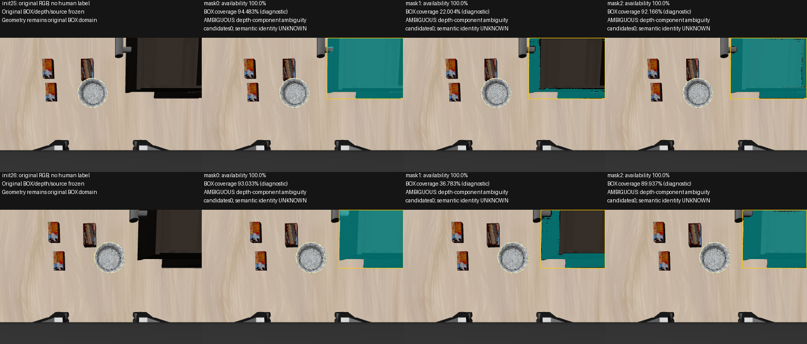

# P1 mask-support repair — complete

**All six unchanged masks now have100% depth availability, but all six fail the
original depth-component ambiguity gate. Candidates0. Development tuning CLOSED.**
No LocateAnything/SAM inference or query/mask/geometry-threshold/order change.
No tracker, control, Qwen or Laya. Next milestone: frozen50-frame evaluation.

Execution: clean `5f971665a00a0585655c437225e99ea3d0b0c12d`;
[prospective protocol](research/p1_mask_support_measurement_protocol.md).
`b5ada28` and evidence `26648a3` remain under tags
`p1-sam2-inference-baseline-b5ada28` and `p1-mask-support-input-evidence-26648a3`.

## Contract and all-mask result

For `native-mask-depth/2`, availability is valid depth inside the **complete
native mask** divided by native mask pixels. Original finite/min/max rules and
threshold0.50 remain. Empty mask has unknown availability and returns UNKNOWN.

Original BOX coverage is independently recorded as mask pixels inside BOX / BOX
pixels; native full area and BOX counts are also preserved. Neither coverage
measure gates availability. Fitting still uses original BOX with outside-mask
depth UNKNOWN. Init25 mask0's16037 native pixels include16029 inside and8 outside
BOX; all16037 have valid depth and count for availability. No mask crop/fill.

| Sample | Mask | Availability | BOX coverage | Largest / second component | Result |
|---|---:|---:|---:|---:|---|
| init25 |0 |100% |94.483% |9902 /6105 |AMBIGUOUS;0 candidates |
| init25 |1 |100% |22.004% |1924 /1756 |AMBIGUOUS;0 candidates |
| init25 |2 |100% |92.166% |9704 /5927 |AMBIGUOUS;0 candidates |
| init26 |0 |100% |93.033% |7157 /5542 |AMBIGUOUS;0 candidates |
| init26 |1 |100% |36.783% |2776 /2249 |AMBIGUOUS;0 candidates |
| init26 |2 |100% |89.937% |6884 /5405 |AMBIGUOUS;0 candidates |

The narrow masks now pass availability, exposing competing disconnected depth
supports. The repair removes the denominator error but does not establish
surface association. Planes, edge margins, tool interiors and feasibility still
are not reached; physical absence is not established. Every native ordinal0/1/2
was processed for both samples without IoU selection or first-VALID exit.
No development candidate exists for human-region attribution; those frames
have no independent annotation, so identity remains UNKNOWN.

## Freeze and formal50 transition

No further threshold/segmentation tuning on init25/26. The
[formal50 entry receipt](evidence/p1_grounding/mask_support_reanalysis_20261007/formal50-evaluation-entry.json)
pins pipeline code/hashes, unchanged annotation/rules/seal,50 original384×256
RGB-D frame identities (25 agentview/25 wrist),100 ordered fixed-query BOX
records, SAM condition and existing P1 acceptance gates.

Annotations retain existing independent-human-by-user-report provenance, not
independent authentication or a new annotation set. Labels never enter generation,
mask choice or policy. Future candidates outside a VISIBLE human drawer-front
region count as **semantic/segmentation identity failure**, not task-valid
geometry success; UNKNOWN/NOT_VISIBLE never silently become target evidence.

This round forbids inference and supplies no native-mask corpus for those50 IDs.
Repaired-pipeline scoring is explicitly `PENDING_SEALED_NATIVE_MASK_CORPUS`;
old BOX-only evaluation and development results do not substitute. Next route:
50-frame evaluation → ten temporal sequences → P1 GateA/B/C → P2a/B0.
Current P1 remains Gate C, reference/VERIFY UNKNOWN. No development detour follows.

## Verification

13 focused tests passed, including availability, missing/empty depth, absolute-
support rejection and existing source binding. Real replay matches both old BOX
outputs and all six legacy mask outputs exactly. Geometry configuration/threshold
bytes are unchanged; component-through-candidate code is AST-identical to
`b5ada28`. Default BOX behavior, legacy measurement mode and old source guards
remain. Source/seal/lint and independent read-only audit pass. No broad test suite.

[Full evidence](evidence/p1_grounding/mask_support_reanalysis_20261007/README.md)
retains every result/metric/candidate list, prospective registration, exact source
lineage, process receipt, invariants, review and50-frame entry. Existing raw masks
are referenced by hashes rather than copied; historical evidence is intact.
