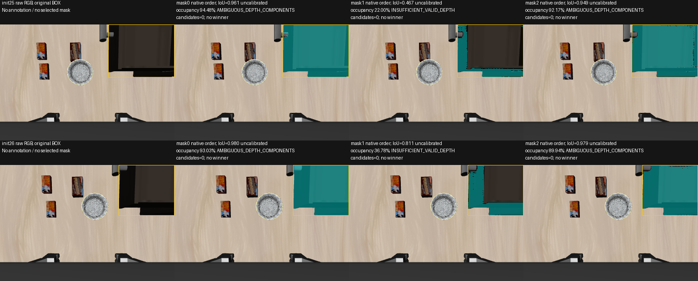

# P1 BOX / SAM2 matched development diagnostic — 2026-10-07

**Completed, with no admitted geometry candidate.** Strict deterministic SAM
execution now works; the perception/interface diagnostic keeps P1 at **Gate C**.
This is two already-inspected development wrist frames, not a held-out benchmark.
No tracker, reference completion, PUSH, Qwen or Laya ran.

Execution: clean `b5ada28becf7b84c57d4ea5c5dc41e78a1f42182`, branch
`feat/p1-segmentation-surface`. The
[preregistered condition](research/p1_sam2_deterministic_grid_protocol.md) inherits
exact BOX/RGB-D inputs from the prior frozen conditions. **Zero new LocateAnything
calls, zero human-label/oracle-target inputs.** Queries, official SAM source and
weights, typed semantics, seed, original geometry gates and BOX denominator fixed.

## Deterministic compatibility repair

The only inference overlay replaces the dense positional encoder's CUDA cumulative
sum of a64×64 all-ones grid with exact float32 integer sequences1..64. Its native
subtraction, normalization and `_pe_encoding` remain. Override applies to the
loaded instance's dense-grid forward; `forward_with_coords` and learned buffers
are unchanged. Official source checkout is unchanged. Strict deterministic
algorithms remain enabled; no `warn_only` or nondeterministic reference run.

Before images, dtype/shape/raw bytes match for original versus repaired CPU PE,
CPU-cumsum coordinate grid transferred to GPU versus GPU-arange grid, and both
grids encoded on the same GPU/buffer. Max PE difference0.0; Gaussian buffer
unchanged. This is tested grid/PE equivalence, not full native-versus-repaired
GPU output equivalence: the strict native path cannot execute CUDA `cumsum`.

The first overlay run at `98d9f33` completed init25 prediction and wrote three raw
masks, then an inherited duplicate `calibrated_confidence` keyword broke record
serialization. It remains STOPPED/unsealed with full NPZ and trace preserved.
The user authorized continuing across routine milestones. Reporting-only repair
at `b5ada28` removed that redundant keyword; a separately registered fresh process
regenerated both images. Thus three predictions completed across this task,
including one disclosed extra init25 call. The two init25 NPZ files are entirely
byte-identical. No cached model state, archived controls or hidden retry used.

## Matched results

All three native decoder multimasks retained in canonical order; no winner.
Outside each native mask, depth becomes UNKNOWN. Original BOX and denominator,
geometry threshold0.50, component/plane/tool gates and EEF input remain fixed.
All retained mask pixels inside each BOX have valid sensor depth here, so mask
occupancy and original-BOX valid-depth ratio are equal.

| Sample / condition | BOX-depth coverage | First geometry boundary | Candidates |
|---|---:|---|---:|
| init25 original BOX | 100% | AMBIGUOUS_DEPTH_COMPONENTS | 0 |
| init25 mask0 | 94.483% | AMBIGUOUS_DEPTH_COMPONENTS | 0 |
| init25 mask1 | 22.004% | INSUFFICIENT_VALID_DEPTH | 0 |
| init25 mask2 | 92.166% | AMBIGUOUS_DEPTH_COMPONENTS | 0 |
| init26 original BOX | 100% | AMBIGUOUS_DEPTH_COMPONENTS | 0 |
| init26 mask0 | 93.033% | AMBIGUOUS_DEPTH_COMPONENTS | 0 |
| init26 mask1 | 36.783% | INSUFFICIENT_VALID_DEPTH | 0 |
| init26 mask2 | 89.937% | AMBIGUOUS_DEPTH_COMPONENTS | 0 |

Original BOX components: init25 9902/7036 dominant supports; init26 8070/5542.
Broad masks0/2 retain comparably sizeable disconnected supports. Narrow masks1
have3733/16965 and5026/13664 valid masked pixels per original BOX. No candidate
was discarded, no physically distinct mask merged, no plane selected by score.
Neither baseline nor any mask reaches plane fitting; downstream plane/edge/tool
support is **not evaluated**, not shown absent.

Root and independent agent inspected both raw RGBs and all six native silhouettes
and overlays after sealing. The broad masks cover a dark central recessed/interior-
looking region and its perimeter; they do not isolate the requested outward front.
Narrow masks exclude much of the center but retain an L-shaped left strip and
bottom lip/base-like band. They may contain useful panel surface; identity/purity
remain unverified, especially in this downward/clipped wrist view. This qualitative
development review is not human evaluation annotation or simulator truth.

Predicted IoU scores are uncalibrated: init25 [0.9613,0.4667,0.9495],
init26 [0.9796,0.8111,0.9791]. They confer no target identity or action authority.

## Interpretation and next gate

Observed: two narrow masks fail the original BOX-depth availability gate before
their components/planes are tested. This is the preregistered **mask-support /
original-ROI denominator incompatibility**. A mask covering less than50% of the
BOX cannot pass that gate even with perfect depth. It is not proof of absent
physical support or SAM incapacity.

Observed: four broad masks remain multi-component ambiguous. Qualitative review
supports continued subpart contamination. Correct drawer-front association and
usable tool-interior support remain unestablished. The physical-surface-insufficiency
hypothesis is unresolved because early gates prevent its evaluation.

Next substantive experiment would separate sensor-depth availability from mask
occupancy in a prospectively fixed mask-support measurement contract, while
retaining absolute support, plane, edge, uncertainty and semantic-association
checks. It must evaluate all sealed masks without selecting by score or first
VALID result. **No denominator/gate rewrite is implemented here.** A successful
local plane still would not prove target identity, continuous tracking, fixed
reference or VERIFY. Do not enter tracker/P2 to compensate for missing evidence.

## Timing, validation and evidence

Encoding/prediction: init25 152.83/79.00ms; init26 44.98/10.84ms. Geometry:
original BOX 91.05/73.04ms; broad masks66.95–86.27ms; early-rejected narrow
masks5.40/6.43ms. Two offline samples include startup/cache effects; these are
not end-to-end continuous Hz, target throughput, drop rate or freshness evidence.

Native/BOX/geometry stage seals passed; original core geometry/runtime/tracker/
servo/scheduler/provider hashes match `1fedb9c`. Changed-file lint passed.
Meaningful validation was actual numerical equivalence and stage integration;
no broad historical test suite or additional semantic-model run added.

[Portable evidence and exact summary](evidence/p1_grounding/box_sam2_grid_20261007/README.md)
retain raw logits/lowres/IoU/masks, all candidates/metrics, source lineage,
process identities/logs, equivalence proof, partial failure and independent review.
Archive member bytes verified; weights/environments and existing sensor captures
are referenced, not duplicated. Historical failures remain intact.
