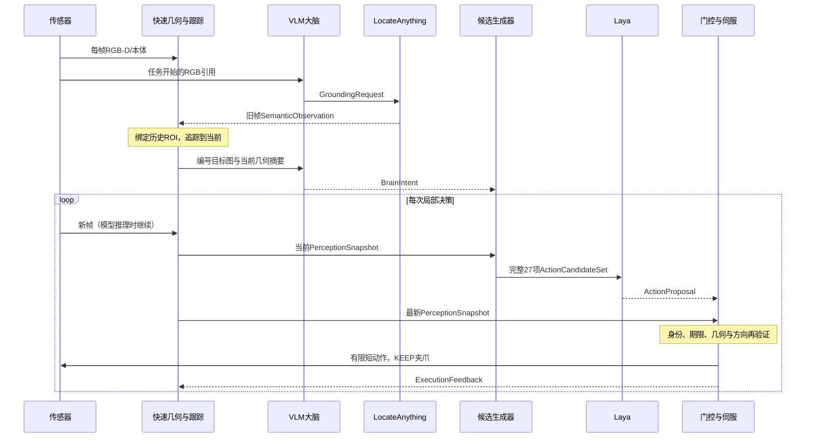

# 模块通信协议与完整异步推理例子

日期：2026-09-29。协议版本：`embodied.protocol/1`。

**这是拟实施的接口设计，尚未接入现有运行代码。下面的数值是自洽的演示轨迹，不是实际模型推理或任务成功记录。** 不重复下载模型或更改当前控制器。

相关文档：[总体计划](brain-cerebellum-plan-v2.md)、[目标点估计](target-point-perception.md)。

## 1. 模块和消息

| 发布方 | 消息 | 订阅方 | 内容 |
|---|---|---|---|
| 任务入口 | TaskCommand | 大脑、调度器 | 原始任务、目标版本、预算 |
| 传感器采集 | FrameBundle | 语义定位、快速几何、大脑 | 同时刻RGB-D、K/T、本体状态 |
| 大脑 | GroundingRequest | LocateAnything | 查询目标/部件、引用帧 |
| LocateAnything | SemanticObservation | 关联器 | 原帧二维框、定位存在性 |
| 点云几何 | GeometryObservation | 跟踪与融合 | 观测面片、接触点候选、协方差 |
| 跟踪与融合 | PerceptionSnapshot | 大脑、候选、执行门控 | 当前目标、本体、几何年龄/状态 |
| 大脑 | BrainIntent | 调度器、候选、小脑 | 目标ID、阶段、约束模板 |
| 候选生成器 | ActionCandidateSet | Laya、规则baseline | 完整27项、参数、可执行状态 |
| Laya | ActionProposal | 执行门控 | 所选动作ID、版本引用、期限 |
| 执行门控 | ActionContract / Rejection | 唯一伺服执行器、日志 | 最新几何验证后的短执行段 |
| 执行器 | ExecutionFeedback | 状态整理器、大脑、日志 | 实际机器人运动和拒绝/中断 |
| 感知完成检查 | StageEvidence | 调度器、大脑 | 视觉阶段证据；未知也明确输出 |
| 独立评测器 | EvaluationRecord | 离线分析 | 官方success等真值，策略禁止订阅 |

VLM为Qwen3-VL-4B-Instruct，二维定位复用LocateAnything，小脑用Laya。上述选择是计划，不表示模型已完成联合验证。



## 2. 通用消息信封

所有进程传送同一种信封；模块payload不自己重复拼接不一致的身份。

```json
{
  "protocol": "embodied.protocol/1",
  "message_type": "PerceptionSnapshot",
  "message_id": "ep7/fusion/218",
  "producer": "fusion",
  "producer_seq": 218,
  "episode_id": "ep7",
  "episode_generation": 1,
  "goal_generation": 3,
  "clock_domain": "server-A/boot-09",
  "reference_sim_time_s": 6.40,
  "emitted_monotonic_ns": 102200000000,
  "source_ids": ["ep7/geometry/217", "ep7/proprio/128"],
  "payload": {}
}
```

规则：

- `message_id`全局唯一；重发相同ID幂等。`producer_seq`只在同生产者/episode内比较，不把语义和几何的序号互相比较。
- `episode_generation`在reset时改变；`goal_generation`在换任务/取消目标时改变。旧generation不得改变状态。
- 时间单位显式：运动预测用`sim_time_s`；模型耗时和墙钟deadline用同一`clock_domain`的monotonic纳秒。跨机器不能直接比较monotonic值，需要重新建立接收端期限和传输预算。
- 采集payload保存原始`capture_sim_time_s/capture_monotonic_ns`。快照有当前参考时刻，也保留每项最后接受观测时间。一次融合/读取不刷新观测年龄。
- 每个消费者在接收时另记`received_monotonic_ns`，计算queue/transport延迟；原消息不可变。
- `source_ids`记录真实数据依赖，图像/深度引用保留校验和、shape/dtype、布局和depth scale。共享内存仅在消费者释放或超时后回收；日志引用持久保存，不能是已失效的环形缓冲槽。
- 不允许NaN/Inf，缺测写`null`并同时给`valid=false/reason`。单位米/弧度/秒，像素只用于图像空间；姿态采用`position_m`和`quaternion_xyzw`，不用无说明的7维列表。
- `robot_base`是本episode固定坐标系，点云和EEF统一至该坐标系；变换必须使用采集时刻，不读取隐藏物体pose。

## 3. 各模块payload合同

下面是payload必需字段；实际消息外面都加第2节信封。数组中的covariance采用明确形状，生产者不能用quality字符串代替数值误差。

### 3.1 TaskCommand与FrameBundle

TaskCommand：`instruction, task_id, controller_config_id, robot_model_id, episode_budget_sim_s, episode_budget_wall_s`。budget由调度器执行，模型不能扩大。

FrameBundle：

```text
bundle_id, capture_sim_time_s, capture_monotonic_ns
views[{camera_id, frame_seq, calibration_version,
       rgb_blob, depth_blob, width_px, height_px,
       depth_units="m", pixel_origin="top_left",
       intrinsics_K[3,3], T_base_camera[4,4]}]
proprio{capture_sim_time_s, eef_position_base_m[3],
        eef_quaternion_xyzw[4], joint_position_rad[N],
        gripper_width_m, valid}
```

每个view须同次RGB/depth捕获；双相机不同步时分别保留时间，不能伪装同时曝光。腕部外参来自标定+本体FK。K调用按height,width验证，非方形图像作为必测案例。

### 3.2 GroundingRequest与SemanticObservation

GroundingRequest：`request_id, query_generation, query, camera_id, frame_seq, calibration_version, frame_ref, deadline_monotonic_ns`。只有合法帧引用可进入定位模型。

SemanticObservation：`request_id, query_generation, camera_id, frame_seq, calibration_version, capture_sim_time_s, boxes_xyxy_px[N,4], detection_present, calibrated_confidence, raw_output_ref, model_revision, latency_ms`。

`calibrated_confidence=null`直到独立校准；“有框”不是1.0概率。原始量化框转像素只做一次，约束`0<=x1<x2<=width`和`0<=y1<y2<=height`，退化/越界/重复框显式处理。

语义晚到时：找到历史frame，建立/确认ROI与track；用缓冲RGB-D追踪到当前，质量通过才绑定。已经存在可靠track时只修正语义，不把旧depth点重新计权。历史缺失则`HISTORY_MISSING`，不能按旧bbox直接抓当前目标。

### 3.3 GeometryObservation与PerceptionSnapshot

GeometryObservation：`track_id, track_generation, feature_id, source_frame_ids, camera_calibration_ids, capture_sim_time_s, frame="robot_base", position_m[3], position_covariance_m2[3,3], normal_unit[3], normal_covariance[3,3], visible_patch_ref, edge_margin_m, plane_residual_m, support_ratio, status, reason_codes`。

几何status：`TRACKED / DEGRADED / LOST / AMBIGUOUS`。feature是可见面片/推点，不是MuJoCo物体site。法向无充分支持时invalid，不能归一化零向量。

PerceptionSnapshot：`snapshot_id, revision, tracks[], proprio, observed_occupancy_ref, calibration_versions, safety_state`。

tracks至少包含：track/feature generation、当前位置/法向估计、最后接受几何时刻、最后语义绑定时刻、covariance、occlusion、quality、各自age、来源。未知空间和观测空闲空间分开；接触后不能无限CV外推。

状态整理器计算`target_error_base_m = desired_eef_position_base_m - measured_eef_position_base_m`。目标点与预备位置分开：抽屉接触点`p_contact`，外向法向`n_out`，预备位置`p_standoff = p_contact + d_standoff*n_out`。本例d=0.030m来自配置，不由VLM猜测。

### 3.4 BrainIntent与StageEvidence

BrainIntent：`intent_id, intent_generation, based_on_snapshot_id, target_track_id, target_track_generation, feature_id, feature_generation, stage, operation, constraint_template_id, completion_template_id, policy_config_revision, expires_monotonic_ns, max_duration_sim_s, abstain`。

阶段：`OBSERVE / APPROACH / ALIGN / INTERACT / RETREAT / VERIFY`。VLM只选择已存在的目标/feature和注册模板；数值阈值、工具尺寸和控制预算来自配置。

较老snapshot不等于无效意图。调度器检查generation、track lineage、feature存在、语义一致与deadline，允许可靠对齐到当前的意图。目标变化或完成证据触发新的intent generation。VLM返回建议，只有调度器能原子安装/替换当前intent。

StageEvidence：`intent_id, stage, source_snapshot_ids, predicate_id, result=SATISFIED|NOT_SATISFIED|UNKNOWN, metrics, thresholds_revision`。VERIFY需要可见固定柜体参照和闭合几何；静止/推不动不等于关闭。官方success不进入此消息。

### 3.5 ActionCandidateSet：完整27项

候选集包含`catalog_revision, intent_id/generation, source_snapshot_id, target_track/generation, feature_id/generation, candidates[27], presentation_order, candidate_hash, generated_monotonic_ns, proposal_deadline_monotonic_ns`。

固定词表如下，每项保持稳定ID；平移单位m、旋转单位rad，全部reference frame=`robot_base`。工具坐标或任务局部坐标作为将来新catalog，不能静默改变ID含义。

```json
{
  "catalog_revision": "base27-v1",
  "translation_step_m": {"03":0.003,"10":0.010,"40":0.040},
  "rotation_step_rad": 0.17453292519943295,
  "ids": [
    "X-40","X-10","X-03","X+03","X+10","X+40",
    "Y-40","Y-10","Y-03","Y+03","Y+10","Y+40",
    "Z-40","Z-10","Z-03","Z+03","Z+10","Z+40",
    "RX-10","RX+10","RY-10","RY+10","RZ-10","RZ+10",
    "OPEN","CLOSE","HOLD"
  ]
}
```

每项记录`id, primitive, reference_frame, nominal_delta, execution_status=ALLOWED|BLOCKED|UNKNOWN, hard_reason_codes[], geometric_effect_estimate, max_segment_duration_s, max_segment_translation_m, max_segment_rotation_rad`。

**不能因“增加目标误差”“本阶段不优”“VLM不喜欢”而BLOCKED。** 那些是提供Laya比较的软信息。只能根据已观测空间、机器人运动学/工作空间、工具/连杆扫掠、执行器能力或时效硬约束门控。例：`JOINT_LIMIT / OBSERVED_COLLISION / SPACE_UNKNOWN / GEOMETRY_STALE / SENSOR_INVALID`。

所有27项在日志和状态中存在；Laya choice选项覆盖全部ALLOWED项，blocked/unknown另以状态给出；不是按排名取top-K。其实际推理选项数随物理条件变化。模型仍可能选错ID，执行层最后硬拦截，不假设提示可以替代门控。VLM决定目标阶段，不删除机械臂词表。

`candidate_hash`：排除纯日志时间字段，把catalog、intent/target/feature generation、source snapshot、完整参数和状态按UTF-8规范JSON（key排序、紧凑分隔、禁止NaN）做SHA256。每个请求保存选项排列和token截断检查，返回ID不能只凭显示序号解码。

±40mm和±10°是上限动作意图。执行只安装一个≤100ms、平移≤5mm/旋转≤2°的片段（接触更小），明确返回`PARTIAL`和remaining magnitude；下一片段必须重新得到有效合同。不能把40mm暗中当3mm，也不能一次盲执行40mm。

### 3.6 LayaRequest与ActionProposal

LayaRequest：`request_id, intent_id/generation, candidate_set_id/hash, source_snapshot_id, target/feature generation, stage, operation, relative_error, geometry_age, quality/covariance_summary, proprio, recent_feedback, candidates, deadline_monotonic_ns`。

需要Laya的数值是error及关系摘要，不是整幅点云。不使用隐藏对象关节、真实轴、contact identity或预测分支。完整27项预算须实测无截断；不通过就修输入预算/域内训练，不能悄悄删选项。

ActionProposal：`request_id, decision_id, candidate_set_id/hash, intent/target/feature generation, source_snapshot_id, selected_action_id, probabilities_by_action, raw_confidence, calibrated_confidence, model_revision, inference_ms`。

期限继承请求deadline，模型不能把deadline重新向后写。概率必须有限、非负且在本请求合法ID上归一化；原始confidence不作为物理安全证明。返回invalid choice或输出格式错误产生Rejection。

### 3.7 ActionContract与ExecutionFeedback

ActionContract：`contract_id, decision_id, intent/target/feature generation, source_snapshot_id, validated_snapshot_id, action_id, reference_frame, delta_position_m[3], delta_rotation_rad[3], gripper_command=KEEP|OPEN|CLOSE, target_eef_pose, issued_sim_time_s, valid_until_sim_s, issued_monotonic_ns, expires_monotonic_ns, controller_config_id`。

安装前按最新snapshot再验证：

1. 当前episode/goal/intent/target/feature generation一致；proposal未过期，catalog/hash匹配原请求。
2. 当前几何/本体/标定仍有效，安全状态允许所选动作。
3. 旧source snapshot与当前有同一target lineage。允许重新计算**同方向同类别**短片段；目标移动超过容差、法向/纠正方向发生语义变化则拒绝，绝不能擅自选另一个动作。
4. 执行合同同时受sim与wall deadline约束；任一过期即停止。上层只传KEEP/OPEN/CLOSE，后端独占极性。
5. 同一时刻只有一个active contract。安装幂等，重发不重复执行；每个servo tick检查期限和最新状态，已取消/更换goal不得继续运动。

ExecutionFeedback：`contract_id, decision_id, status=COMPLETED|PARTIAL|ABORTED|REJECTED, started/finished_sim_time_s, started/finished_monotonic_ns, measured_eef_delta_m, measured_gripper_state, remaining_requested_magnitude, reason_codes`。

目标误差变化由融合器拿新几何和反馈计算，另带`before_snapshot/after_snapshot`，不能把尚未采集的新目标位置伪造到执行器结果中。伺服tick仍继续发布本体读数。

Rejection通用字段：`rejected_message_id, reason_code, checked_snapshot_id, retryable, detail`。理由包括`WRONG_EPISODE / WRONG_GOAL / INVALID_SCHEMA / CALIBRATION_CHANGED / HISTORY_MISSING / TARGET_LOST / INTENT_REPLACED / PROPOSAL_EXPIRED / ACTION_BLOCKED / ACTION_SEMANTICS_CHANGED`。拒绝时保持或停止，告知调度器重请求；不无限紧循环重试。

## 4. 异步队列与生命周期

| 通路 | 队列/交付语义 | 满或失效时 |
|---|---|---|
| RGB-D→快几何 | 每camera最新pending=1；图像历史环初值5s | 覆盖计数，保留capture身份 |
| 定位/大脑/Laya请求 | 每worker一个in-flight、一个latest pending | pending替换；新goal取消旧结果 |
| 慢推理结果 | 有界结果队列；到达仍须门控 | 过期/身份错计数，不能silent续命 |
| PerceptionSnapshot | 原子latest不可变对象 | 消费者可读新状态，不修改老对象 |
| 意图安装/合同/取消/反馈 | 有界可靠控制事件，ACK/idempotent重发 | 不得latest覆盖丢控制命令；ACK缺失时停住 |
| 日志/评测 | 独立追加，完整原始信封和结果 | 标记丢日志/错误，不能用缺失记录声称成功 |

模型结果延迟对准capture与track，不按到达顺序覆盖几何。stop/reset先撤销goal/contract，再等待worker退出/完成或丢弃旧epoch结果。关闭时不能留下持GPU的daemon。

## 5. 一次可复算的推理轨迹

### 前提与坐标

下面是合成演示，不是模型实际输出。时间`wall_elapsed_s`是同一server monotonic时钟的显示形式；每行的ns值等于秒乘1e9。仿真以实时节奏运行，等待慢模型时机械臂HOLD，但相机/几何继续更新。

假设视觉得到抽屉正面接触点`p_contact=[0.400,0.100,0.300]m`，外向法向`[-1,0,0]`。预备距离配置0.030m，因此APPROACH目标`p_standoff=[0.370,0.100,0.300]m`。机器人当前EEF=`[0.350,0.096,0.300]m`，误差为`[0.020,0.004,0]m`。这些是观测示例，不能从MuJoCo隐藏目标位姿读取。

### 时间线

| wall_elapsed_s | sim_time_s | 发布/消费与内容 |
|---:|---:|---|
| 100.00 | 4.20 | Frame118：RGB-D与EEF；任务为关闭上层抽屉 |
| 100.20 | 4.40 | Qwen查询请求：`upper drawer front panel`，引用Frame118 |
| 102.20 | 6.40 | Locate结果完成：Frame118像素框`[92,104,272,224]`；这是4.20s的框，不是6.40s框 |
| 102.35 | 6.55 | 关联器从历史帧118回放到当前；track drawer_2建立，输出当前几何；当前有效捕获6.50s |
| 102.35 | 6.55 | Qwen读取编号目标和几何，提出APPROACH阶段；机器人仍HOLD |
| 104.35 | 8.55 | Qwen意图返回；目标lineage相同，调度器安装intent17；读取snap218，capture=8.50s |
| 104.35 | 8.55 | Laya请求：相对误差`[20,4,0]mm`、最新geometry age=0.05s、完整27项 |
| 104.65 | 8.85 | Laya示例返回`X+03`；期间相机已产snap224，capture=8.80s |
| 104.65 | 8.85 | 执行门控：intent/target/hash一致，proposal未过期；以snap224重新检查X+03 |
| 104.75 | 8.95 | 100ms合同结束，实际EEF增量`[0.0028,0.0001,0]m` |
| 104.80 | 9.00 | 新Frame/几何：EEF=`[0.3528,0.0961,0.300]m`，目标未移动；误差=`[0.0172,0.0039,0]m` |

从首次语义到局部动作的等待没有让控制线程阻塞。没有可靠目标时一直HOLD；不以盲运动展示“异步”。最终目标点/方向的质量必须依赖真实捕获及回放，不能仅把旧点更新时间改成8.80s。

### 大脑意图与小脑输入

```json
{
  "intent": {
    "intent_id": "intent17",
    "intent_generation": 1,
    "target_track_id": "drawer_2",
    "target_track_generation": 1,
    "feature_id": "front_patch_4",
    "feature_generation": 1,
    "based_on_snapshot_id": "snap204",
    "stage": "APPROACH",
    "operation": "PUSH",
    "constraint_template_id": "standoff_visible_surface/v1",
    "completion_template_id": "standoff_reached/v1",
    "expires_monotonic_ns": 120350000000
  },
  "laya_input": {
    "request_id": "laya64",
    "intent_id": "intent17",
    "source_snapshot_id": "snap218",
    "candidate_set_id": "cand64",
    "candidate_hash": "COMPUTED_SHA256_AT_RUNTIME",
    "geometry_capture_sim_time_s": 8.50,
    "reference_sim_time_s": 8.55,
    "geometry_age_s": 0.05,
    "target_standoff_base_m": [0.370,0.100,0.300],
    "eef_position_base_m": [0.350,0.096,0.300],
    "relative_error_base_m": [0.020,0.004,0.0],
    "quality": "TRACKED",
    "gripper_state": "OPEN",
    "previous_error_trend": "NO_ACTION_YET",
    "allowed_action_ids": [
      "X-40","X-10","X-03","X+03","X+10","X+40",
      "Y-40","Y-10","Y-03","Y+03","Y+10","Y+40",
      "Z-40","Z-10","Z-03","Z+03","Z+10","Z+40",
      "RX-10","RX+10","RY-10","RY+10","RZ-10","RZ+10",
      "OPEN","CLOSE","HOLD"
    ],
    "deadline_monotonic_ns": 105550000000
  }
}
```

示例假设已观测的开阔工作空间、工具姿态和机器人限位均允许这27项的短执行段，因此全部ALLOWED，包括会暂时增加误差的动作和CLOSE。阶段适宜性由Laya比较，不偷偷按APPROACH删选项。真实环境不满足条件时按硬门槛记录BLOCKED/UNKNOWN，不能把这一演示当安全保证。

### Laya返回与执行

```json
{
  "proposal": {
    "decision_id": "dec64",
    "request_id": "laya64",
    "candidate_set_id": "cand64",
    "candidate_hash": "COMPUTED_SHA256_AT_RUNTIME",
    "selected_action_id": "X+03",
    "raw_confidence": 0.64,
    "calibrated_confidence": null,
    "inference_ms": 300.0
  },
  "contract": {
    "contract_id": "act91",
    "decision_id": "dec64",
    "source_snapshot_id": "snap218",
    "validated_snapshot_id": "snap224",
    "action_id": "X+03",
    "reference_frame": "robot_base",
    "delta_position_m": [0.003,0,0],
    "delta_rotation_rad": [0,0,0],
    "gripper_command": "KEEP",
    "issued_sim_time_s": 8.85,
    "valid_until_sim_s": 8.95,
    "issued_monotonic_ns": 104650000000,
    "expires_monotonic_ns": 104750000000
  },
  "feedback": {
    "contract_id": "act91",
    "status": "COMPLETED",
    "started_sim_time_s": 8.85,
    "finished_sim_time_s": 8.95,
    "measured_eef_delta_m": [0.0028,0.0001,0],
    "measured_gripper_state": "OPEN",
    "reason_codes": []
  },
  "next_state": {
    "source_snapshot_id": "snap227",
    "reference_sim_time_s": 9.00,
    "eef_position_base_m": [0.3528,0.0961,0.300],
    "target_standoff_base_m": [0.370,0.100,0.300],
    "relative_error_base_m": [0.0172,0.0039,0],
    "stage_evidence": "NOT_SATISFIED"
  }
}
```

上述payload摘录省去信封、完整27项参数及归一化probabilities；实际消息必须补全第2/3节字段，不能把字符串`COMPUTED_SHA256_AT_RUNTIME`当真的hash。该步只缩小APPROACH误差，没有接触抽屉，没有“关闭成功”结论。

### 过期/失跟踪分支

如果Laya在wall105.60s才返回，已超过105.55s请求deadline：发布`PROPOSAL_EXPIRED`，不生成act91。

如果wall104.65s当前target是LOST或已换成drawer_3：发布`TARGET_LOST/WRONG_GOAL`，机器人HOLD，重新观测。若只是snap218变成snap224而target和动作语义保持一致，则按最新几何验证，不因revision不同永久拒绝慢模型。

## 6. 直接实现前的验收

1. JSON/schema、单位/shape、quaternion和covariance合法；27项stable ID可逆，无重复/遗漏/截断。
2. 接收错误episode/goal/camera/calibration结果不改变belief，重复合同不再次执行。
3. 无新观测读取快照不刷新age；乱序测量重放与时间序一致，窗口前移不丢历史后验。
4. candidate不能以进展/阶段作为硬过滤；规则和Laya共享完整词表、同一约束与预算。
5. 请求过期、意图替换、目标失跟踪均能停止；旧快照可可靠重绑定的proposal可生效。
6. GRASP→MOVE保持夹爪，RELEASE→MOVE保持打开，KEEP不携带跨后端数值极性。
7. 模型耗时、queue wait、snapshot age、decision到执行延迟分别统计；此示例的sim/wall与几何误差可复算。
8. policy只读取传感白名单；EvaluationRecord中的success、对象真值、隐藏接触和未来预演从任何模块都不可回流。

本轮交付协议和数值例子，尚未声称有schema validator、消息总线或多模型执行实现。下一步按总体计划先修P0，再逐模块实现合同及以上访问/时效测试。
